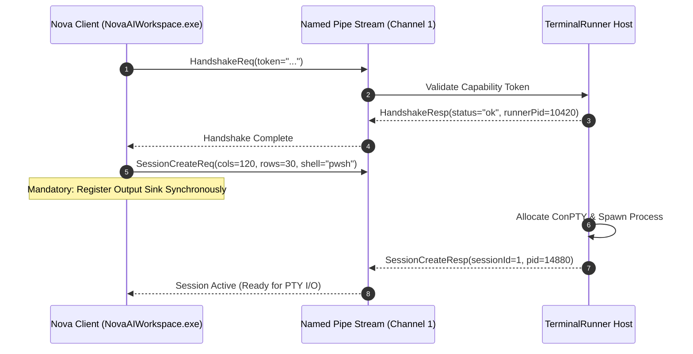
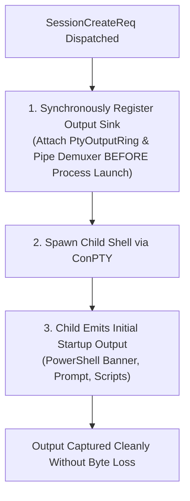

# IPC Control Frames & Handshake Protocol

All management operations—such as authenticating connections, creating pseudo console sessions, resizing terminal windows, closing shells, and listening for exit events—are transmitted as structured JSON messages over **Channel 1 (Control RPC)**.



---

## 1. JSON Control Channel Schemas

All messages on Channel 1 are UTF-8 encoded JSON objects containing a mandatory `type` discriminator:

### 1. Handshake Messages
Transmitted immediately upon pipe connection before any other commands are permitted:

#### `HandshakeReq`
```json
{
  "type": "HandshakeReq",
  "clientPid": 8920,
  "token": "4f8a1c9e2b7d3a5e8f0a2c4e6b8d0a2c4e6b8d0a2c4e6b8d0a2c4e6b8d0a2c4e"
}
```

#### `HandshakeResp`
```json
{
  "type": "HandshakeResp",
  "status": "ok",
  "runnerPid": 10420,
  "protocolVersion": 1
}
```

---

### 2. Session Creation Messages

#### `SessionCreateReq`
```json
{
  "type": "SessionCreateReq",
  "sessionId": 1,
  "cols": 120,
  "rows": 30,
  "shell": "powershell",
  "cwd": "C:\\Workspace\\Project"
}
```

#### `SessionCreateResp`
```json
{
  "type": "SessionCreateResp",
  "sessionId": 1,
  "status": "created",
  "childPid": 14880
}
```

---

### 3. Window Resizing Messages

When an operator resizes the terminal dock window in the WinUI 3 interface, or an agent specifies custom dimensions:

#### `SessionResizeReq`
```json
{
  "type": "SessionResizeReq",
  "sessionId": 1,
  "cols": 140,
  "rows": 40
}
```

* Invokes the Win32 `ResizePseudoConsole` API under the hood, prompting full-screen CLI programs (such as `vim`, `htop`, or PowerShell formatting engines) to reflow their layout dynamically.

---

### 4. Session Termination & Exit Event Messages

#### `SessionCloseReq`
```json
{
  "type": "SessionCloseReq",
  "sessionId": 1
}
```

#### `SessionExitedEvent` (Broadcast Event)
When a child process terminates naturally or via an exit command:

```json
{
  "type": "SessionExitedEvent",
  "sessionId": 1,
  "exitCode": 0,
  "timestampUtc": "2026-10-18T06:15:30.120Z"
}
```

---

## 2. The Synchronous Sink Registration Invariant

When provisioning a new terminal session, a critical race condition exists between process spawning and output stream listening:



* **The Race Vulnerability:** If the output listener is registered asynchronously or after the child process is created, fast-starting CLI commands emit their banner and prompt before the demultiplexer begins reading Channel 2. The client misses the initial output and hangs waiting for prompts.
* **Nova's Architectural Guarantee:** The client registers its `PtyOutputRing` and event handler synchronously *before* sending `SessionCreateReq`. `TerminalRunner` does not launch the shell process until the channel route is active, guaranteeing **zero byte loss** on startup.

---

## 3. Related Documentation

* [IPC Wire Protocol Overview](../README.md)
* [Framing, Channel Multiplexing & Ring Buffers](../framing-and-channel-multiplexing/README.md)
* [Agent Headless Sessions & Security](../../agent-sessions-and-security/README.md)
* [Terminal Open Tool Reference](../../../../mcp-reference/tools/terminal-ops/nova-terminal-open.md)
