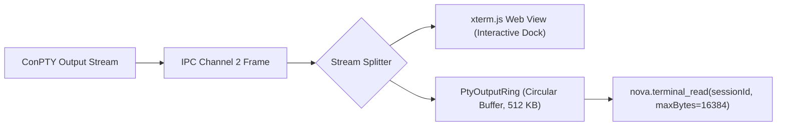

# IPC Framing, Channel Multiplexing & Ring Buffers

To support simultaneous interactive dock sessions, background automation scripts, keyboard input, and control messages over a single duplex named pipe, Nova implements a custom binary framing protocol. This design ensures that raw terminal output streams and structured JSON control RPCs do not collide or corrupt pipe state.

```
0                   1                   2                   3
0 1 2 3 4 5 6 7 8 9 0 1 2 3 4 5 6 7 8 9 0 1 2 3 4 5 6 7 8 9 0 1
+-+-+-+-+-+-+-+-+-+-+-+-+-+-+-+-+-+-+-+-+-+-+-+-+-+-+-+-+-+-+-+-+
|                 Magic Bytes: 'N' 'T' 'P' 'Y'                  |
|             (0x4E, 0x54, 0x50, 0x59 in hex ASCII)             |
+-+-+-+-+-+-+-+-+-+-+-+-+-+-+-+-+-+-+-+-+-+-+-+-+-+-+-+-+-+-+-+-+
|  Channel ID   |          Payload Length (Bytes 0..2)          |
| (1, 2, or 3)  |             (32-bit Little-Endian)            |
+-+-+-+-+-+-+-+-+-+-+-+-+-+-+-+-+-+-+-+-+-+-+-+-+-+-+-+-+-+-+-+-+
| Payload Length (Byte 3) |         Payload Data ...            |
+-+-+-+-+-+-+-+-+-+-+-+-+-+                                     +
|                                                               |
```

---

## 1. The 9-Byte Binary Header Specification

Every frame sent across the named pipe begins with an exact 9-byte header:

| Byte Offset | Field Name | Data Type | Permitted Values & Description |
| :--- | :--- | :--- | :--- |
| **0..3** | `Magic` | 4 Bytes (ASCII) | Fixed constant: `0x4E`, `0x54`, `0x50`, `0x59` (`NTPY`). Packets lacking this magic sequence are rejected and cause immediate pipe teardown. |
| **4** | `ChannelId` | `uint8` (1 Byte) | Virtual channel routing identifier: `1` (Control), `2` (PtyOutput), `3` (PtyInput). |
| **5..8** | `PayloadLength` | `uint32` (4 Bytes LE) | Little-endian payload size in bytes. Maximum permitted length is **1,048,576 bytes (1 MiB)**. |

### Virtual Channel Routing

* **Channel 1 (Control RPC):** Carries UTF-8 encoded JSON control frames (Handshakes, session provisioning, terminations, window resizing).
* **Channel 2 (PTY Output Stream):** Streams raw terminal output emitted by ConPTY (VT/ANSI escape sequences, terminal redraws, stdout/stderr) from `TerminalRunner` to the client.
* **Channel 3 (PTY Input Stream):** Streams raw keystrokes, control characters (`\r`, `\x03`), and text payloads from the client into the ConPTY input pipe.

---

## 2. Atomic Pre-Composed Writes

In a multi-threaded application, multiple tasks and timers may attempt to write frames to the pipe concurrently.

### The Interleaving Risk
If a process writes the 9-byte header and the payload using separate `Stream.Write` calls:
1. Thread A writes Header A (declaring 100 bytes).
2. Thread B preempts and writes Header B (declaring 50 bytes).
3. Thread A writes Payload A.
The pipe stream is corrupted, causing desynchronization and connection termination.

### The Pre-Composed Invariant
Nova guarantees that every frame is pre-composed into a single contiguous buffer before dispatch:

```csharp
// Allocate or rent a single buffer for header + payload
byte[] buffer = ArrayPool<byte>.Shared.Rent(9 + payloadLength);
try
{
    // 1. Pack 9-byte header
    buffer[0] = 0x4E; buffer[1] = 0x54; buffer[2] = 0x50; buffer[3] = 0x59; // NTPY
    buffer[4] = (byte)channelId;
    BinaryPrimitives.WriteUInt32LittleEndian(buffer.AsSpan(5, 4), (uint)payloadLength);

    // 2. Copy payload
    payload.CopyTo(buffer.AsSpan(9, payloadLength));

    // 3. Dispatch in a single atomic WriteAsync under the pipe mutex
    await _writeLock.WaitAsync(cancellationToken);
    try
    {
        await _pipeStream.WriteAsync(buffer.AsMemory(0, 9 + payloadLength), cancellationToken);
        await _pipeStream.FlushAsync(cancellationToken);
    }
    finally
    {
        _writeLock.Release();
    }
}
finally
{
    ArrayPool<byte>.Shared.Return(buffer);
}
```

---

## 3. The `PtyOutputRing` Circular Memory Buffer

When an agent needs to inspect terminal output via [`nova.terminal_read`](../../../../mcp-reference/tools/terminal-ops/nova-terminal-read.md), reading directly from the OS pipe would consume bytes and starve the interactive WinUI terminal dock.

Nova resolves this by routing all Channel 2 output into an in-memory circular ring buffer (`PtyOutputRing`):



### Buffer Invariants
* **Fixed Memory Cap:** The ring buffer allocates a fixed byte array (default 512 KB per session) on creation, avoiding continuous garbage collection allocations during heavy compilation outputs.
* **Overwriting Head:** When the buffer fills, writing new bytes wraps around to the beginning, cleanly overwriting the oldest output.
* **Cumulative Counter:** The buffer maintains an immutable 64-bit `TotalBytesReceived` counter. Agents can determine whether they missed output by comparing subsequent offset positions.
* **Non-Destructive Reads:** Reading from `PtyOutputRing` does not discard data. An agent can inspect the output multiple times without affecting human operator visibility.

---

## 4. Related Documentation

* [IPC Wire Protocol Overview](../README.md)
* [Control Frames & Handshake Protocol](../control-frames-and-handshake/README.md)
* [ConPTY & Process Lifecycles](../../conpty-and-runner/process-lifecycle-and-job-objects/README.md)
* [Terminal Read Tool Reference](../../../../mcp-reference/tools/terminal-ops/nova-terminal-read.md)
