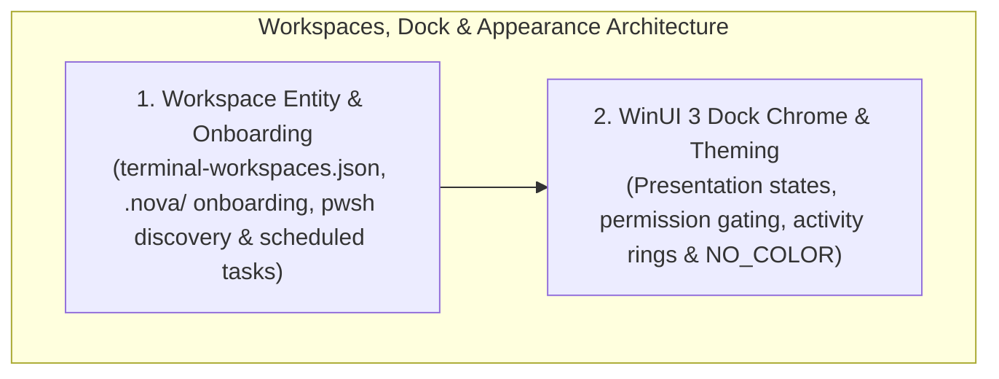

# Workspaces, UI Dock & Appearance Settings Hub

A high-performance terminal is not merely an automation pipeline; it is also the human developer's interactive command center. Developers manage multiple project directories, switch between startup CLIs (such as `pwsh`, `cmd`, or AI coding agents), inspect real-time compilation activities, and configure custom themes and font sizes.

Nova AI Workspace provides a persistent **`TerminalWorkspace` Entity Model**, **`.nova/` Onboarding Script Injection**, an **Interactive WinUI 3 Dock Interface**, and centralized appearance settings.

---

## Architectural Subsystems

Explore the dedicated architecture guides within this domain:

### 1. [Workspace Entity Model & Project Onboarding](workspace-entity-and-onboarding/README.md)
* **The Persistent Entity Model:** Storage layout in `%LOCALAPPDATA%\NovaBrowser\terminal-workspaces.json`, tracking directory paths, custom startup CLIs (`pwsh`, `cmd`, `claude`, `codex`), and favorites.
* **`.nova/` Onboarding Injection:** Automatically bootstrapping environment scripts, setting project environment variables, and pre-loading developer aliases upon shell launch.
* **PowerShell Discovery Engine:** Detecting modern PowerShell 7+ (`pwsh.exe`) across standard Windows install paths versus falling back to Windows PowerShell 5.1.
* **Scheduled Task Workspace Binding:** Linking background automation runs to persistent project roots.

### 2. [WinUI 3 Dock Chrome, Theming & Activity Monitoring](winui-dock-chrome-and-theming/README.md)
* **Dock Presentation States:** Managing `expanded`, `collapsed`, and `hidden` presentation modes via [`nova.terminal_dock_get_state`](../../../mcp-reference/tools/terminal-ops/nova-terminal-dock-get-state.md).
* **Operator Permission Gate:** Strictly requiring human authorization (`TerminalAgentCanControlDock`) before an agent is permitted to alter visible dock states.
* **Real-Time Activity Indicators:** The visual pulsing dot (2s active vs. 6s idle) alerting developers to background terminal execution without opening the dock.
* **Appearance & Theme Configuration:** Managing color themes, font sizes, and program color rules (`NO_COLOR=1`) via [`nova.terminal_settings_set`](../../../mcp-reference/tools/terminal-ops/nova-terminal-settings-set.md).

---

## Related Documentation

* [Terminal Workspaces Master Hub](../README.md)
* [ConPTY & External Runner Host](../conpty-and-runner/README.md)
* [IPC Named Pipe Wire Protocol](../ipc-wire-protocol/README.md)
* [Agent Headless Sessions & Security](../agent-sessions-and-security/README.md)
* [Command Execution & Sentinels](../command-execution-and-sentinels/README.md)
