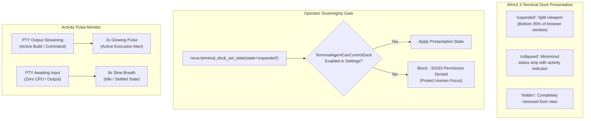

# WinUI Dock Chrome, Theming & Activity Monitoring

The terminal dock in Nova AI Workspace provides an integrated developer experience directly within the WinUI 3 browser shell. Powered by **xterm.js** running inside an isolated WebView2 container, the dock enables developers to run interactive REPLs, compile software, and execute terminal tools without leaving the application window.



---

## 1. Dock Presentation States & Permission Gating

The terminal dock supports three visual presentation states:

| Presentation State | Visual Appearance | Interactive Capabilities |
| :--- | :--- | :--- |
| **`expanded`** | Occupies the lower 35% of the browser window with an adjustable splitter handle. | Full xterm.js keyboard focus, mouse scrollback, tab switching. |
| **`collapsed`** | Minimized to a compact 32 px toolbar strip at the bottom of the window. | Displays active tab titles and real-time activity indicators; click expands. |
| **`hidden`** | Completely removed from layout; maximum screen space for web content. | Sessions remain running in `TerminalRunner`; dock can be reopened via hotkey (`Ctrl+\``). |

### The Operator Focus Protection Gate
Autonomous AI agents can query the dock state via [`nova.terminal_dock_get_state`](../../../../mcp-reference/tools/terminal-ops/nova-terminal-dock-get-state.md). However, attempting to modify the visual state via [`nova.terminal_dock_set_state`](../../../../mcp-reference/tools/terminal-ops/nova-terminal-dock-set-state.md) is guarded by an explicit user preference:

* **Default Policy:** `AppSettings.TerminalAgentCanControlDock = false`.
* **Behavior:** If an agent attempts to open, close, or collapse the dock without human opt-in, the call is rejected immediately with error `-32033 Permission Denied`.
* **Rationale:** A human user actively reading documentation or writing code must not have their viewport unexpectedly resized or interrupted by autonomous background tasks.

---

## 2. Real-Time Activity Monitoring (The Pulsing Dot)

When long-running commands (such as `npm install`, `cargo build`, or test suites) run in background tabs, developers need to know whether the job is still active without switching tabs.

Nova monitors the PTY output stream and updates a visual activity indicator in the dock tab header:

```
┌────────────────────────────────────────────────────────┐
│  [ • ] Frontend (pwsh)   [   ] Tests (node)        [ + ]│
└────────────────────────────────────────────────────────┘
     ▲
  Activity Indicator (Pulsing Dot)
```

1. **Active Stream (2-Second Pulse):**
   Whenever PTY output bytes arrive within a 2-second window, the dot pulses with an animated accent glow. The operator knows at a glance that compilation is actively progressing.
2. **Idle Stream (6-Second Breath):**
   When output ceases for more than 2 seconds, the animation slows to a gentle 6-second breathing cycle, indicating that the command has finished or is paused waiting for user input.

---

## 3. Terminal Appearance & Theming

Operators configure terminal appearance via WinUI Settings or programmatically via [`nova.terminal_settings_set`](../../../../mcp-reference/tools/terminal-ops/nova-terminal-settings-set.md):

```json
{
  "name": "nova.terminal_settings_set",
  "arguments": {
    "theme": "dracula",
    "fontSize": 14,
    "programColors": "auto"
  }
}
```

### Supported Color Themes
* **`dark` (Default):** High-contrast modern dark palette matching WinUI 3 controls.
* **`light`:** High-readability light theme for bright ambient environments.
* **`dracula`:** Vibrant purple-and-cyan developer palette.
* **`solarized`:** Scientifically designed low-contrast terminal palette.
* **`high_contrast`:** WCAG AAA compliant accessibility theme.

### The `programColors` Setting & `NO_COLOR=1`
Controlling whether CLI tools output ANSI color escape sequences:
* **`"auto"` (Default):** Terminal tools emit color codes if the session supports VT100.
* **`"on"`:** Forces 24-bit TrueColor sequences even when redirected.
* **`"off"`:** Automatically injects the standard environment variable `$env:NO_COLOR = "1"` into all newly opened shells. CLI programs omit formatting escape bytes, significantly reducing LLM token consumption and eliminating parsing noise during automated text analysis.

---

## 4. Related Documentation

* [Workspaces, UI Dock & Appearance Overview](../README.md)
* [Workspace Entity Model & Onboarding](../workspace-entity-and-onboarding/README.md)
* [Terminal Dock State Tool Reference](../../../../mcp-reference/tools/terminal-ops/nova-terminal-dock-get-state.md)
* [Terminal Settings Tool Reference](../../../../mcp-reference/tools/terminal-ops/nova-terminal-settings-set.md)
