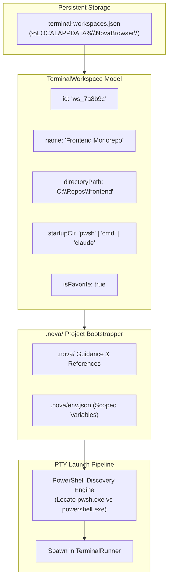
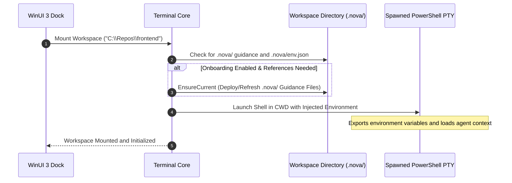

# Workspace Entity Model & Project Onboarding

In software engineering, developers frequently switch between multiple codebases, monorepos, and infrastructure directories. Each repository requires distinct environment variables, startup commands, and shell configurations.

Nova AI Workspace structures project folders into persistent **`TerminalWorkspace` Entities**, backed by automated **`.nova/` Onboarding Script Injection** and an intelligent **PowerShell Discovery Engine**.



---

## 1. The `TerminalWorkspace` Schema

Workspaces are stored centrally in the operator's local application data directory (`%LOCALAPPDATA%\NovaBrowser\terminal-workspaces.json`):

```json
{
  "version": 1,
  "workspaces": [
    {
      "id": "ws_7a8b9c0d",
      "name": "Frontend Monorepo",
      "directoryPath": "C:\\Repos\\frontend",
      "startupCli": "pwsh",
      "onboardingEnabled": true,
      "isFavorite": true,
      "createdAtUtc": "2026-04-10T09:00:00Z",
      "lastUsedUtc": "2026-10-18T06:00:00Z"
    }
  ]
}
```

### Field Definitions
* **`id` (string):** Unique identifier generated upon workspace creation (`ws_{8-hex}`).
* **`name` (string):** User-friendly display label rendered in the WinUI 3 workspace picker.
* **`directoryPath` (string):** Absolute filesystem root for the project. Rejects relative paths and UNC network shares.
* **`startupCli` (string):** Preferred shell or CLI tool executed on tab creation (`"pwsh"`, `"powershell"`, `"cmd"`, `"claude"`, `"codex"`).
* **`onboardingEnabled` (boolean):** Toggles automated `.nova/` onboarding script execution.
* **`isFavorite` (boolean):** Pins the workspace to the top of the dock picker for rapid one-click mounting.

---

## 2. Project Onboarding & Agent Reference (`.nova/`)

When a developer or coding agent opens a workspace in the terminal dock, manual setup (running environment managers, exporting API endpoints, or locating MCP tools) is tedious and error-prone.

Nova streamlines project initialization via the `.nova/` convention:



1. **Environment Variables (`.nova/env.json`):** Key-value pairs defined in this file are injected directly into the shell's process environment block before child process launch.
2. **Agent Guidance & References (`.nova/`):** When `onboardingEnabled: true`, Nova ensures that reference documents and MCP capability guides are kept up-to-date in `.nova/`, enabling external coding agents (such as Claude Code or Codex) to discover browser automation capabilities immediately upon mounting.

---

## 3. The PowerShell Discovery Engine

Modern development environments often have multiple versions of PowerShell installed simultaneously.

To ensure developers and AI agents utilize the modern cross-platform PowerShell core rather than legacy Windows PowerShell 5.1, Nova scans standard installation locations in priority order:

```
1. Active PATH resolution for 'pwsh.exe'
2. %ProgramFiles%\PowerShell\7\pwsh.exe (Standard 64-bit MSI)
3. %LOCALAPPDATA%\Microsoft\WindowsApps\pwsh.exe (Microsoft Store package)
4. %ProgramFiles(x86)%\PowerShell\7\pwsh.exe (32-bit install fallback)
5. %SystemRoot%\System32\WindowsPowerShell\v1.0\powershell.exe (Windows 5.1 legacy fallback)
```

* **Version Preference:** If PowerShell 7+ (`pwsh.exe`) is detected anywhere on the system, Nova selects it as the preferred shell engine.
* **Graceful Degradation:** If modern PowerShell is absent, Nova seamlessly falls back to legacy Windows PowerShell 5.1, applying the appropriate sanitization rules.

---

## 4. Scheduled Tasks Workspace Integration

Nova's [Scheduled Tasks & Automation Engine](../../../scheduled-tasks/README.md) integrates directly with terminal workspaces:

* Background automation jobs can bind to a `workspaceId`, inheriting its root directory and environment configuration.
* Tasks exchange files and reports through the workspace's `shared/` directory under a strict **1 MiB UTF-8 byte boundary**.

---

## 5. Related Documentation

* [Workspaces, UI Dock & Appearance Overview](../README.md)
* [WinUI Dock Chrome, Theming & Activity Monitoring](../winui-dock-chrome-and-theming/README.md)
* [Scheduled Tasks Engine Architecture](../../../scheduled-tasks/README.md)
* [Terminal Open Tool Reference](../../../../mcp-reference/tools/terminal-ops/nova-terminal-open.md)
