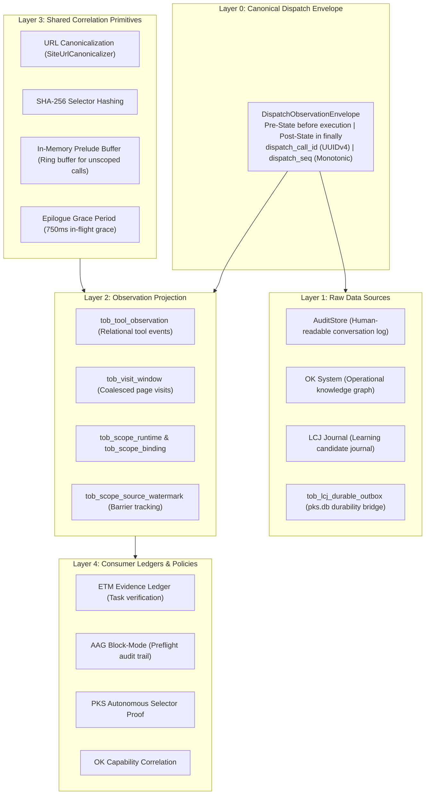
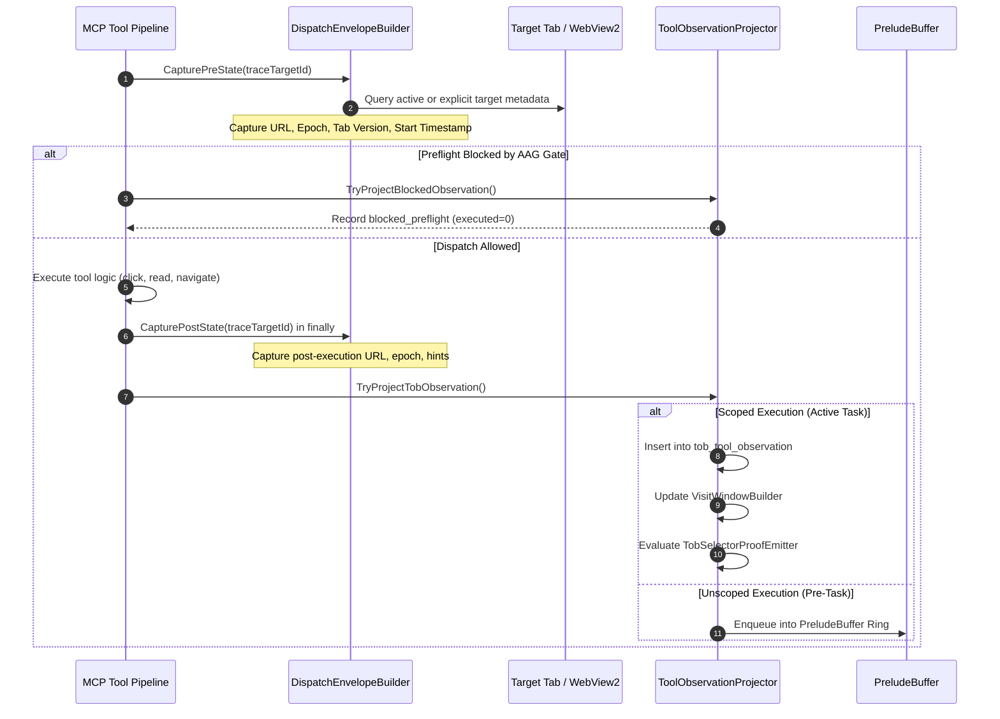
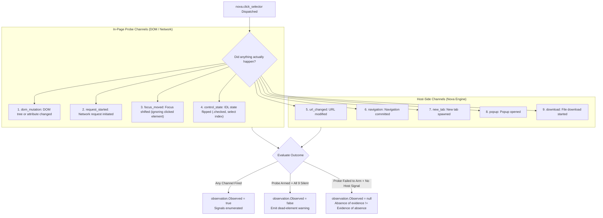
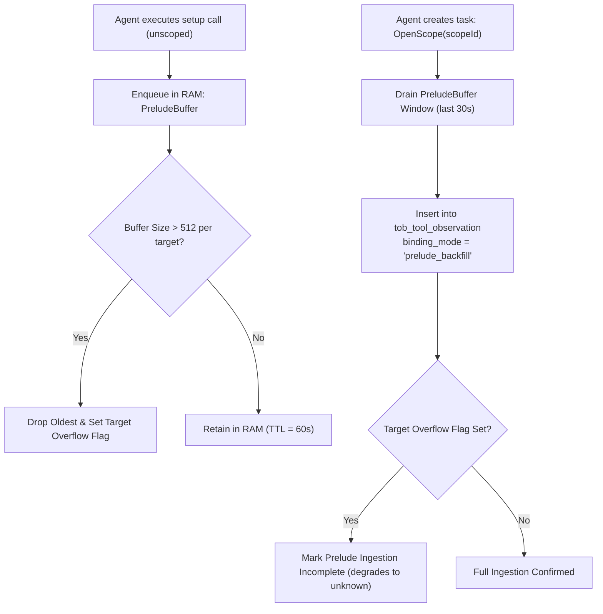

# Dispatch Envelope & Layer Pipeline

In autonomous browser operations, relying solely on agent self-reports is inherently dangerous. Language models frequently hallucinate success: an agent may report that it *"read the refund policy"* when navigation failed silently, or assert that it *"clicked the confirmation button"* when the element lacked an event listener.

Nova's **Tool Observation Bus (TOB)** resolves this by establishing an immutable, server-side observation ledger governed by the core axiom:

> *"What the agent says is a claim. What Nova observes is evidence."*

Every tool dispatch is captured, classified, and correlated through a deterministic **5-Layer Pipeline** anchored by the **Canonical Dispatch Envelope**.

---

## 1. The 5-Layer Bus Architecture

TOB operates across five architectural layers spanning the execution lifecycle from pre-dispatch interception to high-level policy evaluation:

### Layer Responsibilities

| Layer | Component | Core Responsibility |
| :--- | :--- | :--- |
| **Layer 0** | **Dispatch Envelope** | Intercepts every MCP tool call, capturing immutable pre-state and guaranteed post-state. |
| **Layer 1** | **Raw Data Sources** | Replicates envelope data across independent persistence sinks (`AuditStore`, `OKStore`, `LCJ`). |
| **Layer 2** | **Observation Projection** | Normalizes and projects tool calls into relational SQLite tables in `pks.db`. |
| **Layer 3** | **Correlation Primitives** | Provides URL canonicalization, SHA-256 selector hashing, and prelude ring buffers. |
| **Layer 4** | **Consumer Ledgers** | Consumes projected evidence for task grading, AAG safety enforcement, and PKS learning. |

---

## 2. Canonical Dispatch Envelope Lifecycle

Every tool execution follows a deterministic, fail-safe envelope lifecycle that brackets tool execution:

### 2.1 Pre-State and Post-State Capture
* **Pre-State Capture:** Captured immediately before tool logic executes. Records `targetId`, `targetSessionId`, tab state version, navigation epoch (`pageEpoch`), raw URL, normalized route URL, and start timestamp (`started_at_ms`).
* **Post-State Capture in `finally`:** Post-state is captured strictly inside a guaranteed `finally` block. This guarantees capture occurs even if the tool throws an unhandled exception, encounters a timeout, or the renderer process terminates unexpectedly.
* **Effective Attributes:** To cleanly resolve intermediate page navigations, TOB derives effective attributes (`page_url_effective_norm`, `page_epoch_effective`) using `COALESCE(postState, preState)`.

### 2.2 The Foreign Target Resolution Invariant
In multi-tab workflows, an agent frequently targets a background tab by supplying an explicit `targetId` (e.g. `nova.click_selector(selector="...", targetId="tab-2")`).

> [!IMPORTANT]
> **No Foreground Tab Borrowing**
> 
> TOB **never borrows the identity of the foreground active tab** when evaluating background actions.
> 
> Attributing background clicks to the foreground URL corrupts PKS selector proofs, visit windows, and task verification. `DispatchEnvelopeBuilder.CaptureSnapshot` explicitly checks whether `traceTargetId` differs from `ActiveTargetId`. If foreign, it resolves the specific tab's URL and title independently. If the background tab cannot be resolved, the URL fields remain empty rather than falling back to the wrong tab.

---

## 3. Signal Flags & Tool Classification (`ObservationSignalFlags`)

TOB categorizes every tool execution using a 64-bit bitmask (`ObservationSignalFlags`). This bitmask describes exactly what data was exposed to the agent and what mutations were committed to the browser runtime:

| Signal Flag | Bit | Description & Behavioral Meaning |
| :--- | :---: | :--- |
| **`ContentExposed`** | `1 << 0` | Readable text or structured data was returned to the agent context. |
| **`VisualExposed`** | `1 << 1` | A visual image or screenshot was returned to the agent. |
| **`DomExposed`** | `1 << 2` | Raw DOM nodes, layout geometries, or element trees were exposed. |
| **`SelectorTouched`** | `1 << 3` | A specific DOM selector was targeted (clicked, typed, focused). |
| **`NavigationIntent`** | `1 << 4` | Navigation was initiated (URL change, back, forward, reload). |
| **`NavigationCommitted`** | `1 << 5` | Navigation was confirmed committed by the browser engine. |
| **`MutationAttempted`** | `1 << 6` | A DOM mutation was dispatched (click, type, option select). |
| **`MutationCommitted`** | `1 << 7` | DOM mutation was confirmed effective on the target page. |
| **`InputSupplied`** | `1 << 8` | Physical or synthetic user input was provided (keystrokes, text). |
| **`SearchExecuted`** | `1 << 9` | In-page text search or grep query was performed. |
| **`ConsoleExposed`** | `1 << 10` | Browser console logs or errors were returned. |
| **`FileExposed`** | `1 << 11` | External or local file payload was read. |
| **`ViewportOnly`** | `1 << 12` | Read or capture was strictly constrained to the visible viewport. |
| **`FullDocument`** | `1 << 13` | Complete document tree or full-page scroll was exposed. |
| **`TargetResolved`** | `1 << 14` | Target WebView/tab was successfully located and matched. |

### 3.1 Tool-to-Signal Mapping Rules
The `ObservationClassifier` inspects the tool name and execution outcome to assign action kinds (`read`, `navigate`, `interact`, `write`, `meta`) and surface types:

* **`nova.perceive`:** Classified as `read` on `webpage`. Flags: `ContentExposed | VisualExposed | DomExposed | TargetResolved`.
* **`nova.read_text` / `nova.read_text_structured`:** Classified as `read` on `dom_node`. Flags: `ContentExposed | DomExposed | TargetResolved`.
* **`nova.read_dom`:** Classified as `read` on `dom_node`. Flags: `ContentExposed | DomExposed | FullDocument | TargetResolved`.
* **`nova.click_selector`:** Classified as `interact` on `dom_node`. Flags: `SelectorTouched | MutationAttempted | (MutationCommitted) | TargetResolved`.
* **`nova.type_selector`:** Classified as `interact` on `dom_node`. Flags: `SelectorTouched | InputSupplied | MutationAttempted | (MutationCommitted) | TargetResolved`.
* **`nova.navigate` / `nova.back` / `nova.forward`:** Classified as `navigate` on `webpage`. Flags: `NavigationIntent | (NavigationCommitted) | TargetResolved`.

### 3.2 The Perceive-First Surface Exposure Filter
To prevent agents from bypassing safety gates (such as AAG's `safety.perceive_first`) with cheap no-ops, TOB enforces a strict surface exposure filter:
* Invocations of `nova.search_text` **do not qualify** as surface exposure, even though they expose text.
* Only substantive observation tools (`nova.perceive`, `nova.read_text`, `nova.read_dom`, `nova.dom_extract`) set `_surfaceExposedByTarget = true`.

---

## 4. Multi-Channel Click Effect Observation Engine

A persistent flaw in web automation is the "silent dead click": dispatching a synthetic click event onto an unmounted element, an element without an attached event listener, or an element whose handler has not yet bound will return `ok: true`. The language model interprets `ok: true` as proof that the action succeeded, even though the page state never changed.

To solve this, TOB runs a multi-channel effect observer for `nova.click_selector` that monitors **nine distinct observation channels**:

### 4.1 Core Invariants of the Effect Engine
1. **Host Evidence Trumps Probe Failure:** If host-level events fire (navigation, new tab, popup, download, URL change), the click is confirmed effective (`observation.Observed = true`) even if the in-page JavaScript probe failed to arm.
2. **Absence of Evidence is Not Evidence of Absence:** If the in-page probe fails to inject and no host events fire, Nova records `observation.Observed = null`. It **never** reports `false`, preventing false-positive dead element warnings caused by instrumentation failures.
3. **The Control State Invariant:** Toggling native HTML inputs (e.g. checkbox `.checked` or `<select>` options) modifies DOM IDL properties without necessarily generating MutationObserver attribute mutations or network requests. The probe explicitly checks control state diffs to avoid incorrectly calling working form inputs "dead".
4. **Actionable Dead Element Warnings:** When all 9 channels remain silent and the probe was fully functional, Nova includes an explicit warning enumerating every checked channel (`no DOM mutation, no started request, no focus move, no control state change`).

---

## 5. In-Memory Prelude Ring Buffer

When an agent performs setup calls (navigating to a starting URL, dismissing an initial cookie modal) *before* explicitly creating a workflow task instance, those dispatches are unscoped.

### 5.1 Buffer Specifications
* **Capacity:** Max 512 dispatches per target, max 4,096 globally.
* **TTL:** 60-second in-memory retention.
* **Drain Window:** Upon `OpenScope`, TOB drains the last 30 seconds (`PreludeWindowMs = 30_000`) of matching dispatches and backfills them into `tob_tool_observation` with `binding_mode = 'prelude_backfill'`.
* **Per-Target Overflow Isolation:** The ring buffer tracks buffer overflows strictly per target (`_overflowByTarget[targetKey]`). An overflow on an unrelated tab does not mark another tab's prelude drain as incomplete, preventing artificial degradation to `unknown`.

---

## Related Documentation

* **[Master Architecture Hub](../README.md)** — Complete overview of the Tool Observation Bus.
* **[Observation Projections & Visit Windows](../observation-projections-and-visit-windows/README.md)** — Scope lifecycles, visit windows, flush barriers, and relational database schemas.
* **[Evidence Ledgers & Consumer Verification](../evidence-ledgers-and-consumer-verification/README.md)** — ETM evidence grading, autonomous PKS selector proof, and anti-hallucination verification.
* **[Closed-Loop System (CLS)](../../closed-loop-system-cls/README.md)** — State transition enforcement and postcondition contracts.
* **[Agent Awareness Gates (AAG)](../../agent-awareness-gates-aag/README.md)** — Preflight situational awareness and tab leases.
