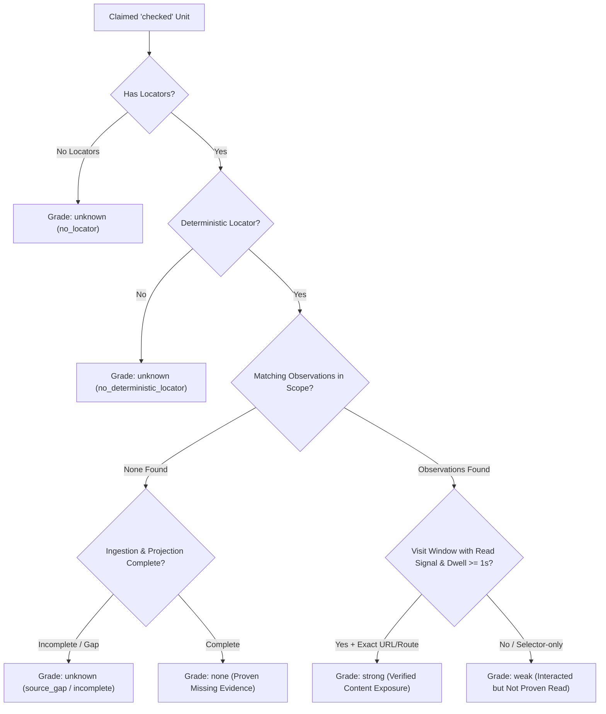
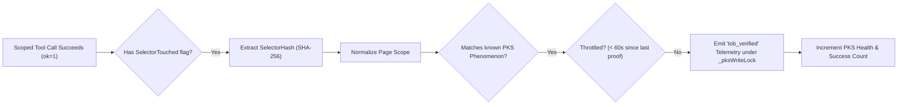

# Evidence Ledgers & Consumer Verification

In enterprise browser automation, claiming that a task was executed is not the same as proving it. Language models under operational pressure may fabricate completion, confuse prior conversational context with active tab state, or skip critical steps due to prompt truncation.

Nova's **Tool Observation Bus (TOB)** pairs server-side event capture with mathematical verification through the **Evidence Ledger (`EvidenceLedger`)**, the **Unit Locator Inference Engine**, and the **Autonomous PKS Selector Proof Emitter**.

---

## 1. The Evidence Ledger (`EvidenceLedger`)

When an autonomous task instance completes via the Episodic Task Memory (ETM) subsystem, the **Evidence Ledger** correlates agent claims against observed runtime evidence:



### 1.1 The Four Evidence Grades

| Evidence Grade | Required Criteria | Practical Meaning |
| :---: | :--- | :--- |
| **`strong`** | Matching visit window in `tob_visit_window` with `read_count > 0`, `dwell_ms >= 1000` (1 second), and exact URL or route locator match. | Strong proof that the target page was loaded, displayed, and content was returned to the agent for at least 1 second. |
| **`weak`** | Matching observation exists in `tob_tool_observation`, but lacks a substantive read signal, lacks a visit window, or is located *only* by selector hash or URL prefix. | The agent touched or interacted with the target, but content exposure or dwell time was not established. |
| **`none`** | Deterministic locators exist, data ingestion and projection are 100% complete, and zero matching observations exist. | **Proven fabrication / omission:** The agent claimed completion, but Nova observed zero corresponding actions. |
| **`unknown`** | No deterministic locators exist, or a measurement gap occurred (`unknown_due_to_source_gap`, `projection_incomplete`, `scope_binding_missing`). | Indeterminate: Nova cannot prove or disprove the claim due to missing instrumentation. |

### 1.2 The "Strong" Grade Ceiling Invariant
> [!IMPORTANT]
> **Grade `strong` is strictly achievable only for locator types `url_exact` and `route_key`.**
> 
> In `EvidenceLedger.CountStrongVisitWindows`, visit windows are evaluated via:
> ```sql
> SELECT COUNT(*) FROM tob_visit_window
> WHERE workflow_scope_id = @scope AND read_count > 0 AND dwell_ms >= 1000 AND (page_url_norm = @val OR route_key_norm = @val)
> ```
> Because `tob_visit_window` coalesces page-level interactions and does not maintain an element selector index, work units whose sole deterministic locator is a DOM selector (`selector_hash`) or a URL prefix (`url_prefix`) can at most achieve grade `weak`. Individual element interactions prove execution, but only visit windows prove sustained page dwell time.

---

## 2. Unit Locator Inference & Normalization Engine (`TobUnitLocatorWriter`)

Work units defined in ETM tasks are automatically analyzed to infer typed locators:

| Unit Kind / Input Pattern | Inferred Locator Type | Normalization Algorithm | Match Key | Achievable Grade Ceiling |
| :--- | :--- | :--- | :--- | :---: |
| `unit_kind: "selector"` | `selector` | `SelectorNormalizer.NormalizeSelector` | SHA-256 Hex Hash | `weak` |
| `unit_kind: "document"` or `"pdf"` | `document_page` | Trimmed string | Trimmed string | `weak` |
| Starts with `http://` or `https://` | `url_exact` | `SiteUrlCanonicalizer.Canonicalize` | Route URL without query/hash | `strong` |
| Starts with `#`, `.`, `[`, or contains `>`, `+`, `~` | `selector` | `SelectorNormalizer.NormalizeSelector` | SHA-256 Hex Hash | `weak` |
| Starts with `/` or path-like string | `route_key` | Trimmed lowercase without slashes | `null` | `strong` |
| Domain-like string (contains `.`) | `url_exact` | Canonical route URL | Scheme + Host + Path | `strong` |

### 2.1 Complete Exception Reason Code Catalog (`perUnitExceptions`)
When a checked work unit does not achieve `strong`, the ledger records precise diagnostic reason codes:

| Reason Code | Grade | Cause & Trigger Condition |
| :--- | :---: | :--- |
| **`visit_window_missing`** | `weak` | Read observations were recorded, but no visit window on that URL met the dwell threshold (`dwell_ms >= 1000`). |
| **`no_read_like_observation`** | `weak` | Tool interactions occurred on the locator (e.g. clicks or input), but no content-reading tool was executed. |
| **`scope_binding_missing`** | `unknown` | The task instance lacked an active workflow scope ID. |
| **`no_locator`** | `unknown` | The work unit definition contained zero locators. |
| **`no_deterministic_locator`** | `unknown` | Locators exist, but none belong to the `declared` or `derived` deterministic classes. |
| **`unknown_due_to_source_gap`** | `unknown` | Upstream ingestion timed out or encountered an uncommitted buffer gap. |
| **`projection_incomplete`** | `unknown` | Tool observation projection did not reach the sequence barrier within the flush timeout. |
| **`no_matching_observation`** | `none` | Deterministic locators exist and data pipelines were 100% complete, but zero matching tool calls occurred. |

---

## 3. Evidence Snapshot Schema (`evidence_snapshot_json`)

Upon task completion, the ledger compiles an immutable JSON summary saved to `task_instance.evidence_snapshot_json`:

```json
{
  "schemaVersion": 1,
  "workflowScopeId": "scope-9f8a2b1c",
  "completedAtMs": 1728394000120,
  "completeness": {
    "ingestionComplete": true,
    "projectionComplete": true,
    "budgetTruncated": false
  },
  "counts": {
    "claimedCheckedUnits": 12,
    "observedCheckedUnits": 11,
    "strong": 10,
    "weak": 1,
    "none": 1,
    "unknown": 0
  },
  "perUnitExceptions": {
    "itemCount": 2,
    "items": [
      {
        "unitKey": "doc-terms-page",
        "evidenceGrade": "weak",
        "reasonCodes": ["no_read_like_observation"]
      },
      {
        "unitKey": "doc-refund-policy",
        "evidenceGrade": "none",
        "reasonCodes": ["no_matching_observation"]
      }
    ]
  }
}
```

---

## 4. Autonomous PKS Selector Proof (`TobSelectorProofEmitter`)

When an agent interacts with web pages, TOB autonomously validates and promotes UI patterns in the Phenomenological Knowledge Store (PKS) without requiring the agent to self-report:



### 4.1 Key Characteristics of Selector Proofs
* **Zero Agent Overhead:** Operates entirely in the background. If a scoped call touches a selector whose SHA-256 hash matches a known phenomenon on that domain, TOB reports `tob_verified`.
* **60-Second Throttle:** Emits at most one proof per `(scope, phenomenon)` pair per 60 seconds (`ThrottleIntervalMs = 60_000`), preventing rapid interaction loops from skewing health statistics.
* **Thread-Safe Telemetry:** Telemetry emission executes under `_pksWriteLock` to prevent concurrent `pks_upsert` calls from overwriting health counters.
* **Alternative Selector Splitting:** When phenomena contain OR-alternatives (e.g. `#btn-submit OR .action-btn`), `TobSelectorProofIndex` normalizes and indexes each sub-selector individually, matching single agent dispatches cleanly.

---

## 5. AAG Preflight Block Recording

When an Agent Awareness Gate (such as `setup.bootstrap_required` or `safety.perceive_first`) halts a tool call, the underlying tool logic never executes. However, recording this attempt is essential for debugging and compliance.

TOB handles this via **Blocked Preflight Projections** (`TryProjectBlocked`):
* **Schema Fields:** `ok = 0`, `executed = 0`, `outcome_kind = 'blocked_preflight'`, `block_stage = 'aag_preflight'`, `error_code = 'aag_blocked:<gateId>'`.
* **Unscoped Projection:** Blocked calls are written unscoped (`workflow_scope_id = NULL`), as an awareness failure occurs before scope binding can take place.
* **Dynamic Gate Mode Resolution:** The configured gate mode (`Block`, `ShadowBlock`, `Warn`) is **not stored** in the database row; it is resolved dynamically from settings to prevent stale configuration values.

---

## 6. Operational Health Metrics (`TobHealthMetrics`)

To diagnose whether a poor task verification score was caused by agent incompetence or browser infrastructure delays, TOB tracks atomic operational metrics:

| Metric Name | Type | Diagnostic Meaning |
| :--- | :---: | :--- |
| `ScopeGatedCallCount` | Counter | Total tool calls evaluated against active scopes. |
| `BackfilledPreludeCallCount` | Counter | Unscoped calls rescued from the prelude buffer and bound to a new scope. |
| `ProjectedObservations` | Counter | Total observations written to `tob_tool_observation`. |
| `VisitWindowsFlushed` | Counter | Total visit windows materialized to `tob_visit_window`. |
| `ClaimEventsWritten` | Counter | Total agent claim events recorded in `tob_claim_event`. |
| `FlushTimeouts` | Counter | Number of times a sequence barrier timed out waiting for subsystem flushes. |
| `IngestionIncompleteCompletions` | Counter | Tasks completed while data pipelines had uncommitted in-flight dispatches. |
| `UnscopedDropCount` | Counter | Unscoped calls discarded after prelude buffer overflow. |
| `SelectorProofEmitted` | Counter | Total autonomous PKS selector proof telemetry events dispatched. |

---

## Related Documentation

* **[Master Architecture Hub](../README.md)** — Complete overview of the Tool Observation Bus.
* **[Dispatch Envelope & Layer Pipeline](../dispatch-envelope-and-layer-pipeline/README.md)** — 5-layer pipeline, canonical envelopes, signal flags, and click effect engines.
* **[Observation Projections & Visit Windows](../observation-projections-and-visit-windows/README.md)** — Scope lifecycles, visit windows, flush barriers, and relational database schemas.
* **[Episodic Task Memory (ETM)](../../learning/episodic-task-memory-etm/README.md)** — Task work unit tracking and completion verification.
* **[Phenomenological Knowledge Store (PKS)](../../learning/phenomenological-knowledge-store-pks/README.md)** — Procedural UI memory and autonomous health tracking.
* **[Agent Awareness Gates (AAG)](../../agent-awareness-gates-aag/README.md)** — Preflight situational awareness and tab leases.
