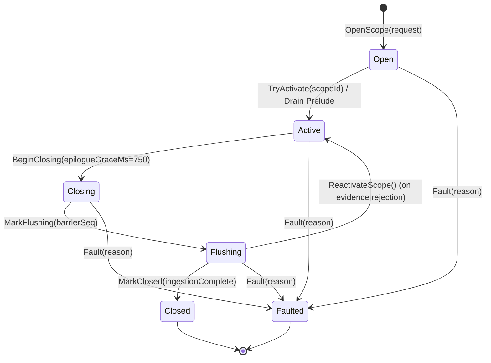
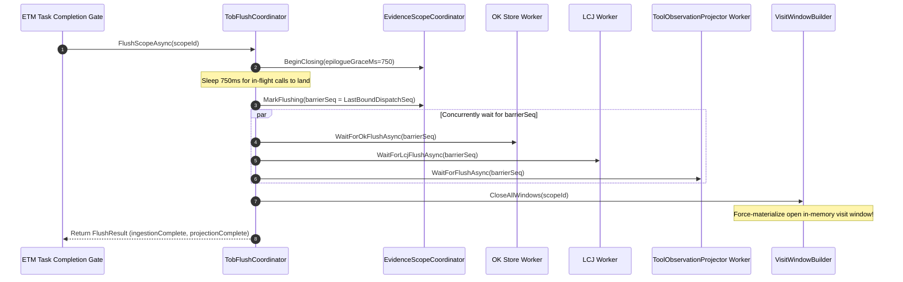
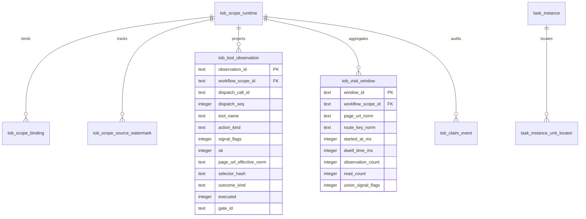
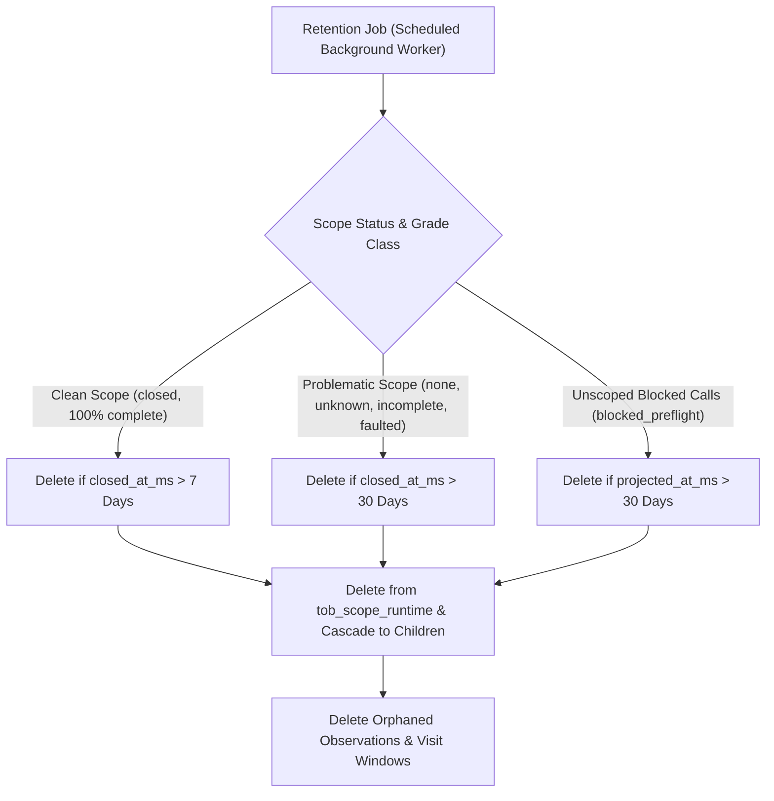

# Observation Projections & Visit Windows

During interactive browser sessions, capturing millions of raw DOM events and keystrokes would rapidly overwhelm database storage and degrade query latency. Conversely, failing to aggregate discrete clicks into coherent page interactions prevents high-level verification systems from determining whether an agent genuinely reviewed a page or merely flashed past it.

Nova's **Tool Observation Bus (TOB)** resolves this through **Scope Lifecycle Gating**, **Materialized Visit Windows**, and the asynchronous **Flush & Barrier Protocol**. By coalescing discrete tool calls into relational projections in `pks.db`, TOB ensures high-performance, deterministic evidence capture.

---

## 1. Scope Lifecycle State Machine

To prevent unbounded database bloat during regular browsing, TOB observations are **scope-gated**: observations are projected to relational tables only when an active workflow scope exists (such as a running task instance or a leased tab session).



### The 8 Frozen Scope Invariants

1. **Single Identity Invariant:** Every tool dispatch receives exactly one unique `dispatch_call_id` (UUIDv4) and a strictly monotonic `dispatch_seq`.
2. **Bracketing Guarantee:** Pre-State is captured strictly before tool logic executes; Post-State is captured strictly in a guaranteed `finally` block.
3. **Single Scope Binding:** A dispatch may bind to at most one workflow scope (`WorkflowScopeBinding`).
4. **Mutual Exclusion per Target:** Only one scope in states `open | active | closing` may exist for any given `target_session_id`.
5. **No Binding in Flushing:** Once a scope enters `flushing`, no new dispatches can bind to it.
6. **Frozen Sequence Barrier:** `barrier_seq` is strictly frozen upon entering `flushing`; all dispatches with `seq <= barrier_seq` must commit before correlation runs.
7. **Complete Ingestion Prerequisite:** Grade `none` may only be assigned when data ingestion and projection are 100% complete; any gap degrades to `unknown`.
8. **Retention Precedence:** Scope retention never prunes records before the task's final `evidence_snapshot_json` is generated.

### 1.1 Scope Reactivation on Evidence Rejection
When an agent attempts task completion, Nova flushes the sequence barrier and evaluates the Evidence Ledger. If the evidence gate rejects the completion (e.g. required strong evidence but observed weak or none), the scope is **not closed or aborted**:

```
+-----------------------------------------------------------------------------------------------+
| SCOPE REACTIVATION FLOW (Evidence Rejection)                                                  |
+-----------------------------------------------------------------------------------------------+
| 1. Close Open Windows -> VisitWindowBuilder closes open windows to prevent dwell time bleed.   |
| 2. State Transition   -> Scope transitions from 'Flushing' back to 'Active'.                  |
| 3. Clear Barrier      -> BarrierDispatchSeq is reset to null (unlocked).                      |
| 4. Resume Binding     -> Subsequent agent recovery actions bind to the SAME workflow scope.   |
| 5. Remediation        -> Agent executes missing reads, then re-attempts completion.           |
| 6. Final Gate         -> Scope transitions Closing -> Flushing -> Closed upon passing gate.   |
+-----------------------------------------------------------------------------------------------+
```

* This prevents the agent from losing previously verified work units while allowing it to fix omissions in-place.

### 1.2 Crash Recovery Invariant (`RecoverFromDb`)
If Nova AI Workspace terminates unexpectedly while workflow scopes are active:
* On application startup, `EvidenceScopeCoordinator.RecoverFromDb()` inspects `tob_scope_runtime`.
* All scopes in states `open`, `active`, `closing`, or `flushing` are recovered.
* Active target tab bindings are re-registered in memory (`ActiveBindings`), preventing orphaned scopes from permanently deadlocking target tabs against new workflows.

---

## 2. Epilogue Grace Period & Barrier Protocol

Autonomous tasks frequently end with a final verification action (e.g. confirming a success banner). If the task completion call executes concurrently with the final verification call, race conditions can cause the verification call to be dropped.

TOB prevents this via the **Epilogue Grace Period** and the **`TobFlushCoordinator`**:



### 2.1 The 750 ms Epilogue Grace Period
* When task completion is initiated, `BeginClosing` begins a **750 ms grace window** (`epilogue_grace_ms = 750`).
* Any tool calls finishing within this window are assigned `binding_mode = 'epilogue_grace'` and safely bound to the scope before the sequence barrier locks.

### 2.2 The In-Memory Visit Window Flush Invariant
> [!IMPORTANT]
> The visit window of the page the agent is currently sitting on resides *purely in memory* within `VisitWindowBuilder._openWindows` until a navigation occurs or the window is explicitly closed.
> 
> If the flush protocol did not explicitly close open windows, the current page would never count as a materialized visit window in SQLite! `TobFlushCoordinator` calls `_visitWindowBuilder.CloseAllWindows(scopeId)` before returning, ensuring the active page is inserted into `tob_visit_window` ahead of correlation.

### 2.3 The Barrier Non-Stall Guarantee
In `ToolObservationProjector`, database writes execute asynchronously on a background worker thread.
* If a database write encounters an unexpected SQLite constraint or disk I/O failure, sequence counter advancement (`AdvanceCommittedSeq`) still executes inside a guaranteed `finally` block.
* This guarantees that `WaitForFlushAsync` will **never stall or hang indefinitely**. The missing observation may result in an `unknown` grade, but system responsiveness is preserved.

---

## 3. Database Schema & Storage Architecture (`pks.db`)

All TOB tables reside in `pks.db` and are initialized via Migrations V14 and V15:



### Relational Table Reference

| Table Name | Primary Role | Retention Policy |
| :--- | :--- | :--- |
| **`tob_tool_observation`** | Relational projection of executed or blocked tool calls. | Scope End + 7d (normal) / 30d (problematic) |
| **`tob_visit_window`** | Materialized, coalesced page visits with dwell times and read counts. | Scope End + 7d (normal) / 30d (problematic) |
| **`tob_claim_event`** | Audit log of agent status claims (`unit_checked`). | Scope End + 30d |
| **`tob_scope_runtime`** | Scope lifecycle state machine and barrier metadata. | Scope End + 30d |
| **`tob_scope_binding`** | Multi-target session and tab bindings for scopes. | Cascades on scope deletion |
| **`tob_scope_source_watermark`** | Ingestion barrier watermarks per data pipeline. | Cascades on scope deletion |
| **`task_instance_unit_locator`** | Typed locator definitions for ETM work units. | Task Instance Lifetime |
| **`tob_lcj_durable_outbox`** | Reserved durability bridge for future LCJ integration. | Scope End + 7d / 30d |

### 3.1 Outbox Durability Bridge Semantics (`tob_lcj_durable_outbox`)
The `tob_lcj_durable_outbox` table records selector interactions alongside dispatch call IDs and outcomes:
* **Current Status:** This table is currently write-only (with severity recorded as a literal `0` placeholder). It is an architectural reservation designed as a durable persistence bridge for future out-of-process LCJ consumers.
* In-process LCJ consumers read observations directly from memory. The outbox table is pruned by `TobRetentionPolicy` and must not be treated as an active bidirectional queue.

### 3.2 Single-Worker Channel & Deadlock Prevention
`PksStore.GetDb()` operates over a single-worker asynchronous queue:
* Lightweight status queries (e.g. `task_instance_get`, `get_instructions`) invoke `EvidenceLedger.CorrelateSummary()` instead of the full `Correlate()` method.
* For completed instances, `CorrelateSummary()` reads the pre-compiled `evidence_snapshot_json` via fast JSON parsing without touching SQLite.
* For active instances, unit counts are queried directly on the already-open connection without nesting asynchronous channel dispatches.

---

## 4. Dual-Tier Retention Policy (`TobRetentionPolicy`)

To maintain high SQLite query performance and prevent database bloat, TOB implements an automated, dual-tier retention policy:



* **Normal Scopes (7 Days):** Cleanly completed scopes with full ingestion and zero exceptions are purged after 7 days.
* **Problematic Scopes (30 Days):** Scopes containing `none` or `unknown` grades, incomplete ingestion, or faulted terminations are retained for 30 days to facilitate operator audits.
* **Unscoped Blocked Calls (30 Days):** AAG blocked-call observations are pruned after 30 days based on `projected_at_ms`.
* **Defensive CASCADE Deletion:** Child rows in `tob_scope_binding` and `tob_scope_source_watermark` are explicitly pre-deleted before removing runtime rows, protecting against SQLite foreign key cascade exceptions.

---

## Related Documentation

* **[Master Architecture Hub](../README.md)** — Complete overview of the Tool Observation Bus.
* **[Dispatch Envelope & Layer Pipeline](../dispatch-envelope-and-layer-pipeline/README.md)** — 5-layer pipeline, canonical envelopes, signal flags, and click effect engines.
* **[Evidence Ledgers & Consumer Verification](../evidence-ledgers-and-consumer-verification/README.md)** — ETM evidence grading, autonomous PKS selector proof, and anti-hallucination verification.
* **[Closed-Loop System (CLS)](../../closed-loop-system-cls/README.md)** — State transition enforcement and postcondition contracts.
* **[Agent Awareness Gates (AAG)](../../agent-awareness-gates-aag/README.md)** — Preflight situational awareness and tab leases.
