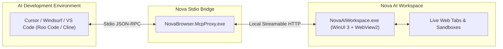

# Connect VS Code, Cursor & Windsurf to Nova

> [!NOTE]
> This guide details how to connect modern AI-enabled development environments—including **Cursor IDE**, **Windsurf**, and **Visual Studio Code** extensions (such as **Roo Code** and **Cline**)—to Nova AI Workspace via the Model Context Protocol (MCP).

---

## 1. Overview

Nova AI Workspace provides full Model Context Protocol (MCP) server support, enabling popular code editors and AI development tools to directly inspect web applications, automate testing, and interact with live browser tabs during coding sessions.

Connection is established using Nova's high-performance stdio proxy bridge (`NovaBrowser.McpProxy.exe`). The proxy communicates with your editor via standard input/output (`stdio`) and forwards tool requests to Nova's local authenticated server.



---

## 2. Connecting Cursor IDE

Cursor includes native MCP client support:

1. Open **Cursor Settings** (`Ctrl+,`) and navigate to **Features → MCP**.
2. Click **Add New MCP Server**.
3. Enter the following parameters:
   * **Name:** `nova`
   * **Type:** `command`
   * **Command:** `C:\Users\<YourUsername>\AppData\Local\nova-cognitive\Nova\bin\NovaBrowser.McpProxy.exe --mirror-structured-content`
4. Alternatively, edit your Cursor MCP configuration JSON file directly:
   ```json
   {
     "mcpServers": {
       "nova": {
         "command": "C:\\Users\\<YourUsername>\\AppData\\Local\\nova-cognitive\\Nova\\bin\\NovaBrowser.McpProxy.exe",
         "args": ["--mirror-structured-content"]
       }
     }
   }
   ```
5. Save the configuration and verify that the green indicator lights up next to `nova`.

---

## 3. Connecting Visual Studio Code (Roo Code & Cline)

VS Code extensions such as **Roo Code** and **Cline** manage MCP servers through an internal settings file:

1. In VS Code, click the **Roo Code** or **Cline** icon in the activity bar.
2. Click the **MCP Servers** (network/plug) icon to open MCP configuration.
3. Add the `nova` server block to the `mcpServers` object:
   ```json
   {
     "mcpServers": {
       "nova": {
         "command": "C:\\Users\\<YourUsername>\\AppData\\Local\\nova-cognitive\\Nova\\bin\\NovaBrowser.McpProxy.exe",
         "args": ["--mirror-structured-content"]
       }
     }
   }
   ```
4. Save the file. The extension immediately launches the proxy process and displays Nova's discovered tools.

---

## 4. Connecting Windsurf IDE

Windsurf supports MCP servers through its global configuration file:

1. Open Windsurf Settings and locate the **MCP Configuration** section.
2. Add Nova to your configuration file:
   ```json
   {
     "mcpServers": {
       "nova": {
         "command": "C:\\Users\\<YourUsername>\\AppData\\Local\\nova-cognitive\\Nova\\bin\\NovaBrowser.McpProxy.exe",
         "args": ["--mirror-structured-content"]
       }
     }
   }
   ```
3. Restart Windsurf or reload the active window to establish the connection.

---

## 5. Compatibility Switches Explained

Nova's proxy bridge supports specialized flags for different editor environments:

* **`--mirror-structured-content` (Recommended):**
  Many IDE extensions pass only plain text blocks to the model and ignore structured JSON envelopes. Adding this switch duplicates all structured tool results directly into the text block, ensuring that tools like `nova.tabs` and `nova.perceive` are fully visible to your coding assistant.
* **`--antigravity-tool-names`:**
  If your extension enforces strict naming rules that disallow dots in tool names (e.g. rejecting `nova.tabs`), this switch exposes tools using underscores (e.g. `nova_tabs`) while translating calls back to Nova's internal conventions.

---

## 6. Verifying Your Setup

Once connected, ask your assistant in Cursor, Windsurf, or VS Code:

> *"Use Nova to list my open browser tabs and tell me what page is currently active."*

The model will call `nova.tabs`, inspect the active tab list, and report your open pages.

---

## 7. Related Documentation

* **[VS Code & Cursor Troubleshooting](../troubleshooting/vscode-and-cursor.md)** — Diagnosing spawn errors, path escaping, and missing tools.
* **[Claude Code Integration](claude-code.md)** — Connecting the Anthropic CLI runner.
* **[OpenAI Codex Integration](openai-codex.md)** — Connecting OpenAI Codex.
* **[Integration Overview](README.md)** — Master hub for all client connections.
