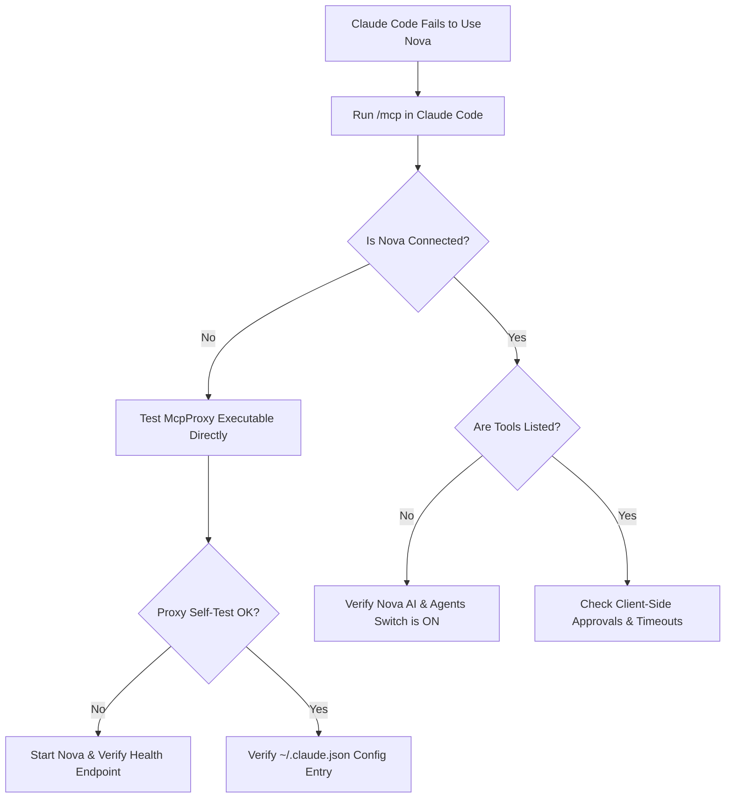

# Claude Code Troubleshooting

> [!NOTE]
> This guide resolves connection failures, proxy launch stalls, and execution errors when using the **Anthropic Claude Code CLI** with Nova AI Workspace. For initial configuration, see the [Claude Code Integration Guide](../integration/claude-code.md).

---

## 1. Quick Diagnostic Checklist

When Claude Code fails to connect to Nova or reports that browser tools are unavailable, work through this sequence:



1. **Check connection status:** In an active Claude Code session, type `/mcp` and press Enter.
   * **Expected:** `nova` is listed with status `connected`.
   * **Failure:** `nova` is listed as `failed` or does not appear at all.
2. **Verify Nova is running:** Open a PowerShell window and run:
   ```powershell
   Invoke-RestMethod http://127.0.0.1:27183/health
   ```
   * **Expected response:** `{"status":"ready"}` or similar JSON payload.
   * If the command fails with connection refused, launch **Nova AI Workspace** and verify that **Menu → Settings → AI & agents → Allow agents to control the browser** is enabled.
3. **Run the stdio bridge self-test:**
   ```powershell
   & "$env:LOCALAPPDATA\nova-cognitive\Nova\bin\NovaBrowser.McpProxy.exe" --self-test
   ```
   * **Expected output:** `NovaBrowser.McpProxy self-test OK`.
   * Installations from version 1.0.0-alpha.17 or older use `%LOCALAPPDATA%\NovaBrowser` instead of `%LOCALAPPDATA%\nova-cognitive\Nova`; see [Diagnostics](diagnostics.md#1-local-filesystem-locations).
   * If the proxy executable is missing, launch Nova once; it places the proxy binary in `bin\` during initialization.

---

## 2. Common Symptoms & Root Causes

### Symptom A: Claude Code Reports "Connection Failed" or "Server Closed Connection"

#### Cause 1: Windows Path Escaping in `~/.claude.json`
Claude Code stores its global MCP server registry in your user profile at `%USERPROFILE%\.claude.json`. In JSON, every Windows backslash must be escaped with a double backslash (`\\`).

**Incorrect:**
```json
{
  "command": "C:\Users\Username\AppData\Local\nova-cognitive\Nova\bin\NovaBrowser.McpProxy.exe"
}
```

**Correct:**
```json
{
  "command": "C:\\Users\\Username\\AppData\\Local\\nova-cognitive\\Nova\\bin\\NovaBrowser.McpProxy.exe"
}
```

#### Cause 2: Outdated Command-Line Arguments
Older guides or external scripts may have included obsolete arguments such as `--pipe`, `--port`, or `--token`. The modern Nova stdio bridge handles local authentication automatically and reads configuration dynamically from Nova's profile.
* Passing unknown arguments causes the bridge to terminate immediately with exit code `2`.
* Remove all arguments unless you explicitly require `--mirror-structured-content`.

---

### Symptom B: Claude Code Connects but Reaches for `curl` or Ignores Browser Tools

#### Cause 1: Session Started Before Nova Configuration
Claude Code parses its MCP configuration **only upon session launch**. If you enabled the Nova MCP integration or modified `~/.claude.json` while a Claude Code session was already running in your terminal:
1. Exit Claude Code (`/exit` or `Ctrl+C`).
2. Open a new terminal window.
3. Launch `claude` again and verify with `/mcp`.

#### Cause 2: Client Prompt Cache / Instruction Bypass
If the model does not discover browser capabilities, remind Claude Code explicitly in your prompt:
> *"Use the connected Nova MCP tools (such as nova.tabs and nova.perceive) to inspect the active browser tab."*

---

### Symptom C: Bearer Token Authentication Failures

The stdio bridge automatically retrieves an encrypted bearer token from `%LOCALAPPDATA%\nova-cognitive\Nova\mcp-identity.dat` (secured via Windows DPAPI) and presents it to Nova's local HTTP listener.

#### Cause: Running Claude Code Under a Different User Account
* Windows DPAPI encryption is tied strictly to the Windows user security identifier (SID).
* If Nova runs as your standard user account, but Claude Code runs inside an elevated Administrator command prompt or a separate service account, the bridge cannot decrypt `mcp-identity.dat`.
* **Resolution:** Ensure both Nova and your terminal running Claude Code run under the **same standard Windows user account**. Do not run Claude Code "As Administrator" unless Nova is also elevated.

---

## 3. Recommended `~/.claude.json` Configuration

Below is the verified, minimal configuration entry for Claude Code:

```json
{
  "mcpServers": {
    "nova": {
      "command": "C:\\Users\\<YourUsername>\\AppData\\Local\\nova-cognitive\\Nova\\bin\\NovaBrowser.McpProxy.exe"
    }
  }
}
```

*(Replace `<YourUsername>` with your actual Windows user account name).*

---

## 4. Reading Diagnostic Logs

If connection issues persist, inspect the dedicated bridge log:

* **Log Path:** `%LOCALAPPDATA%\nova-cognitive\Nova\Logs\novabrowser-mcp-stdio-proxy.log`
* **Common Log Entries:**
  * `[INF] Starting NovaBrowser.McpProxy`: The bridge was invoked by Claude Code.
  * `[ERR] Failed to connect to Nova within 90s`: Nova was not running and could not be auto-launched.
  * `[ERR] DPAPI decryption failed`: Running under a mismatched user account.

---

## 5. Related Troubleshooting

* **[Agent & MCP Connection Issues](agent-connection-issues.md)** — General connection diagnostic steps.
* **[Agent Behavior Troubleshooting](agent-behavior.md)** — Diagnosing tool failures and missing result data.
* **[Claude Code Integration Guide](../integration/claude-code.md)** — Step-by-step setup walkthrough.
* **[Troubleshooting Hub](README.md)** — Main diagnostic sitemap.
