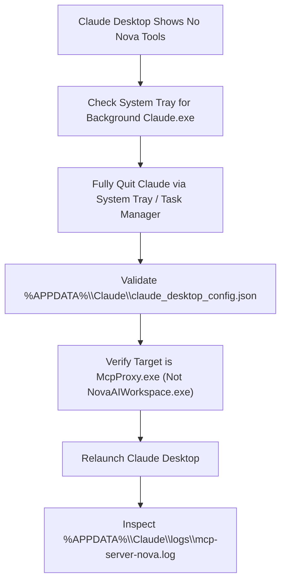

# Claude Desktop Troubleshooting

> [!NOTE]
> This guide resolves configuration errors, missing tool icons, and execution timeouts when connecting the **Anthropic Claude Desktop** application to Nova AI Workspace. For initial configuration, see the [Claude Desktop Integration Guide](../integration/claude-desktop.md).

---

## 1. Quick Diagnostic Checklist

When Claude Desktop does not display Nova tools or shows a disconnected indicator:



1. **Fully quit Claude Desktop:** Claude Desktop minimizes to the Windows notification area (system tray) by default. Simply closing its window **does not reload** configuration changes. Right-click the Claude icon in the system tray and select **Quit**, or terminate `Claude.exe` in Task Manager.
2. **Verify configuration path:** Open `%APPDATA%\Claude\claude_desktop_config.json` in a text editor and verify JSON syntax.
3. **Verify Nova is running:** Start Nova AI Workspace before opening Claude Desktop.
4. **Check Claude Desktop logs:** Open `%APPDATA%\Claude\logs\mcp.log` and `%APPDATA%\Claude\logs\mcp-server-nova.log` to inspect startup errors.

---

## 2. Common Symptoms & Root Causes

### Symptom A: Hammer Tool Icon Missing in Claude Desktop

#### Cause 1: Running in Background During Config Edits
Claude Desktop reads its configuration file **only when the root Electron process starts**. If you edited `claude_desktop_config.json` while Claude was running (even if minimized to tray), the new configuration is ignored.
* **Resolution:** Fully exit Claude Desktop via the notification area, then relaunch it.

#### Cause 2: Syntax Error or Single Backslashes in JSON
If `claude_desktop_config.json` contains invalid JSON (such as single backslashes in Windows file paths, unclosed braces, or trailing commas), Claude Desktop silently disables all MCP servers without displaying an error alert.

* **Incorrect:**
  ```json
  {
    "command": "C:\Users\Username\AppData\Local\nova-cognitive\Nova\bin\NovaBrowser.McpProxy.exe"
  }
  ```
* **Correct:**
  ```json
  {
    "command": "C:\\Users\\Username\\AppData\\Local\\nova-cognitive\\Nova\\bin\\NovaBrowser.McpProxy.exe"
  }
  ```

#### Cause 3: Pointing Directly to Nova's GUI Executable
Claude Desktop expects an MCP server that communicates over standard input/output (`stdio`).
* **Incorrect:** Pointing to `NovaAIWorkspace.exe` (or `Nova.exe`). Nova is a WinUI 3 graphical browser shell, not a stdio console process.
* **Correct:** Pointing to `NovaBrowser.McpProxy.exe` located in your `%LOCALAPPDATA%\nova-cognitive\Nova\bin\` directory. Installations from version 1.0.0-alpha.17 or older use `%LOCALAPPDATA%\NovaBrowser` instead of `%LOCALAPPDATA%\nova-cognitive\Nova`; see [Diagnostics](diagnostics.md#1-local-filesystem-locations). The proxy acts as the lightweight stdio-to-HTTP bridge.

---

### Symptom B: The Model Sees Only "Use structuredContent" Summaries

#### Cause: Electron Client Handling of Structured MCP Responses
Certain releases of Claude Desktop render text content blocks to the language model but do not pass raw `structuredContent` JSON envelopes into the chat context. When an agent queries `nova.tabs` or `nova.perceive`, it may report seeing only a summary message.

#### Resolution: Enable Structured Content Mirroring
Add the `--mirror-structured-content` argument to your Claude Desktop configuration. This instructs Nova's proxy to duplicate all structured JSON fields directly into the readable text block:

```json
{
  "mcpServers": {
    "nova": {
      "command": "C:\\Users\\<YourUsername>\\AppData\\Local\\nova-cognitive\\Nova\\bin\\NovaBrowser.McpProxy.exe",
      "args": ["--mirror-structured-content"]
    }
  }
}
```

---

### Symptom C: Tool Execution Timed Out / Server Disconnected

#### Cause: Approval Dialogs or Interactive Prompts
If Nova's autonomy level is set to **Supervised** or if high-impact tool confirmations are set to **Always Ask**, Nova displays an interactive confirmation dialog in the browser window before executing sensitive actions.
* If you do not approve the prompt in Nova within the timeout window, the proxy returns a timeout error to Claude Desktop.
* **Resolution:** Keep Nova visible while working with Claude Desktop, or adjust confirmation policies in **Menu → Settings → AI & agents → Confirmations & audit**.

---

## 3. Reading Diagnostic Logs

Claude Desktop maintains two relevant log files:

1. **`%APPDATA%\Claude\logs\mcp.log`:**
   Logs the initialization of all configured MCP server processes. Look for `[nova] Process spawned with PID ...` or parse errors.
2. **`%APPDATA%\Claude\logs\mcp-server-nova.log`:**
   Captures the standard error (`stderr`) output emitted by Nova's proxy bridge. If the bridge cannot locate Nova's token or health port, the exact failure reason is recorded here.

---

## 4. Related Troubleshooting

* **[Agent & MCP Connection Issues](agent-connection-issues.md)** — General connection diagnostic steps.
* **[Agent Behavior Troubleshooting](agent-behavior.md)** — Diagnosing tool failures and missing result data.
* **[Claude Desktop Integration Guide](../integration/claude-desktop.md)** — Step-by-step setup walkthrough.
* **[Troubleshooting Hub](README.md)** — Main diagnostic sitemap.
