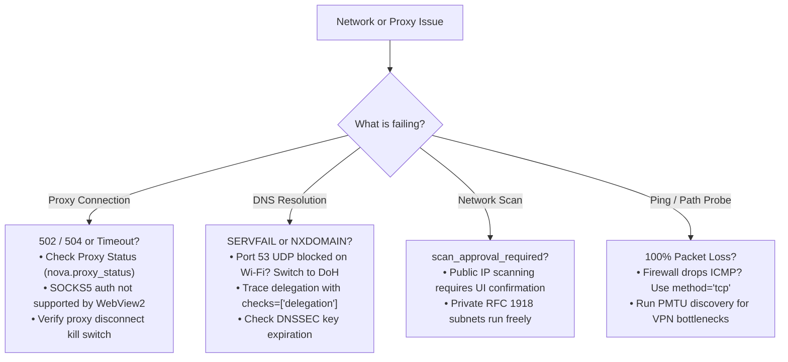

# Network & Proxy Troubleshooting

> [!NOTE]
> This guide addresses connection failures, proxy dropouts, DNS resolution errors, and network scanning approval gates across Nova AI Workspace.

---

## 1. Quick Diagnostic Decision Tree



---

## 2. Proxy Connection & Routing Issues

### 2.1 Proxy Connection Returns 502 Bad Gateway or 504 Gateway Timeout
* **Symptom:** Webpages fail to load with `ERR_PROXY_CONNECTION_FAILED`, `HTTP 502`, or `HTTP 504`.
* **Root Causes:**
  1. The remote proxy server is offline, overloaded, or unreachable from your local network.
  2. The proxy hostname failed to resolve.
* **Resolution:**
  * Open **Settings → Identity & security → Proxies** and click **Test Proxy** on the profile card.
  * Agents can run [`nova.proxy_test(profileId='...')`](../mcp-reference/tools/proxy-and-network/nova-proxy-test.md) to inspect measured handshake latency and the reflected external IP address.
  * Check [`nova.proxy_log()`](../mcp-reference/tools/proxy-and-network/nova-proxy-log.md) for timestamped connection attempts and socket errors.

### 2.2 SOCKS5 Proxy Fails with Authentication Error
* **Symptom:** SOCKS5 proxy connects when unauthenticated, but fails immediately when a username and password are provided.
* **Root Cause:** The underlying Chromium and Microsoft WebView2 network stack does not natively support embedded username/password authentication for SOCKS5 proxies.
* **Resolution:**
  * Configure your SOCKS5 proxy to authenticate using **IP address allowlisting**.
  * Use a local proxy forwarder or relay tool.
  * Switch to an **HTTP or HTTPS proxy** protocol, which fully supports Basic and Digest credential authentication.

### 2.3 Traffic Blocked After Emergency Kill Switch
* **Symptom:** All HTTP and HTTPS traffic drops immediately for a tab or sandbox.
* **Root Cause:** The emergency proxy kill switch was engaged via [`nova.proxy_disconnect`](../mcp-reference/tools/proxy-and-network/nova-proxy-disconnect.md).
* **Resolution:** Re-establish traffic flow by calling [`nova.proxy_reconnect`](../mcp-reference/tools/proxy-and-network/nova-proxy-reconnect.md).

### 2.4 WebSocket & SSE Streams Terminate Unexpectedly During Proxy Switch
* **Symptom:** Long-lived WebSocket connections (e.g. Phoenix channels, Socket.IO, GraphQL subscriptions) or Server-Sent Events (SSE) drop immediately and throw `WebSocket connection to '...' failed` when switching proxies.
* **Root Cause:** Switching proxy profiles ([`nova.proxy_switch`](../mcp-reference/tools/proxy-and-network/nova-proxy-switch.md)) or engaging the kill switch ([`nova.proxy_disconnect`](../mcp-reference/tools/proxy-and-network/nova-proxy-disconnect.md)) instantly severs underlying full-duplex TCP tunnels to prevent data packets from continuing to leak across the previous egress route.
* **Resolution:**
  * Ensure web applications implement standard exponential backoff reconnection logic (e.g. `reconnectAfterMs`).
  * In automated agent workflows, use [`nova.network_read`](../mcp-reference/tools/dom-and-reading/nova-network-read.md) with `kinds: ["websocket"]` and `waitForMatchMs: 5000` to wait for the client application to complete its automatic re-handshake over the new proxy tunnel before continuing UI interactions.

---

## 3. DNS Diagnostics & Name Resolution Failures

### 3.1 Queries Return `SERVFAIL` or Broken Delegation
* **Symptom:** Domain resolution fails with `status: "server_failure"` or recursive resolvers fail to return records.
* **Root Causes:**
  * Broken nameserver delegation (lame delegation).
  * DNSSEC validation failure (parent zone publishes a `DS` record that does not match the active `DNSKEY` published by the domain).
* **Resolution:**
  * Run a full root-to-leaf delegation trace:
    ```json
    {
      "name": "nova.net_dns",
      "arguments": {
        "name": "example.com",
        "checks": ["delegation"]
      }
    }
    ```
  * Inspect `delegation.findings` to verify whether authoritative nameservers agree on SOA serials and whether DNSSEC signatures are within their validity windows.

### 3.2 Port 53 UDP Blocked on Guest or Hotel Wi-Fi
* **Symptom:** Wire-format DNS queries time out repeatedly on public or corporate networks.
* **Root Cause:** The network firewall drops outgoing UDP port 53 traffic to force clients through an internal captive portal or logging resolver.
* **Resolution:**
  * Switch transport to DNS-over-HTTPS (DoH), which encapsulates DNS queries inside standard HTTPS traffic:
    ```json
    {
      "name": "nova.net_dns",
      "arguments": {
        "name": "example.com",
        "resolvers": ["cloudflare", "google"],
        "transport": "doh"
      }
    }
    ```
  * If a sandbox proxy is active, all DoH traffic strictly traverses that proxy tunnel, eliminating direct port 53 exposure.

---

## 4. Subnet Scanning & Public IP Approval Gates

### 4.1 Scan Fails with `scan_approval_required`
* **Symptom:** Calling [`nova.net_scan`](../mcp-reference/tools/proxy-and-network/nova-net-scan.md) fails immediately with error code `scan_approval_required`.
* **Root Cause:** The scan target includes external, public IP addresses. To protect third-party internet infrastructure against unapproved reconnaissance, Nova strictly requires explicit operator confirmation before probing public IP ranges.
* **Resolution:**
  * A desktop confirmation dialog appears in Nova: **Agent wants to scan public IP range [targets]**. Click **Allow** to authorize the scan for the current session.
  * Private RFC 1918 subnets (`10.0.0.0/8`, `172.16.0.0/12`, `192.168.0.0/16`), CGNAT, link-local, and loopback ranges run freely under standard agent permissions without requiring interactive approval.

---

## 5. Latency & Path Probing (ICMP vs. TCP)

### 5.1 Host Shows 100% Packet Loss on ICMP Ping
* **Symptom:** `nova.net_ping` reports `packetLoss: 100%` despite the website or API being reachable in the browser.
* **Root Cause:** Modern cloud hosting providers (e.g. AWS EC2 Security Groups, Cloudflare, Azure) frequently disable ICMP echo replies by default to mitigate denial-of-service vectors.
* **Resolution:**
  * Switch to TCP handshake ping (`method: "tcp"`), which measures Round-Trip Time by initiating a TCP SYN handshake on an open port:
    ```json
    {
      "name": "nova.net_ping",
      "arguments": {
        "host": "api.example.com",
        "method": "tcp",
        "port": 443
      }
    }
    ```

### 5.2 VPN / Tunnel Packet Drops (PMTU Discovery)
* **Symptom:** Connections hang or stall when transferring large payloads over VPNs or GRE tunnels.
* **Root Cause:** Path MTU fragmentation mismatch along intermediate router hops.
* **Resolution:**
  * Run Path MTU discovery with `dontFragment: true` and `mtuDiscovery: true` in `nova.net_ping` to detect the exact supported packet size limit.

---

## 6. Related Documentation

* **[Network Diagnostics User Guide](../user-guide/tools/network-and-diagnostics.md)** — Step-by-step instructions for all 5 network disciplines.
* **[Proxies & Network Routing](../user-guide/identity-and-security/proxies.md)** — Managing proxy profiles, credentials, and WebRTC leak defense.
* **[Network Architecture Hub](../core-features/network/README.md)** — Architectural internals of proxies, interception, DNS, and path probing.
* **[Troubleshooting Hub](README.md)** — Main troubleshooting index.

---

[Back to Troubleshooting Hub](README.md)
