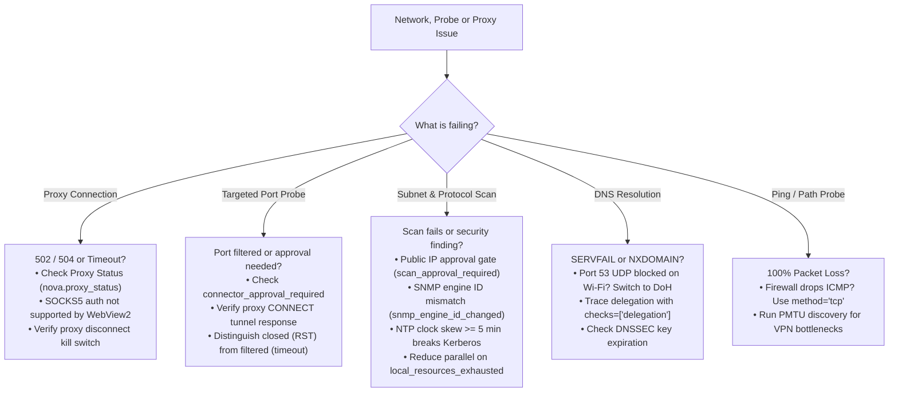

# Network, Proxy, Port Probe & Deep Protocol Troubleshooting

This guide resolves proxy connection failures, DNS resolution errors, path latency bottlenecks, TCP port probe refusals (`nova.net_probe`), and network discovery or protocol probe issues (SNMP, NTP, LDAP, SMB in `nova.net_scan`) across Nova AI Workspace.

---

## Quick Symptom Checker

| Symptom / Error Code | Root Cause | Primary Resolution |
| :--- | :--- | :--- |
| `connector_approval_required` | `nova.net_probe` was invoked on a host not previously confirmed in this session. | **Security Invariant.** Probing arbitrary network hosts requires interactive user confirmation once per session unless the host is an already-configured working connector. Run interactively or register host in Settings → Connectors. |
| Port state `filtered` in `nova.net_probe` | Target host dropped TCP SYN packets or a firewall silently discarded traffic. | Verify host-level firewall rules (`ufw`, `iptables`, `nftables`, Windows Defender Firewall) and cloud security group ingress rules. |
| Port state `closed` in `nova.net_probe` | Host answered with TCP RST. The host is online, but no service is bound to that port. | Verify the target service is actively listening (`ss -tulpn` or `netstat -ano`) and bound to `0.0.0.0` or `::`, not just `127.0.0.1`. |
| `proxyConnect` reports `auth_required` | HTTP proxy answered with HTTP 407 Proxy Authentication Required. | Proxy requires authentication. Check `Proxy-Authenticate` header (Basic, Digest). Supply credentials via an explicit proxy profile in Nova. |
| `proxyConnect` reports `not_http` or `refused` | Target port is not an HTTP proxy or the proxy policy denied CONNECT tunneling to that destination. | Verify the port hosts a forward HTTP proxy and that proxy ACLs allow outbound CONNECT tunnels to the specified target port (e.g. 443). |
| `scan_approval_required` | `nova.net_scan` targeted public (non-RFC 1918) IP addresses. | Confirm the public scan prompt in Nova's desktop UI. Private ranges (`10.0.0.0/8`, `172.16.0.0/12`, `192.168.0.0/16`, CGNAT) run freely without prompts. |
| `local_resources_exhausted` | The scanning machine ran out of local socket buffers or ephemeral ports. | Reduce concurrent probes via parameter `parallel` (e.g. from 64 down to 16 or 8) and increase `timeoutMs`. |
| `snmp_engine_id_changed` | An SNMPv3 agent answered with an `engineID` different from the one pinned during previous signed exchanges. | **Spoofing Guard.** Nova rejects unverified engine swaps to prevent replay attacks. If hardware was replaced or reset, re-enter credentials in Settings → Connectors. |
| `snmp_v2c_in_use` / `snmp_public_address` | SNMPv2c is sending plaintext community strings, or an SNMP agent is responding on a public IP address. | Migrate from SNMPv2c to encrypted SNMPv3 (`authPriv` with AES-128). Restrict UDP port 161 access to private management subnets. |
| `ntp_time_offset` / `ntp_unsynchronized` | Target clock differs from local clock, or device reports Stratum 16 / leap alarm. | If offset $\ge 300\text{ s}$ (5 minutes), Kerberos logins fail and TLS certificates appear expired. Synchronize the device with an authoritative stratum-1/2 time server. |
| `directory_reachable` / LDAP missing in scan | LDAP ports (389, 636, 3268, 3269) are not scanned by default in `portSets: ["quick"]`. | Specify `portSets: ["admin"]` or explicitly add LDAP ports in `ports: [389, 636]` to include directory RootDSE exploration. |
| `smb1_enabled` finding | Remote device actively supports the deprecated, unencrypted SMBv1 dialect. | **High Risk.** SMBv1 is vulnerable to remote exploit vectors (e.g. EternalBlue). Disable SMBv1 on the target operating system or NAS. |
| `SERVFAIL` / Lame delegation in `nova.net_dns` | DNSSEC signature expired or authoritative nameservers disagree on SOA serials. | Trace the delegation tree using `checks: ["delegation"]` to identify mismatched parent `DS` and child `DNSKEY` records. |
| Port 53 UDP blocked on Wi-Fi | Outbound UDP 53 is intercepted or filtered by guest/hotel network firewalls. | Switch transport to DNS-over-HTTPS via parameter `transport: "doh"` with `resolvers: ["cloudflare", "google"]`. |
| 100% packet loss on `nova.net_ping` | Destination cloud firewall or router throttles or drops ICMP Echo requests. | Switch ping method to TCP SYN handshakes using `method: "tcp"` with `port: 443`. |

---

## 1. Quick Diagnostic Decision Tree



---

## 2. Proxy Connection & Routing Issues

### 2.1 Proxy Connection Returns 502 Bad Gateway or 504 Gateway Timeout
* **Symptom:** Webpages fail to load with `ERR_PROXY_CONNECTION_FAILED`, `HTTP 502`, or `HTTP 504`.
* **Root Causes:**
  1. The remote proxy server is offline, overloaded, or unreachable from your local network.
  2. The proxy hostname failed to resolve.
* **Resolution:**
  * Open **Settings → Identity & security → Proxies** and click **Test Proxy** on the profile card.
  * Agents can run [`nova.proxy_test(profileId='...')`](../mcp-reference/tools/proxy-and-network/nova-proxy-test.md) to inspect measured handshake latency and the reflected external IP address.
  * Check [`nova.proxy_log()`](../mcp-reference/tools/proxy-and-network/nova-proxy-log.md) for timestamped connection attempts and socket errors.

### 2.2 SOCKS5 Proxy Fails with Authentication Error
* **Symptom:** SOCKS5 proxy connects when unauthenticated, but fails immediately when a username and password are provided.
* **Root Cause:** The underlying Chromium and Microsoft WebView2 network stack does not natively support embedded username/password authentication for SOCKS5 proxies.
* **Resolution:**
  * Configure your SOCKS5 proxy to authenticate using **IP address allowlisting**.
  * Use a local proxy forwarder or relay tool.
  * Switch to an **HTTP or HTTPS proxy** protocol, which fully supports Basic and Digest credential authentication.

### 2.3 Traffic Blocked After Emergency Kill Switch
* **Symptom:** All HTTP and HTTPS traffic drops immediately for a tab or sandbox.
* **Root Cause:** The emergency proxy kill switch was engaged via [`nova.proxy_disconnect`](../mcp-reference/tools/proxy-and-network/nova-proxy-disconnect.md).
* **Resolution:** Re-establish traffic flow by calling [`nova.proxy_reconnect`](../mcp-reference/tools/proxy-and-network/nova-proxy-reconnect.md).

### 2.4 WebSocket & SSE Streams Terminate Unexpectedly During Proxy Switch
* **Symptom:** Long-lived WebSocket connections (e.g. Phoenix channels, Socket.IO, GraphQL subscriptions) or Server-Sent Events (SSE) drop immediately and throw `WebSocket connection to '...' failed` when switching proxies.
* **Root Cause:** Switching proxy profiles ([`nova.proxy_switch`](../mcp-reference/tools/proxy-and-network/nova-proxy-switch.md)) or engaging the kill switch ([`nova.proxy_disconnect`](../mcp-reference/tools/proxy-and-network/nova-proxy-disconnect.md)) instantly severs underlying full-duplex TCP tunnels to prevent data packets from continuing to leak across the previous egress route.
* **Resolution:**
  * Web applications need their own reconnect logic (for example exponential backoff) to recover.
  * In automated agent workflows, use [`nova.network_read`](../mcp-reference/tools/dom-and-reading/nova-network-read.md) with `kinds: ["websocket"]` and `waitForMatchMs: 5000` to wait for the client application to complete its automatic re-handshake over the new proxy tunnel before continuing UI interactions.

---

## 3. DNS Diagnostics & Name Resolution Failures

### 3.1 Queries Return `SERVFAIL` or Broken Delegation
* **Symptom:** Domain resolution fails with `status: "server_failure"` or recursive resolvers fail to return records.
* **Root Causes:**
  * Broken nameserver delegation (lame delegation).
  * DNSSEC validation failure (parent zone publishes a `DS` record that does not match the active `DNSKEY` published by the domain).
* **Resolution:**
  * Run a full root-to-leaf delegation trace:
    ```json
    {
      "name": "nova.net_dns",
      "arguments": {
        "name": "example.com",
        "checks": ["delegation"]
      }
    }
    ```
  * Inspect `delegation.findings` to verify whether authoritative nameservers agree on SOA serials and whether DNSSEC signatures are within their validity windows.

### 3.2 Port 53 UDP Blocked on Guest or Hotel Wi-Fi
* **Symptom:** Wire-format DNS queries time out repeatedly on public or corporate networks.
* **Root Cause:** The network firewall drops outgoing UDP port 53 traffic to force clients through an internal captive portal or logging resolver.
* **Resolution:**
  * Switch transport to DNS-over-HTTPS (DoH), which encapsulates DNS queries inside standard HTTPS traffic:
    ```json
    {
      "name": "nova.net_dns",
      "arguments": {
        "name": "example.com",
        "resolvers": ["cloudflare", "google"],
        "transport": "doh"
      }
    }
    ```
  * If a sandbox proxy is active, all DoH traffic strictly traverses that proxy tunnel, eliminating direct port 53 exposure.

---

## 4. Subnet Scanning & Public IP Approval Gates (`nova.net_scan`)

### 4.1 Scan Fails with `scan_approval_required`
* **Symptom:** Calling [`nova.net_scan`](../mcp-reference/tools/proxy-and-network/nova-net-scan.md) fails immediately with error code `scan_approval_required`.
* **Root Cause:** The scan target includes external, public IP addresses. To protect third-party internet infrastructure against unapproved reconnaissance, Nova strictly requires explicit operator confirmation before probing public IP ranges.
* **Resolution:**
  * A desktop confirmation dialog appears in Nova: **Agent wants to scan public IP range [targets]**. Click **Allow** to authorize the scan for the current session.
  * Private RFC 1918 subnets (`10.0.0.0/8`, `172.16.0.0/12`, `192.168.0.0/16`), CGNAT, link-local, and loopback ranges run freely under standard agent permissions without requiring interactive approval.

---

## 5. Latency & Path Probing (ICMP vs. TCP) (`nova.net_ping`)

### 5.1 Host Shows 100% Packet Loss on ICMP Ping
* **Symptom:** `nova.net_ping` reports `packetLoss: 100%` despite the website or API being reachable in the browser.
* **Root Cause:** Modern cloud hosting providers (e.g. AWS EC2 Security Groups, Cloudflare, Azure) frequently disable ICMP echo replies by default to mitigate denial-of-service vectors.
* **Resolution:**
  * Switch to TCP handshake ping (`method: "tcp"`), which measures Round-Trip Time by initiating a TCP SYN handshake on an open port:
    ```json
    {
      "name": "nova.net_ping",
      "arguments": {
        "host": "api.example.com",
        "method": "tcp",
        "port": 443
      }
    }
    ```

### 5.2 VPN / Tunnel Packet Drops (PMTU Discovery)
* **Symptom:** Connections hang or stall when transferring large payloads over VPNs or GRE tunnels.
* **Root Cause:** Path MTU fragmentation mismatch along intermediate router hops.
* **Resolution:**
  * Run Path MTU discovery with `dontFragment: true` and `mtuDiscovery: true` in `nova.net_ping` to detect the exact supported packet size limit.

---

## 6. Targeted Port Probing & Proxy Tunnels (`nova.net_probe`)

[`nova.net_probe`](../mcp-reference/tools/proxy-and-network/nova-net-probe.md) provides quick, direct verification of up to 32 TCP ports on a single host and tests forward HTTP proxy CONNECT tunnels.

### 6.1 Host Confirmation Gate (`connector_approval_required`)

#### Symptom
```json
{
  "error": {
    "code": -32033,
    "message": "Nova has not checked ports of 'srv.example.com' in this session; the first check of a host needs one confirmation by the user, which needs an interactive session.",
    "data": {
      "reasonCode": "connector_approval_required",
      "host": "srv.example.com",
      "nextAction": "ask_user_to_run_net_probe_interactively"
    }
  }
}
```

#### Why This Happens (Anti-Reconnaissance Invariant)
To prevent rogue scripts or prompt injection payloads from abusing Nova as an arbitrary, silent network scanner, Nova requires interactive user confirmation the first time a host is probed during a session.

#### Exceptions:
* **Configured Connectors:** If the host matches the primary or secondary host of an existing connector (SSH, SFTP, database) that has previously logged in successfully (`IsConnectorHostThatWorked`), the host is recognized as the operator's own infrastructure and probes run without prompting.
* **Once Per Session:** Once confirmed by the user, the host remains authorized for all subsequent `nova.net_probe` calls until Nova restarts.

---

### 6.2 Interpreting Port Probe States

`nova.net_probe` returns clean, truthful TCP states:

| Port State | Underlying Network Reality | Diagnostic Meaning |
| :--- | :--- | :--- |
| `open` | Remote host completed the 3-way handshake (SYN $\rightarrow$ SYN-ACK $\rightarrow$ RST). | An active service is listening on the port and accepting connections. |
| `closed` | Remote host immediately returned TCP RST (refused). | The host is reachable and routing works, but no service is listening on that port, or a local firewall has an explicit `REJECT` rule. |
| `filtered` | No response was received before `timeoutMs` expired. | A firewall or security group dropped the packet (`DROP` rule), or an intermediate router discarded the traffic. |
| `unreachable` | Local OS received ICMP Destination Unreachable / No route to host. | Routing failure, invalid IP address, or gateway disconnection. |

---

### 6.3 HTTP Proxy CONNECT Tunnel Failures (`httpProxyConnect`)

Agents can test an HTTP proxy on the target host by attempting an unauthenticated CONNECT tunnel:
```json
{
  "name": "nova.net_probe",
  "arguments": {
    "host": "proxy.corp.internal",
    "httpProxyConnect": {
      "port": 3128,
      "target": "intranet.internal:443"
    }
  }
}
```

#### Possible Responses:
* `tunnel_established`: The proxy accepted the CONNECT request and established a TCP tunnel (`HTTP/1.1 200 Connection established`).
* `auth_required`: The proxy replied with `HTTP 407 Proxy Authentication Required`. Nova captures the `Proxy-Authenticate` header scheme (e.g. Basic, Digest, Negotiate) so the operator knows which authentication credentials to supply.
* `refused`: The proxy returned an HTTP error status (such as `403 Forbidden` or `502 Bad Gateway`). This indicates proxy ACLs or policy restrictions prohibit tunneling to that specific target port.
* `not_http`: The target port answered, but did not respond with a valid HTTP status line.
* `no_answer`: The proxy socket timed out without an answer.

---

## 7. Deep Protocol Probes & Security Findings (`nova.net_scan`)

[`nova.net_scan`](../mcp-reference/tools/proxy-and-network/nova-net-scan.md) inspects application services across open ports without intrusive exploitation.

### 7.1 SNMP Probing, Connector Targets & Engine Pinning

Nova interrogates UDP port 161 exclusively using credentials defined in SNMP connectors (`nova.connector_create(type="snmp")`):

#### Strict Target Constraints (`NetSnmpTargets`):
* **No Hostnames:** SNMP credentials are bound strictly to IP addresses or CIDR prefixes. Hostnames are rejected because DNS modifications could redirect credentials to an attacker's machine.
* **Prefix Size Floors:** Minimum prefix is `/16` for IPv4 and `/48` for IPv6. Broad ranges such as `0.0.0.0/0` are refused.
* **Max 64 Targets:** Each connector profile covers at most 64 discrete address/CIDR targets.

#### Engine ID Pinning Guard (`snmp_engine_id_changed`):
```json
{
  "severity": "medium",
  "code": "snmp_engine_id_changed",
  "text": "192.168.1.1: another SNMPv3 engine answers at this address than the one this connection got a signed answer from before, so Nova sent it no signed request."
}
```
* **Why This Happens:** When an SNMPv3 agent first responds, Nova records its authoritative `snmpEngineID` in `netmonitor.db`. If the engine ID changes on a known IP, Nova aborts signed requests to prevent credential replay or rogue agent spoofing.
* **Resolution:** If a network switch or router was legitimately replaced or factory-reset, update or re-save the connector in **Settings → Connectors**.

#### Plaintext Community Alert (`snmp_v2c_in_use`):
* **Why This Happens:** The target answered an SNMPv2c query using the configured community string. SNMPv2c transmits community strings in cleartext across the network.
* **Resolution:** Upgrade device management to SNMPv3 with `authPriv` (HMAC authentication and AES encryption).

---

### 7.2 NTP Time Synchronization & Kerberos Security Invariants

Nova queries UDP port 123 using RFC 5905 client requests (Mode 3) and measures true clock offset:
* **RFC 9109 Data Minimization:** Nova transmits a randomized 8-byte transmit timestamp in the client request. Responses are verified by ensuring the server echoes these 8 bytes in its origin timestamp field.
* **No Amplification Vectors:** Nova strictly uses Mode 3 queries; dangerous Mode 6 (`control`) and Mode 7 (`monlist`) queries are never used.

#### Clock Skew & Kerberos Invariant (`ntp_time_offset`):
```json
{
  "severity": "high",
  "code": "ntp_time_offset",
  "text": "192.168.1.10 (server): its clock is 6.2 minutes ahead from this computer's clock (NTP, UDP 123)."
}
```
* **Impact of Clock Skew:**
  * $\ge 5\text{ seconds}$ (`low`): Drift beyond standard NTP tolerances.
  * $\ge 1\text{ minute}$ (`medium`): Breaks TOTP two-factor codes and log timestamp correlation.
  * $\ge 5\text{ minutes}$ (`high`): **Critical Active Directory / Kerberos Failure.** Active Directory Kerberos ticket authentication rejects tickets with clock skew $> 5\text{ minutes}$. In addition, TLS client certificates or server certificates appear expired or not yet valid.
* **Resolution:** Re-sync the target host using `w32tm /resync` on Windows or `chronyc makestep` on Linux.

#### Unsynchronized Time Servers (`ntp_unsynchronized`):
* **Symptom:** Target responds on UDP 123, but emits warning `ntp_unsynchronized`.
* **Root Cause:** The server answered with Stratum 16 or Leap Indicator 3 (`alarm`), indicating its own internal clock is free-running and not synchronized to an upstream reference clock.

---

### 7.3 Active Directory & LDAP RootDSE Probing

When probing LDAP ports (TCP 389/3268 for plain/StartTLS and 636/3269 for TLS), Nova performs an anonymous query of the **RootDSE** (RFC 4511):
* **Safe Extraction:** Extracts `dnsHostName`, `defaultNamingContext`, `domainControllerFunctionality`, `isGlobalCatalogReady`, and `vendorName`.
* **No Bind or Tree Crawl:** Nova never attempts an LDAP bind or searches below the RootDSE.
* **Port Set Note:** LDAP ports are classified under `portSets: ["admin"]`. If running a scan with default `portSets: ["quick"]`, directory servers will not be probed. Pass `portSets: ["admin"]` or explicit `ports: [389, 636]` to include LDAP probing.

---

### 7.4 SMB Dialects & Legacy Protocols (`smb1_enabled`)

During SMB probing on port 445:
* **NTLM Challenge Inspection:** Nova negotiates SMB-2/3 dialects and inspects the unauthenticated NTLM challenge to observe the computer NetBIOS name, domain name, and Windows OS build number. **Nova never answers the challenge or establishes an SMB session.**
* **SMBv1 Alert (`smb1_enabled`):** If the server supports the legacy SMBv1 dialect, Nova emits finding `smb1_enabled` (`high` severity). SMBv1 lacks modern encryption, integrity verification, and is vulnerable to remote exploit vectors like EternalBlue.

---

### 7.5 Scanner Resource Limits (`local_resources_exhausted`)

#### Symptom
```json
{
  "complete": false,
  "incompleteReason": "local_resources_exhausted"
}
```

#### Root Cause
When scanning large subnets with high concurrency, the local Windows OS can exhaust available ephemeral TCP ports or socket buffers. Rather than falsely reporting dropped connections as remote firewalls, Nova halts the scan safely.

#### Resolution:
1. Reduce concurrency: Pass `parallel: 16` or `parallel: 8` (default is 64 for private ranges).
2. Increase timeout: Pass `timeoutMs: 3000`.
3. Narrow target ranges: Scan `/24` subnets (256 addresses) rather than `/20` (4096 addresses) in a single invocation.

---

### 7.6 Asynchronous Scan Jobs & Status Polling

If a scan takes longer than `waitSeconds` (default 20 seconds), Nova returns immediately with `status: "running"` and a unique `scanId`:
```json
{
  "scanId": "scan_8f2b10ca",
  "status": "running",
  "phase": "probes",
  "progress": { "addressesTotal": 254, "hostsDiscovered": 12, "portChecksDone": 640, "portChecksTotal": 3048 }
}
```

#### Managing Long-Running Scans:
1. **Poll Progress:** Call `nova.net_scan_status(scanId="scan_8f2b10ca")`. When complete, `status` becomes `"finished"` and the full results (devices, services, findings) are returned.
2. **Early Termination:** If needed, cancel the scan via `nova.net_scan_stop(scanId="scan_8f2b10ca")`. Active probes in flight are canceled, and all devices discovered up to that point are saved into `netmonitor.db`.

---

## 8. Related Documentation

* **[Network Diagnostics User Guide](../user-guide/tools/network-and-diagnostics.md)** — Step-by-step instructions for all 5 network disciplines.
* **[Network Discovery & Inventory Architecture](../core-features/network/network-discovery-and-inventory/README.md)** — Architectural internals of `netmonitor.db`, evidence scoring, and discovery probes.
* **[Path Diagnostics & Probing Architecture](../core-features/network/path-diagnostics-and-probing/README.md)** — Detailed specification of `nova.net_ping` and `nova.net_probe`.
* **[Proxies & Network Routing](../user-guide/identity-and-security/proxies.md)** — Managing proxy profiles, credentials, and WebRTC leak defense.
* **[Troubleshooting Hub](README.md)** — Main troubleshooting index.

---

[Back to Troubleshooting Hub](README.md)
