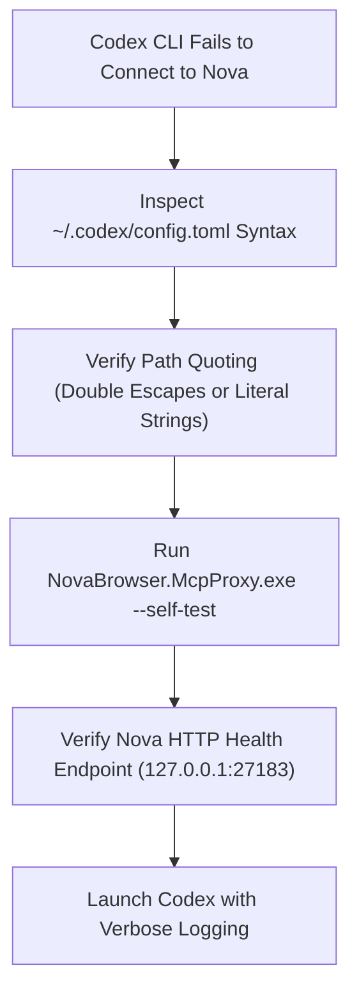

# OpenAI Codex CLI Troubleshooting

> [!NOTE]
> This guide resolves configuration syntax errors, stdio stream pipe stalls, and execution timeouts when connecting the **OpenAI Codex CLI** runner to Nova AI Workspace. For initial configuration, see the [OpenAI Codex Integration Guide](../integration/openai-codex.md).

---

## 1. Quick Diagnostic Checklist

When OpenAI Codex CLI reports that Nova tools are disconnected or fails to invoke browser operations:



1. **Verify TOML configuration syntax:** Check `~/.codex/config.toml` in your user home directory.
2. **Verify Nova is running:** Open a PowerShell console and execute:
   ```powershell
   Invoke-RestMethod http://127.0.0.1:27183/health
   ```
   If Nova's server is down, start **Nova AI Workspace** and verify that agent access is enabled in **Menu → Settings → AI & agents**.
3. **Execute the bridge self-test:**
   ```powershell
   & "$env:LOCALAPPDATA\nova-cognitive\Nova\bin\NovaBrowser.McpProxy.exe" --self-test
   ```
   Expected: `NovaBrowser.McpProxy self-test OK`. Installations from version 1.0.0-alpha.17 or older use `%LOCALAPPDATA%\NovaBrowser` instead of `%LOCALAPPDATA%\nova-cognitive\Nova`; see [Diagnostics](diagnostics.md#1-local-filesystem-locations).

---

## 2. Common Symptoms & Root Causes

### Symptom A: Codex Reports "Failed to Parse Config" or "Invalid Escape Sequence"

#### Cause: TOML Escaping Rules for Windows File Paths
In TOML configuration files, standard double-quoted strings treat backslashes as escape characters. A single backslash (e.g. `C:\Users\...`) is treated as an illegal escape sequence, preventing Codex from starting.

* **Incorrect (Double Quotes with Single Backslashes):**
  ```toml
  [mcp_servers.nova]
  command = "C:\Users\Username\AppData\Local\nova-cognitive\Nova\bin\NovaBrowser.McpProxy.exe"
  ```
* **Correct Option 1 (Escaped Double Backslashes):**
  ```toml
  [mcp_servers.nova]
  command = "C:\\Users\\Username\\AppData\\Local\\nova-cognitive\\Nova\\bin\\NovaBrowser.McpProxy.exe"
  ```
* **Correct Option 2 (Literal String with Single Quotes):**
  ```toml
  [mcp_servers.nova]
  command = 'C:\Users\Username\AppData\Local\nova-cognitive\Nova\bin\NovaBrowser.McpProxy.exe'
  ```

---

### Symptom B: Codex CLI Reports "Server Exited with Code 2"

#### Cause: Outdated Command Arguments in TOML
Earlier prototype setups passed arguments like `--pipe` or `--port`. The modern Nova stdio proxy reads Nova's runtime port and credentials dynamically from disk.
* Any unknown command argument causes the proxy to exit immediately with code `2`.
* Ensure that no obsolete arguments are passed in your `args` array.

---

### Symptom C: Multi-Turn Stalls or Interactive Approval Deadlocks

#### Cause: Terminal Stdio Stalling on Unattended Confirmations
When Codex runs in automated or multi-turn agent loops, invoking a tool that triggers a confirmation prompt in Nova (e.g., submitting high-impact forms or clearing browser data) pauses tool execution until a human clicks **Allow** in the browser.
* If you run Codex in an unattended terminal or background script, the call will wait until Nova's approval timeout elapses.
* **Resolution:** In **Menu → Settings → AI & agents → Confirmations & audit**, adjust your high-impact tool policies to **Once per session** or ensure Nova is visible on your desktop during task runs.

---

## 3. Recommended `~/.codex/config.toml` Configuration

Below is the verified configuration entry for OpenAI Codex:

```toml
[mcp_servers.nova]
command = "C:\\Users\\<YourUsername>\\AppData\\Local\\nova-cognitive\\Nova\\bin\\NovaBrowser.McpProxy.exe"
```

*(Replace `<YourUsername>` with your Windows account name, or use single quotes for a literal path string).*

---

## 4. Diagnostic Log Inspection

If connection errors persist:

1. **Nova Bridge Log:** Open `%LOCALAPPDATA%\nova-cognitive\Nova\Logs\novabrowser-mcp-stdio-proxy.log` to check whether Codex successfully spawned the proxy process and initiated the MCP protocol handshake.
2. **Nova Diagnostic Stream:** In Nova, open **Menu → Settings → Developer options** and verify that diagnostic logging is set to `Information` or `Debug`.

---

## 5. Related Troubleshooting

* **[Agent & MCP Connection Issues](agent-connection-issues.md)** — General connection diagnostic steps.
* **[Agent Behavior Troubleshooting](agent-behavior.md)** — Diagnosing tool failures and missing result data.
* **[OpenAI Codex Integration Guide](../integration/openai-codex.md)** — Step-by-step setup walkthrough.
* **[Troubleshooting Hub](README.md)** — Main diagnostic sitemap.
