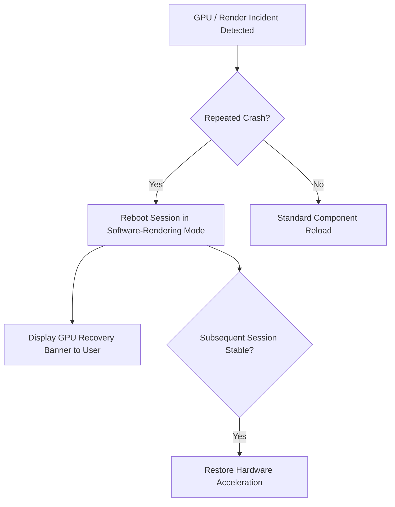

# Performance, Crashes & GPU Incident Recovery

> [!NOTE]
> This guide addresses unexpected application crashes, GPU hardware acceleration driver faults, high memory usage, and background execution throttling in Nova AI Workspace. For general startup diagnostics, see [Diagnostics & Logs](diagnostics.md).

---

## 1. Overview

Nova AI Workspace combines a native WinUI 3 desktop shell with Microsoft WebView2 Chromium rendering and multi-process background automation. To maintain rock-solid stability even during graphics driver crashes or intensive agent research across dozens of tabs, Nova incorporates automated recovery mechanisms:

* **GPU Incident Recovery:** Detects repeated display driver failures and automatically falls back to software CPU rasterization to prevent crash loops.
* **Sleeping Tabs RAM Saver:** Suspends inactive background tabs to reclaim memory while keeping them instantly re-hydratable when an agent or user clicks them.
* **Minidump Capture:** Automatically writes structured diagnostic minidumps when unexpected terminations occur.

---

## 2. GPU Crashes & Incident Recovery Mode

When your physical graphics card (GPU), display driver, or DirectX runtime encounters an internal error:

* **Automated Fallback:** If WebView2 detects repeated GPU process crashes, Nova automatically initializes the subsequent session using CPU software rendering. This breaks infinite crash loops caused by buggy graphics drivers.
* **Recovery Banner:** Nova displays a non-intrusive diagnostic banner notifying you that software rendering is temporarily active.
* **Automatic Restoration:** Once a session runs cleanly without render faults, Nova automatically switches hardware acceleration back on for subsequent runs.
* **Suppressing Notices:** You can toggle whether diagnostic banners are shown in **Settings → Appearance & performance → GPU incident notices** (`gpuIncidentNoticesEnabled`).

### Diagnosing Persistent Graphics Glitches
If you experience black screens, flickering tabs, or repeated GPU crash notices:
1. Open **Menu → Settings → Appearance & performance**.
2. Toggle **WebView2 Hardware Acceleration** to **Off**.
3. Restart Nova. This permanently forces software rendering until you update your graphics drivers.

---

## 3. Crash Minidumps & Log Collection

When an unhandled exception or critical process termination occurs, Nova generates diagnostic artifacts:

* **Minidump Directory:** `%LOCALAPPDATA%\nova-cognitive\CrashDumps\` (beside the profile folder, written by Windows Error Reporting)
  * Minidump files (`.dmp`) capture memory stack traces, active threads, and faulting instruction addresses at the moment of failure.
* **Application Logs:** `%LOCALAPPDATA%\nova-cognitive\Nova\Logs\` (older installations: `%LOCALAPPDATA%\NovaBrowser\Logs\`)
  * Serilog rolling log files record timestamped trace messages, MCP requests, and error call stacks.
* **Reporting Crashes:** When reporting an issue, locate the most recent `.dmp` and `.log` file matching the crash timestamp. Never edit or delete dump files before collecting diagnostic information.

---

## 4. Managing Memory Footprint (Sleeping Tabs)

Running intensive multi-sandbox sessions with dozens of web applications can strain system memory. Nova includes an intelligent tab-suspension engine:

* **Enable Sleeping Tabs:** In **Settings → Appearance & performance**, ensure **Put inactive tabs to sleep** is enabled (`sleepingTabsEnabled = true`).
* **Inactivity Timeout:** Configure how quickly idle tabs are suspended (5, 15, 30, or 60 minutes).
* **Protected Tabs:** Nova **never** puts active tabs, pinned tabs, or tabs actively streaming audio/video to sleep.
* **Agent Transparent Wakeup:** If an AI agent targets a sleeping tab via an MCP tool call (e.g. `nova.read_text` or `nova.click_selector`), Nova automatically wakes and hydrates the tab before executing the tool call.

---

## 5. Background Execution Speed (Anti-Throttling)

Chromium-based engines normally throttle JavaScript timers and animation frames in minimized or hidden tabs to preserve battery life:

* **The Problem:** Throttling can cause long-running agent scrapers, real-time data feeds, or background downloads to slow down dramatically when Nova is minimized.
* **The Solution:** Enable **Keep background tabs at full speed** in **Settings → Appearance & performance** (`antiThrottlingEnabled = true`). This bypasses Chromium's background execution limits, allowing tasks to finish at full speed.

---

## 6. Helper Process Health (Outrider & McpProxy)

Nova relies on dedicated helper processes for external operations:

* **`NovaBrowser.Outrider.exe`:** Runs isolated native OS and hardware diagnostic probes. If an Outrider probe hangs or crashes, Nova terminates only the helper process without crashing your browser window.
* **`NovaBrowser.McpProxy.exe`:** Manages stdio communication with external AI agents. It automatically reconnects if Nova is restarted during an active agent session.

---

## 7. Related Troubleshooting

* **[Diagnostics & Logs](diagnostics.md)** — Where to find logs and diagnostic data.
* **[Sandbox & Session Recovery](sandbox-and-session-recovery.md)** — Recovering tabs and clearing orphaned profiles.
* **[Agent & MCP Connection Issues](agent-connection-issues.md)** — Resolving agent connectivity problems.
* **[Troubleshooting Hub](README.md)** — Main diagnostic sitemap.
