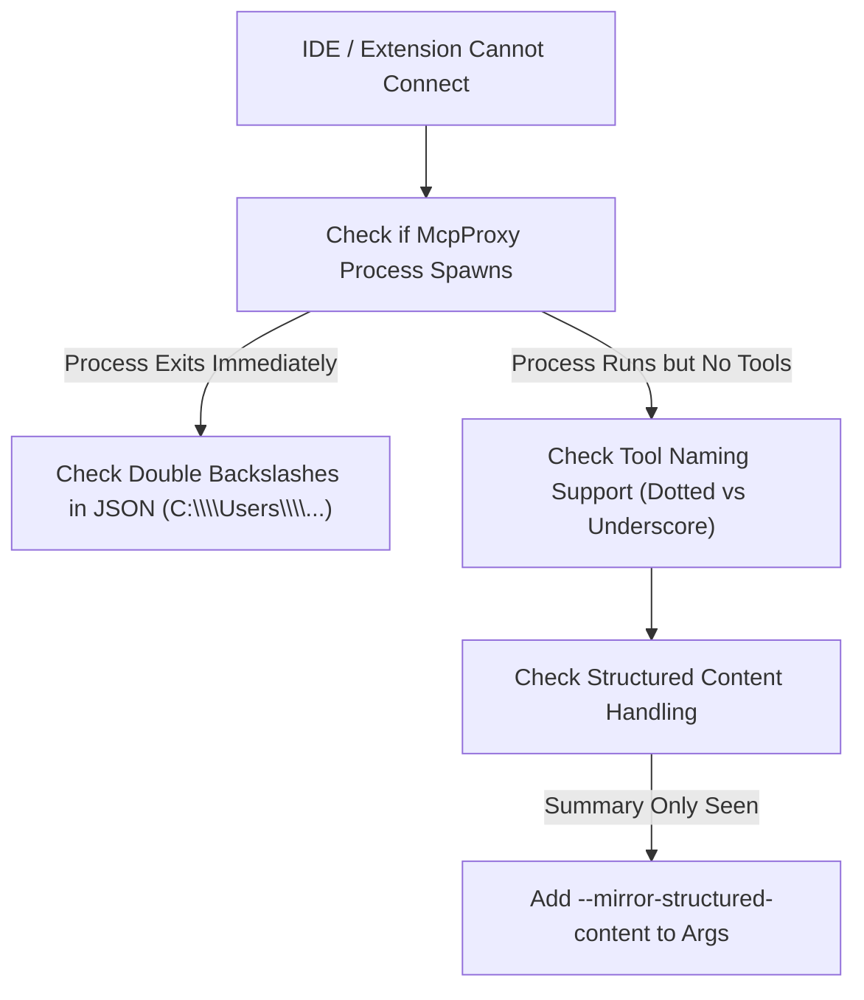

# VS Code, Cursor & Windsurf Troubleshooting

> [!NOTE]
> This guide resolves connection problems, missing tool palettes, and communication errors when integrating Nova AI Workspace with **Cursor IDE**, **Windsurf**, or **Visual Studio Code** extensions (such as **Roo Code** or **Cline**). For initial setup instructions, see the [VS Code & Cursor Integration Guide](../integration/vscode-and-cursor.md).

---

## 1. Quick Diagnostic Checklist

When your IDE or coding extension cannot establish communication with Nova:



1. **Test the proxy executable:** Open PowerShell and verify that `NovaBrowser.McpProxy.exe` executes cleanly:
   ```powershell
   & "$env:LOCALAPPDATA\nova-cognitive\Nova\bin\NovaBrowser.McpProxy.exe" --self-test
   ```
   Installations from version 1.0.0-alpha.17 or older use `%LOCALAPPDATA%\NovaBrowser` instead of `%LOCALAPPDATA%\nova-cognitive\Nova`; see [Diagnostics](diagnostics.md#1-local-filesystem-locations).
2. **Verify Nova is running:** Ensure Nova AI Workspace is open on your desktop and the health check responds:
   ```powershell
   Invoke-RestMethod http://127.0.0.1:27183/health
   ```
3. **Restart the IDE / Reload Window:** IDE extensions load MCP servers into persistent language-server worker processes. Press `Ctrl+Shift+P` and execute **Developer: Reload Window** to force the extension to re-initialize its MCP client.

---

## 2. Common Symptoms & Root Causes

### Symptom A: Extension Reports "Failed to Spawn Process" or "ENOENT"

#### Cause: Windows Path Formatting in IDE Settings
Most VS Code extensions (including Roo Code and Cline) and Cursor configure MCP servers through a JSON configuration file. In JSON, every Windows backslash must be written as `\\`.

* **Incorrect:**
  ```json
  {
    "command": "C:\Users\Username\AppData\Local\nova-cognitive\Nova\bin\NovaBrowser.McpProxy.exe"
  }
  ```
* **Correct:**
  ```json
  {
    "command": "C:\\Users\\Username\\AppData\\Local\\nova-cognitive\\Nova\\bin\\NovaBrowser.McpProxy.exe"
  }
  ```

---

### Symptom B: Tools Discovered but Extension Rejects Dotted Names

#### Cause: Strict Identifier Validation in Specific Extensions
Standard MCP tool names in Nova use dotted hierarchical notation (e.g. `nova.tabs`, `nova.perceive`, `nova.click_selector`). Some IDE plugins enforce regex patterns requiring tool identifiers to consist strictly of alphanumeric characters and underscores `[a-zA-Z0-9_]+`.

#### Resolution: Enable Underscore Tool Naming
Add the `--antigravity-tool-names` compatibility flag to your configuration. In this mode, Nova's bridge translates dotted names into underscores (e.g. `nova_tabs`, `nova_perceive`) and automatically mirrors structured output:

```json
{
  "mcpServers": {
    "nova": {
      "command": "C:\\Users\\<YourUsername>\\AppData\\Local\\nova-cognitive\\Nova\\bin\\NovaBrowser.McpProxy.exe",
      "args": ["--antigravity-tool-names"]
    }
  }
}
```

---

### Symptom C: The Model Sees Only "Use structuredContent" Summaries

#### Cause: IDE Client Text-Only Context Injection
Certain IDE extensions pass only the plain text message block to the language model, ignoring structured JSON metadata. When the agent calls a tool that returns structured data, it sees only a brief summary indicating that structured data was returned.

#### Resolution: Add Structured Content Mirroring
If your extension supports dotted names but drops structured JSON payloads, add `--mirror-structured-content`:

```json
{
  "mcpServers": {
    "nova": {
      "command": "C:\\Users\\<YourUsername>\\AppData\\Local\\nova-cognitive\\Nova\\bin\\NovaBrowser.McpProxy.exe",
      "args": ["--mirror-structured-content"]
    }
  }
}
```

---

## 3. Verified Configuration Templates

### Cursor IDE (`cursor_mcp.json` or Settings > MCP)
```json
{
  "mcpServers": {
    "nova": {
      "command": "C:\\Users\\<YourUsername>\\AppData\\Local\\nova-cognitive\\Nova\\bin\\NovaBrowser.McpProxy.exe",
      "args": ["--mirror-structured-content"]
    }
  }
}
```

### VS Code (Roo Code / Cline `mcp_settings.json`)
```json
{
  "mcpServers": {
    "nova": {
      "command": "C:\\Users\\<YourUsername>\\AppData\\Local\\nova-cognitive\\Nova\\bin\\NovaBrowser.McpProxy.exe",
      "args": ["--mirror-structured-content"]
    }
  }
}
```

*(Remember to replace `<YourUsername>` with your active Windows user profile folder name).*

---

## 4. Reading Extension Diagnostic Logs

* **VS Code Output Pane:** Open **View → Output** and select the extension's channel from the dropdown (e.g. *Roo Code*, *Cline*, or *MCP*). Look for child process exit codes or stderr output from `NovaBrowser.McpProxy.exe`.
* **Nova Proxy Log:** Check `%LOCALAPPDATA%\nova-cognitive\Nova\Logs\novabrowser-mcp-stdio-proxy.log` for bridge connection traces.

---

## 5. Related Troubleshooting

* **[Agent & MCP Connection Issues](agent-connection-issues.md)** — General connection diagnostic steps.
* **[Agent Behavior Troubleshooting](agent-behavior.md)** — Diagnosing tool failures and missing result data.
* **[VS Code & Cursor Integration Guide](../integration/vscode-and-cursor.md)** — Setup walkthrough for modern IDEs.
* **[Troubleshooting Hub](README.md)** — Main diagnostic sitemap.
