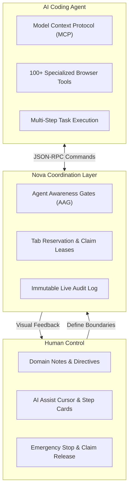

# Collaborating with AI Agents

Nova AI Workspace is built specifically for daily collaboration with local AI coding agents—including Claude Code, OpenAI Codex, Google Antigravity, and custom agent frameworks. Rather than treating browser automation as an invisible background process or a detached headless runner, Nova enables agents to interact directly with your actual desktop tabs while giving you continuous visual transparency, granular permission gates, and instantaneous manual control.

---

## Agent Collaboration Guides

| Guide | Focus Area | Key Topics |
| :--- | :--- | :--- |
| **[Connecting an Agent](connecting-an-agent.md)** | Connection Setup | Easy Setup Wizard, supported AI clients (Claude, Codex, Antigravity), stdio proxy bridge, local bearer tokens, and network access policies. |
| **[Watching Agent Work](watching-agent-work.md)** | Real-Time Observation | AI assist cursor, pulse and lock indicators, floating step cards (Timeline HUD), reduced motion preferences, and tab activity badges. |
| **[Taking Over & Emergency Stop](taking-over-and-emergency-stop.md)** | Human Intervention | Tab-level claim release vs. global emergency stop (`Ctrl+Alt+Escape`), process freeze, co-browsing etiquette, and audit log inspection. |
| **[Domain Notes](domain-notes.md)** | Site-Specific Instructions | User directives, delivery strength (`Hint`, `Warn`, `MUST read`), per-origin scoping, sandbox isolation, and repeat re-acknowledgement timers. |
| **[Project Onboarding](project-onboarding.md)** | Repository Integration | Seeding agent reference notes into code projects (`AGENTS.md`), teaching tool conventions, and verifying agent awareness. |

---

## Core Collaboration Principles

1. **Human-in-the-Loop Transparency:** You are never locked out of your browser. While an agent is working, Nova displays an animated assist cursor showing its targeted elements, along with floating step cards summarizing its current thoughts and pending actions.
2. **Explicit Claim Boundaries:** When an agent acts on a tab, it leases a temporary "claim". Other tabs in your workspace remain completely unaffected, and you can reclaim the tab at any moment.
3. **Fail-Safe Emergency Controls:** A single global action—**Menu → Emergency stop**—instantly terminates all agent tool executions, halts background crawlers, freezes active scripts, and interrupts terminal processes.
4. **Contextual Awareness:** Through [Domain Notes](domain-notes.md), you can leave persistent instructions on any web portal (e.g. *“Never click Delete without asking”*) that agents must technically acknowledge before taking action.

---

## Related Documentation

* **[Your First Five Minutes](../../getting-started/quickstart.md)** — Quickstart guide to running your first agent research task.
* **[Agent Awareness Gates (AAG)](../../core-features/agent-awareness-gates-aag/README.md)** — In-depth architectural specification of Nova's safety gates.
* **[MCP Tool Catalog](../../mcp-reference/tool-catalog.md)** — Complete inventory of all available tools exposed to agents.
* **[All User Guides](../README.md)** — Overview of all desktop and browser user guides.

---

[All user guides](../README.md)
