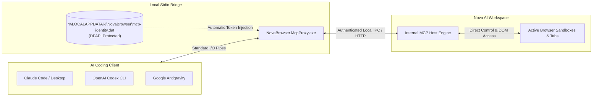

# Connecting an AI Agent

> [!NOTE]
> Open **Menu → Settings → Set up** to launch Nova's connection wizard, or navigate to **Settings → AI & agents → Connection & setup** to manage your local agent bridges and connection credentials.

---

## 1. Overview & Architecture

Nova AI Workspace exposes its browser tabs, navigation engine, and web inspection tools to local AI coding agents using the **Model Context Protocol (MCP)**, an open JSON-RPC 2.0 standard for AI tooling.

Instead of requiring fragile browser extensions, Selenium drivers, or cloud-hosted headless browsers, Nova runs a high-performance local server that your coding agents interact with directly on your Windows desktop:



* **Zero Token Juggling:** The local bridge (`NovaBrowser.McpProxy.exe`) automatically locates your running Nova instance and attaches the session bearer token. You do not need to manually copy and paste API keys into client configurations.
* **Process Autostart:** When you launch a prompt in your connected AI client, the bridge automatically launches Nova if it is not already running.
* **Sandbox Privacy:** Agents operate within the sandbox profile specified by their tool commands, preserving account separation between your personal and work profiles.

---

## 2. The Easy Setup Wizard

For most users, the integrated setup wizard provides a one-click connection experience:

1. Click **Menu** (or press `Alt+F`) and select **Settings → Set up**.
2. If prompted, confirm **Enable AI Access**.
3. Choose **Easy setup (recommended)**.
4. **Detected AI Programs:** Nova automatically inspects your Windows user profile for installed agent environments:
   * **Claude Code (CLI)** (`~/.claude.json`)
   * **Claude Desktop** (`%APPDATA%\Claude\claude_desktop_config.json`)
   * **OpenAI Codex CLI** (`~/.codex/config.toml`)
   * **Google Antigravity** (`~/.gemini/antigravity-cli/mcp/`)
5. Click **Connect** next to the desired program. Nova safely merges its MCP configuration into the client's configuration file without overwriting other tools.
6. **Restart Your AI Client:** AI programs read their MCP configurations during process initialization. Close and restart your terminal session or quit Claude Desktop from the Windows notification area for the new connection to take effect.

---

## 3. Supported AI Clients

Nova supports all major local agent ecosystems:

### Claude Code CLI & Claude Desktop
* **Configuration Target:** Nova writes an entry named `nova` pointing to `NovaBrowser.McpProxy.exe`.
* **Restart Requirement:** Exit Claude Code or fully quit Claude Desktop (via the tray icon in the taskbar) and relaunch.
* **More Details:** See the [Claude Code Integration Guide](../../integration/claude-code.md) and [Claude Desktop Integration Guide](../../integration/claude-desktop.md).

### OpenAI Codex CLI
* **Configuration Target:** Registered under `[mcp_servers.nova]` in your user configuration.
* **More Details:** See the [OpenAI Codex Integration Guide](../../integration/openai-codex.md).

### Google Antigravity
* **Configuration Target:** Installed into your global Antigravity configuration directory with pre-registered tool schemas.
* **More Details:** See the [Google Antigravity Integration Guide](../../integration/google-antigravity.md).

### Custom Scripts & Other MCP Clients
For custom Python scripts, TypeScript frameworks, or emerging tools supporting MCP, you can register `NovaBrowser.McpProxy.exe` as a standard stdio command:

```json
{
  "mcpServers": {
    "nova": {
      "command": "C:\\Users\\<YourUsername>\\AppData\\Local\\NovaBrowser\\tools\\NovaBrowser.McpProxy.exe",
      "args": []
    }
  }
}
```

For advanced network topologies, see [Custom Agents](../../integration/custom-agents.md) and [Protocol & Transport](../../mcp-reference/protocol-and-transport.md).

---

## 4. Security Tokens & Network Isolation

Nova is designed with a defense-in-depth security model to ensure that only authorized local programs can control your browser:

* **Local DPAPI Encryption:** The authentication bearer token is encrypted at rest using Windows Data Protection API (DPAPI) and stored in `%LOCALAPPDATA%\NovaBrowser\mcp-identity.dat`. Only processes running under your Windows user account can decrypt it.
* **Token Rotation:** If you ever suspect that an unauthorized script obtained access, open **Settings → AI & agents → Connection & setup → Security token** and click **Regenerate token**. This immediately invalidates all active sessions.
* **Network Isolation by Default:** By default, Nova's MCP server listens strictly on local loopback (`127.0.0.1`). External devices on your local network cannot connect to Nova.
* **Remote Access Opt-In:** If you need to control Nova from a development container or a second computer, you must explicitly enable **Allow access from other devices on the network** in settings and establish a dedicated bearer secret.

---

## 5. Client Approvals vs. Nova Internal Gates

A frequent source of confusion is the distinction between approvals requested by your AI client and gates enforced by Nova:

| Layer | Who Manages It? | Where Is It Configured? | Purpose |
|---|---|---|---|
| **Client Safety Prompts** | Your AI client (Claude, Codex, etc.) | Client settings (e.g., `--dangerously-skip-permissions` in Claude Code) | Protects against the agent running unauthorized CLI commands or tool calls. |
| **Nova Autonomy Gates** | Nova AI Workspace | **Settings → AI & agents → Access & rules** | Dictates whether Nova's internal engine executes browser actions automatically, asks for clicks, or requires supervision. |

> [!IMPORTANT]
> Changing Nova's autonomy level to **Fully automatic** configures Nova to execute incoming tool calls without internal browser prompts. However, **your AI program may still prompt you** in its terminal or chat interface before sending the call. Connecting Nova never weakens or bypasses your AI client's native safety settings.

---

## 6. Verifying Your Connection

Once connected and restarted, verify that your agent can interact with Nova:

1. Open Nova and ensure at least one tab is open.
2. In your AI client, enter a test prompt:
   > *"Use Nova to open https://en.wikipedia.org and summarize the introductory paragraph."*
3. Watch Nova:
   * The tab displays an animated **AI** cursor navigating to the page.
   * The tab header displays an **Agent active** badge.
   * The agent receives the rendered page content and responds in your chat.

If your client reports that tools are missing or cannot locate the proxy, consult the [Agent Connection Troubleshooting Guide](../../troubleshooting/agent-connection-issues.md).

---

[Back to agents](README.md) · [Watching agent work](watching-agent-work.md) · [Taking over and emergency stop](taking-over-and-emergency-stop.md) · [Connection troubleshooting](../../troubleshooting/agent-connection-issues.md) · [All user guides](../README.md)
