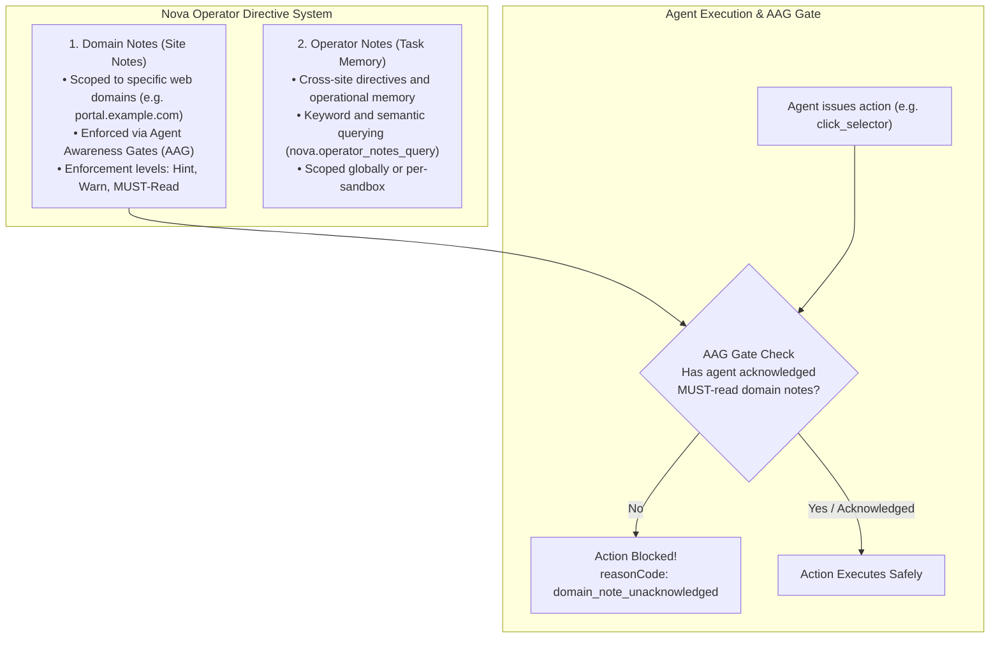

# Domain Notes & Operator Directives

> [!NOTE]
> Domain Notes (referred to as **Site notes** in Nova's desktop UI) allow human operators to attach persistent, site-scoped instructions, constraints, and business rules to specific web domains. Nova's **Agent Awareness Gates (AAG)** enforce these rules across all connected AI agents, preventing unauthorized actions and ensuring adherence to portal-specific protocols.

---

## 1. Overview & Behavioral Guardrails

When AI agents navigate enterprise portals, CRM dashboards, or shopping platforms, they require domain-specific context: *“Never click Delete on customer records,”* *“Always select the EU billing entity,”* or *“Ask before placing any order exceeding $100.”*

Instead of repeatedly prompting the agent in chat, Nova provides a dual-layer directive system:



---

## 2. Managing Site Notes in the Desktop Interface

You can inspect and create Domain Notes directly from the browser window:

1. **Open Site Info:** Click the lock or site badge icon beside the address bar on the target website.
2. **Add Note:** Under **Notes for [domain]**, click **Show**, then **+ Add note**.
3. **Configure the Directive:**
   * **Title & Description:** Enter a short title and explicit instructions (e.g., *“Read before submitting forms”*).
   * **Enforcement Level:** Choose how strictly the note must be enforced:
     * **Hint only:** Exposed to the agent as background context during page inspection.
     * **Warn the agent:** Injects a prominent warning banner into subsequent tool results on this origin.
     * **MUST read (AAG Gate):** Hard gate. Blocks all write actions (clicks, typing, navigation) on the origin until the agent explicitly acknowledges the note via MCP.
   * **Sandbox Scope:** Select **For all sandboxes** or restrict the directive to a specific profile (**Only for [sandbox]**).
4. **Global Management:** Review and edit notes across all domains in **Settings → AI & agents → Access & rules → Site notes**.

---

## 3. Enforcement Levels & Agent Awareness Gates (AAG)

| Level | AAG Gate Behavior | Agent Workflow |
| :--- | :--- | :--- |
| **`hint`** | Non-blocking | Provided in inspection summaries. The agent incorporates advice autonomously. |
| **`warn`** | Non-blocking with telemetry | Injects warnings into tool returns, alerting the agent to potential edge cases. |
| **`must_read`** | **Strictly blocking** | Nova blocks all state-modifying actions on the domain until the agent calls [`nova.domain_note_ack`](../../mcp-reference/tools/task-memory/nova-domain-note-ack.md). |

### 3.1 Re-Acknowledgement Intervals
To prevent agents in long-running loops from losing track of critical constraints, you can configure automatic re-acknowledgement rules:
* **`repeatMinutes`:** Requires re-acknowledgement after a specified duration of elapsed work.
* **`repeatToolCalls`:** Requires re-acknowledgement after a set number of tool executions.
* **Tab Resets:** Closing a tab or opening a new session resets acknowledgment state, ensuring fresh alignment.

---

## 4. Programmatic Domain Note Management over MCP

Connected AI agents can inspect, store, and acknowledge Domain Notes through Nova's task memory tools:

### 4.1 Acknowledging MUST-Read Directives ([`nova.domain_note_ack`](../../mcp-reference/tools/task-memory/nova-domain-note-ack.md))

When an agent encounters a blocked action with `domain_note_unacknowledged`, it must read the directive and record technical acknowledgement:

```json
{
  "name": "nova.domain_note_ack",
  "arguments": {
    "domain": "portal.example.com",
    "key": "pre-submit-check",
    "targetId": "tab-101"
  }
}
```

Once acknowledged, Nova's Agent Awareness Gate immediately lifts the execution barrier for that tab.

### 4.2 Querying & Storing Domain Notes

* **List Domain Notes ([`nova.domain_notes_list`](../../mcp-reference/tools/task-memory/nova-domain-notes-list.md)):** Inspect all directives attached to the current domain or sandbox:
  ```json
  {
    "domain": "portal.example.com",
    "scope": "sandbox"
  }
  ```
* **Create or Update Note ([`nova.domain_note`](../../mcp-reference/tools/task-memory/nova-domain-note.md)):** Record a site-specific discovery or observation:
  ```json
  {
    "domain": "portal.example.com",
    "key": "table-pagination-quirk",
    "value": "Pagination buttons require 500ms settlement before clicking next page.",
    "enforcement": "hint"
  }
  ```
* **Delete Note ([`nova.domain_note_delete`](../../mcp-reference/tools/task-memory/nova-domain-note-delete.md)):** Remove outdated or resolved directives.

---

## 5. Cross-Task Operator Notes Suite

While Domain Notes attach to specific web domains, **Operator Notes** store general operational guidance, project constraints, and operator preferences across all browser sessions:

* **Store Operator Directive ([`nova.operator_notes_store`](../../mcp-reference/tools/task-memory/nova-operator-notes-store.md)):** Save persistent task directives with searchable tags and categories:
  ```json
  {
    "content": "Prefer European date formats (DD.MM.YYYY) across all data exports.",
    "tags": ["formatting", "locale", "export"],
    "category": "preferences"
  }
  ```
* **Semantic Querying ([`nova.operator_notes_query`](../../mcp-reference/tools/task-memory/nova-operator-notes-query.md)):** Search relevant operator guidelines by keyword or similarity score:
  ```json
  {
    "keywords": "date format export",
    "limit": 5
  }
  ```
* **Listing & Deletion ([`nova.operator_notes_list`](../../mcp-reference/tools/task-memory/nova-operator-notes-list.md), [`nova.operator_notes_delete`](../../mcp-reference/tools/task-memory/nova-operator-notes-delete.md)):** Manage and retire completed operator guidelines.

---

## 6. Human Authority & Security Invariants

* **Human Authorship Protection:** Directives entered by human operators in Nova's UI are marked `from you`. Connected agents cannot overwrite or delete human directives without explicit operator authorization.
* **Separation of Notes and Permissions:** A Domain Note is operational guidance, not an authorization waiver. High-hazard actions (such as downloading executables or scanning public subnets) still require interactive human confirmation.

---

## 7. Summary Tool Matrix

| Tool | Capability | Primary Use Case |
| :--- | :--- | :--- |
| [`nova.domain_note`](../../mcp-reference/tools/task-memory/nova-domain-note.md) | Store/update domain note | Attach site-specific rules with enforcement levels (`hint`, `warn`, `must_read`). |
| [`nova.domain_notes_list`](../../mcp-reference/tools/task-memory/nova-domain-notes-list.md) | List notes for domain | Audit all applicable instructions for a target origin and sandbox. |
| [`nova.domain_note_ack`](../../mcp-reference/tools/task-memory/nova-domain-note-ack.md) | Acknowledge MUST-read note | Clear AAG gate blocks to proceed with browser actions. |
| [`nova.domain_note_delete`](../../mcp-reference/tools/task-memory/nova-domain-note-delete.md) | Delete domain note | Remove obsolete site rules or completed instructions. |
| [`nova.operator_notes_store`](../../mcp-reference/tools/task-memory/nova-operator-notes-store.md) | Store operator directive | Save cross-site project constraints, tags, and preferences. |
| [`nova.operator_notes_query`](../../mcp-reference/tools/task-memory/nova-operator-notes-query.md) | Query operator directives | Retrieve matching task instructions via semantic keywords. |
| [`nova.operator_notes_list`](../../mcp-reference/tools/task-memory/nova-operator-notes-list.md) | List operator directives | Review stored operator memory across sandboxes. |
| [`nova.operator_notes_delete`](../../mcp-reference/tools/task-memory/nova-operator-notes-delete.md) | Delete operator directive | Retire obsolete operational guidelines. |

---

## 8. Related Documentation

* **[Agent Awareness Gates (AAG) Architecture](../../core-features/agent-awareness-gates-aag/README.md)** — Architectural enforcement mechanisms for domain notes and directives.
* **[Project Onboarding Guide](project-onboarding.md)** — Seeding persistent project contexts for agent sessions.
* **[Emergency Stop & Taking Control](taking-over-and-emergency-stop.md)** — Pausing agent execution and freezing actions.
* **[Website & Agent Permissions](../identity-and-security/permissions.md)** — Site permissions and security boundaries.

---

[Back to Agents Hub](README.md) · [All user guides](../README.md)
