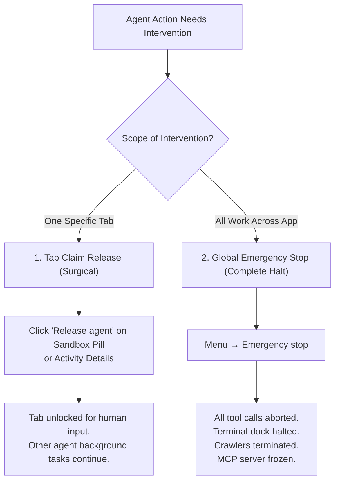

# Taking Over & Emergency Stop

> [!NOTE]
> Nova AI Workspace provides multi-tiered intervention controls: surgical tab-level claim release for smooth co-browsing, and an instant global emergency stop that halts all active agent operations immediately.

---

## 1. Overview & Intervention Levels

When collaborating with an autonomous AI coding agent, maintaining absolute control over your environment is paramount. Nova provides two complementary intervention levels depending on the urgency and scope of the situation:

1. **Tab-Level Takeover (Co-Browsing):** Release an agent's claim on an individual tab so you can type, scroll, or fill out a sensitive form yourself, while allowing background tasks or research routines on other tabs to proceed uninterrupted.
2. **Global Emergency Stop:** Instantly and completely halt all agent activities, abort running scripts, interrupt terminal dock commands, and freeze Nova's MCP server.

---

## 2. Tab Claims & Co-Browsing

When an AI agent interacts with a webpage—such as clicking buttons, selecting dropdown options, or filling out text inputs—it acquires a temporary **tab claim lease**:

* **Visual Activity Indicator:** The claimed tab's header and sandbox pill in the title bar display an animated **Agent active** badge.
* **Claim Interaction Protection:** By default, Nova temporarily protects claimed tabs from accidental human mouse clicks and keystrokes. This prevents your natural typing from accidentally corrupting a multi-step form submission.
* **Natural Co-Browsing:** When you navigate to other tabs or use standard browser hotkeys (`Ctrl+T`, `Ctrl+W`, `Ctrl+Tab`), the AI assist cursor steps aside automatically.

### How to Reclaim an Individual Tab
If you want to take over manual control of a tab without aborting the agent's entire session:
1. Look at the tab strip or the window title bar.
2. Click the **Release agent** button located on the tab's sandbox pill, or open the toolbar activity indicator and click **Release agent**. Clicking into the protected tab also works: Nova asks **Take over control?**, and **Take over** gives you the tab even while the agent is mid-step.
3. If prompted with **Take over control?**, confirm your choice.
4. The agent is immediately notified that its lease was revoked and cannot interact with the tab until you permit it. All other tabs remain active.

---

## 3. Staying in Control

When an agent enters an infinite loop, navigates to an unintended domain, attempts an unwanted action, or when you need everything to stop immediately, use the **Global Emergency Stop**:

### Triggering the Emergency Stop
* Click **Menu** (or press `Alt+F`) and select **Emergency stop**.
* Alternatively, click the dedicated **Emergency stop** action in the activity bar flyout.

### What Happens Instantly
1. **Tool Requests Aborted:** Every pending and active MCP tool call immediately fails with an emergency stop cancellation error returned to the AI client.
2. **Background Processes Killed:** Running web crawlers, surface explorers, and background tasks are terminated on the spot.
3. **Terminal Dock Interrupted:** All active sessions within Nova's integrated terminal dock—including agent runners and your own command-line prompts—receive an immediate interrupt signal (`SIGINT`/`Ctrl+C`).
4. **Tab Leases Revoked:** All claimed tabs are released instantly and restored to full manual control.
5. **Persistent Notice Banner:** Nova displays a persistent yellow status banner across the workspace:
   > *Emergency stop active. Agents, the agent interface (MCP), and running scripts were interrupted.*

---

## 4. Releasing the Emergency Stop

While the emergency stop remains engaged, Nova's internal MCP engine rejects all incoming commands from Claude Code, Codex, or Antigravity with a `403 Forbidden / Stopped` status code.

To resume normal operations after you have reviewed your workspace:
1. Click **Menu** and select **Release emergency stop** (or click **Release** directly on the notification banner).
2. Nova confirms that the agent interface is active once again.
3. Your connected AI client can now be given new instructions.

---

## 5. Post-Intervention Audit & Verification

After an emergency stop or manual tab takeover, you can easily inspect what the agent accomplished prior to being halted:

* **Live Audit Log:** Navigate to **Settings → AI & agents → Confirmations & audit → Live audit log** to see an immutable chronological list of every tool call dispatched, timestamped to the millisecond.
* **Session Recovery:** If tabs were unexpectedly closed or altered during an agent sequence, you can restore your session through **History → Restore previous session**. See [Sandbox & Session Recovery](../../troubleshooting/sandbox-and-session-recovery.md) for detailed recovery workflows.

---

[Back to agents](README.md) · [Watching agent work](watching-agent-work.md) · [Connecting an agent](connecting-an-agent.md) · [Emergency stop step-by-step](../../getting-started/emergency-stop.md) · [All user guides](../README.md)
