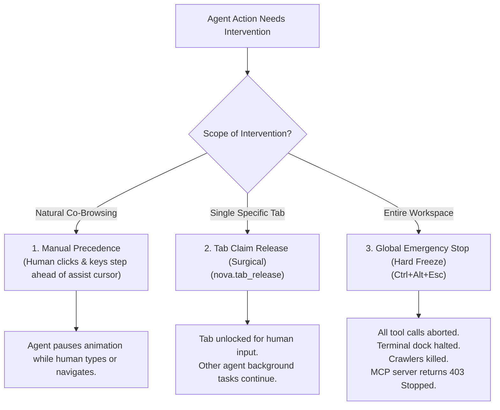

# Taking Over, Co-Browsing & Emergency Stop

> [!NOTE]
> Nova AI Workspace provides multi-tiered intervention controls: surgical tab-level claim release for smooth co-browsing, and an instant global emergency stop (<kbd>Ctrl</kbd>+<kbd>Alt</kbd>+<kbd>Esc</kbd>) that immediately halts all active agent operations across the entire workspace.

---

## 1. Overview & Multi-Tier Intervention Model

When collaborating with an autonomous AI coding agent, maintaining absolute control over your environment is paramount. Nova provides three complementary intervention levels depending on the urgency and scope of the situation:



1. **Manual Input Precedence:** Standard mouse clicks, scrolling, and keyboard shortcuts take immediate precedence over agent cursor animations.
2. **Tab-Level Takeover (Co-Browsing):** Release an agent's claim on an individual tab so you can type, complete an MFA challenge, or fill out a sensitive form yourself, while allowing background tasks or research routines on other tabs to proceed uninterrupted.
3. **Global Emergency Stop (<kbd>Ctrl</kbd>+<kbd>Alt</kbd>+<kbd>Esc</kbd>):** Instantly and completely halt all agent activities, abort running scripts, interrupt terminal dock commands, and freeze Nova's MCP server.

---

## 2. Tab Claims & Co-Browsing Etiquette

When an AI agent interacts with a webpage—such as clicking buttons, selecting dropdown options, or filling out text inputs—it acquires an exclusive **tab claim lease**:

### 2.1 The Claim Lifecycle ([`nova.tab_claim`](../../mcp-reference/tools/browser-automation/nova-tab-claim.md))
* **Visual Activity Indicator:** The claimed tab's header and sandbox pill in the title bar display an animated **Agent active** badge with a pulsing visual reticle.
* **Lease Expiration (`ttlMs`):** Every claim has a bounded Time-To-Live (default 30,000 ms). If an agent crashes or loses network connectivity, the lease automatically expires and unlocks the tab.
* **Accidental Input Guard:** By default, Nova temporarily protects claimed tabs from accidental human mouse clicks and keystrokes while an agent is mid-step, preventing accidental form submission corruption.

### 2.2 Taking Over Control Manually
If you want to take over manual control of a tab without aborting the agent's entire session:
1. Look at the tab strip or the window title bar.
2. Click the **Release agent** button located on the tab's sandbox pill, or open the toolbar activity indicator and click **Release agent**.
3. **Direct Click Takeover:** Clicking directly into the active viewport prompts: **Take over control?** Clicking **Take over** revokes the agent's lease immediately, even mid-step.
4. The agent's claim ends and any action it had running there is cancelled; its next tool call is stopped once with a `tab_taken_over` notice telling it not to continue in that tab without asking.

### 2.3 Programmatic Release ([`nova.tab_release`](../../mcp-reference/tools/browser-automation/nova-tab-release.md))
Agents release claims cleanly when their subtask completes:

```json
{
  "name": "nova.tab_release",
  "arguments": {
    "targetId": "tab-101",
    "finalizeDecision": "keep"
  }
}
```

---

## 3. Global Emergency Stop (<kbd>Ctrl</kbd>+<kbd>Alt</kbd>+<kbd>Esc</kbd>)

When an agent enters an unexpected loop, navigates to an unintended domain, attempts an unwanted transaction, or when you need everything to freeze immediately, use the **Global Emergency Stop**:

### 3.1 Triggering the Emergency Stop
* **Global Hotkey:** Press <kbd>Ctrl</kbd>+<kbd>Alt</kbd>+<kbd>Esc</kbd> from any application on your machine.
* **Menu Action:** Click **Menu** (or press `Alt+F`) and select **Emergency stop**.
* **Activity Indicator:** Click the **Emergency stop** action inside the main toolbar activity flyout.
* **Windows System Tray:** Right-click the Nova tray icon and choose **Emergency stop**.

### 3.2 What Happens Instantly
1. **MCP Tool Requests Aborted:** Every in-flight and queued MCP tool call immediately fails with a cancellation error returned to the AI client.
2. **Background Processes Killed:** Active surface exploration crawlers, background tasks, and media transcribers are terminated on the spot.
3. **Terminal Dock Interrupted:** All running processes inside Nova's integrated ConPTY terminal dock—including dev servers and build scripts—receive an immediate interrupt signal (`SIGINT` / `Ctrl+C`).
4. **Tab Leases Revoked:** All claimed tabs are released instantly and restored to human manual control.
5. **Persistent Notice Banner:** Nova displays a prominent warning banner across the window chrome:
   > *Emergency stop active. Agents, the agent interface (MCP), and running scripts were interrupted.*

---

## 4. Releasing the Emergency Stop

While the emergency stop remains engaged, Nova's internal MCP engine rejects all incoming commands from Claude Code, Codex, or Antigravity with a `403 Forbidden / Stopped` status code, preventing the model from re-initiating unwanted actions.

To resume normal operations after you have reviewed your workspace:
1. Click **Menu** and select **Release emergency stop** (or click **Release** directly on the notification banner).
2. Nova confirms that the agent interface is active once again.
3. Your connected AI client can now be given new instructions.

---

## 5. Post-Intervention Audit & Verification

After an emergency stop or manual tab takeover, you can easily inspect what the agent accomplished prior to being halted:

* **Live Audit Log:** Navigate to **Settings → AI & agents → Confirmations & audit → Live audit log** to see an immutable chronological list of every tool call dispatched, timestamped to the millisecond.
* **Session Recovery:** If tabs were unexpectedly closed or altered during an agent sequence, you can restore your session through **History → Restore previous session**. See [Sandbox & Session Recovery](../../troubleshooting/sandbox-and-session-recovery.md) for detailed recovery workflows.

---

## 6. Summary Tool Matrix

| Tool | Capability | Primary Use Case |
| :--- | :--- | :--- |
| [`nova.tab_claim`](../../mcp-reference/tools/browser-automation/nova-tab-claim.md) | Acquire tab lease | Lock tab for automated interaction with bounded TTL. |
| [`nova.tab_release`](../../mcp-reference/tools/browser-automation/nova-tab-release.md) | Release tab lease | Relinquish automation claim and restore tab to manual mode. |

---

## 7. Related Documentation

* **[Agent Awareness Gates (AAG) Architecture](../../core-features/agent-awareness-gates-aag/README.md)** — Architectural enforcement mechanisms for domain notes and directives.
* **[Watching Agent Work Guide](watching-agent-work.md)** — Understanding the AI assist cursor, HUD overlays, and step cards.
* **[Connecting an Agent Guide](connecting-an-agent.md)** — Setup instructions for Claude Code, Codex, and Antigravity.
* **[Keyboard Shortcuts Reference](../browser/keyboard-shortcuts.md)** — Hotkey index including emergency stops.

---

[Back to Agents Hub](README.md) · [All user guides](../README.md)
