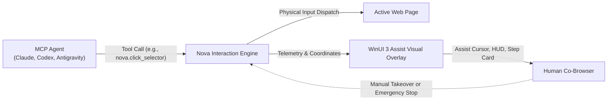

# AI Visualization & Live Observation

> [!NOTE]
> Unlike traditional headless browser automation where agents act silently and invisibly in the background, Nova AI Workspace features a real-time **AI Visualization** layer. It projects an animated assist cursor, action captions, target locks, and step cards directly over the live browser viewport so you always see what an agent is doing as it happens.

---

## 1. High-Level Architecture: The Live Visual Feedback Loop

Nova's assist visualization acts as a transparent visual bridge between autonomous Model Context Protocol (MCP) tool calls and human supervision:



---

## 2. The AI Assist Cursor & Action Phases

When an agent interacts with a webpage, Nova displays an on-screen cursor badge marked **AI**. The cursor moves smoothly across the viewport, locks onto targeted DOM bounding boxes, and reflects the agent's internal progress through distinct action phases:

```
+-------------------------------------------------------------------+
|                                                                   |
|       +---------------------------------------------+             |
|       | [Search corporate directory...]             |             |
|       +---------------------------------------------+             |
|                     ^                                             |
|                     | [ AI ] Target locked                        |
|                     +-(O) (pulsing reticle)                       |
|                                                                   |
|   +-----------------------------------------------------------+   |
|   | Step 2/4: Type query "Financial report Q3"                |   |
|   | Next: Click Search button                                 |   |
|   +-----------------------------------------------------------+   |
+-------------------------------------------------------------------+
```

### The Seven Assist Action Phases

| Action Phase | Visual Feedback | HUD Caption | Next-Step Prediction |
| :--- | :--- | :--- | :--- |
| **`scan`** | Pulsing searching ring moving across layout | *Searching target...* | Lock target |
| **`lock_on`** | Snaps to element bounding box with animated reticle | *Target locked* | Perform action |
| **`act`** | Action ripple for clicks; blinking caret for typing; scroll indicator | *Performing action...* | Verify result |
| **`verify_ok`** | Expanding green confirmation ring | *Verified* | Complete step |
| **`verify_fail`** | Amber/red warning pulse | *Verification failed* | Complete step |
| **`recover`** | Repositioning sweep to adjacent layout boundaries | *Recovering...* | Rescan |
| **`step_done`** | Smooth fade-out of active reticle | *Done* | Prepare next step |

### Confidence Scoring & Tempo Modulation

Nova dynamically modulates the playback speed and visual duration of assist animations based on element confidence scores:
* **High-Confidence Steps:** Executed cleanly with brisk, fluid animations so automated workflows remain responsive.
* **Low-Confidence or Ambiguous Targets:** The assist cursor slows down and lingers over the target element, giving the human supervisor adequate time to intervene before a potentially erroneous click occurs.

---

## 3. The Assist Step Card & HUD

In addition to the cursor reticle, Nova can render an informative **Step Card** at the bottom of the viewport:

* **Step Index & Total:** Displays progress through multi-action sequences (*Step 2/5: Click "Checkout"*).
* **Intent & Action Description:** Summarizes the current operation in clear human terms (*Type query: "Annual 2026 report"*).
* **Next-Step Preview:** Predicts the agent's upcoming operation (*Next: Verify confirmation message*).
* **Intelligent Text Bounds:** Long labels and complex selectors are automatically truncated to prevent the HUD from obscuring critical form elements or navigation controls.

---

## 4. Window Chrome & System-Level Indicators

You do not need to look directly at the active page to know when an agent is working. Nova projects agent status across all browser chrome surfaces:

### 4.1 Tab Strip Markers
* **Active Glow:** Any browser tab currently executing agent commands displays an animated glow and a dedicated agent badge.
* **Informative Tooltips:** Hovering over the tab badge reveals the exact operational state:
  * *Agent active:* Tool call currently executing in the tab.
  * *Agent recently active:* Completed a tool call within the last few seconds.
  * *Agent reserved:* The agent holds an exclusive lease on the tab but is currently idle or deliberating.

### 4.2 Sandbox Pill Indicators
When an agent operates inside an isolated sandbox (e.g., Sandbox A or B), the sandbox pill in the title bar displays the active agent badge. Right-clicking the pill exposes the **Release agent** option.

### 4.3 The Activity Flyout
Clicking the agent icon in the top toolbar opens the **Activity Flyout**. It provides a comprehensive live overview:
* All tabs and sandboxes currently claimed by agents.
* The connected client identity (Claude Code, OpenAI Codex, Antigravity).
* Elapsed lease durations and active tool names.
* One-click **Release agent** buttons for surgical, tab-by-tab intervention.

### 4.4 Windows Taskbar & System Tray
* **Taskbar Overlay Badge:** Nova's taskbar icon displays a small activity badge while agents are running.
* **System Notification Area (Tray):** When Nova is minimized or configured to run in the background, hovering over its notification area icon displays: *Nova AI Workspace — an agent is working*.

---

## 5. Configuration & Accessibility Settings

Customize the AI visualization layer under **Settings → Appearance & performance → AI visualization** (or toggle it quickly via **Menu → View → AI visualization**):

* **Show assist cursor (AI):** Master toggle for the on-screen assist reticle and action captions (Enabled by default).
* **Assist cursor: reduced motion:** Respects Windows accessibility preferences. Disables continuous fluid cursor easing and snaps the reticle directly to element coordinates, eliminating motion fatigue.
* **Show optional step card:** Controls the visibility of the multi-step HUD card at the bottom of the viewport.

---

## 6. Seamless Co-Browsing & Emergency Stop

Nova is engineered for co-browsing, meaning human users always retain absolute authority:

1. **Direct Takeover:** While an agent holds a tab, Nova protects it against accidental clicks and keystrokes. Click into the tab and Nova asks **Take over control?** — choose **Take over** and the tab is yours. You can also click **Release agent** on the sandbox pill.
2. **Surgical Lease Release:** Click **Release agent** on any tab context menu or sandbox pill to revoke the agent's hold without interrupting other tasks.
3. **Global Emergency Stop:** Choose **Menu → Emergency stop** to instantly freeze all running agents, fade out all assist visual overlays, revoke tab claims, and pause terminal sessions. There is intentionally no keyboard shortcut to prevent accidental triggers during active browsing.

---

## Related Documentation

* **[Taking Over & Emergency Stop](taking-over-and-emergency-stop.md)** — Step-by-step procedures for live takeover and safety interrupts.
* **[Connecting an Agent](connecting-an-agent.md)** — Setting up MCP connections and configuring AI assistants.
* **[Appearance & Performance Settings](../settings/appearance.md)** — Visual customization and assist cursor settings.
* **[AI & Agents Settings](../settings/ai-and-agents.md)** — Autonomy levels and confirmation rules.

---

[Back to Agents](README.md) · [All user guides](../README.md)
