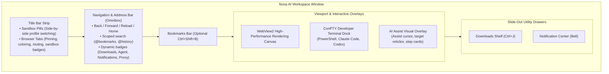

# Daily Browser Controls

> [!NOTE]
> Nova AI Workspace provides a high-performance Windows desktop browser built with native WinUI 3 chrome. Engineered for everyday research, multi-account workflow management, and seamless collaboration with AI coding agents, Nova combines familiar browsing ergonomics with developer-centric workspace utilities.

---

## 1. High-Level Architecture: The Browser Window Planes

Nova's interface integrates everyday navigation, profile sandboxing, integrated developer tooling, and AI agent supervision into a coherent visual layout:

---

## 2. Browser Guides & Operational Reference

Explore the complete suite of daily browser guides covering navigation, tab management, file downloads, history, notifications, and security:

| Guide | Primary Focus | Key Features & Capabilities |
| :--- | :--- | :--- |
| **[Workspace Layout & Chrome](tabs-and-windows.md)** | Anatomy & Windows | Full breakdown of WinUI 3 chrome, title-bar sandbox pills, tab management (pinning, coloring, muting), omnibox controls, ConPTY terminal dock integration, and system tray background execution. |
| **[Downloads Panel & Safety](downloads.md)** | File Retrieval & Security | The real-time downloads drawer (<kbd>Ctrl</kbd>+<kbd>J</kbd>), transfer state machine (*Active*, *Queued*, *Paused*, *Done*, *Failed*), executable safety barrier (*"Keep this file?"*), bulk controls, auto-open preferences, and MCP automation. |
| **[Favorites & Bookmarks](favorites.md)** | Saved Pages & NTP | Address bar star (<kbd>Ctrl</kbd>+<kbd>D</kbd>), bookmark bar (<kbd>Ctrl</kbd>+<kbd>Shift</kbd>+<kbd>B</kbd>), nested folders, New Tab Page speed dials, import/export, and `@bookmarks` scoped search. |
| **[Browsing History](history.md)** | Visited Pages & Cleanup | History tab (<kbd>Ctrl</kbd>+<kbd>H</kbd>) with search, sandbox filter and badges, recently closed tabs (<kbd>Ctrl</kbd>+<kbd>Shift</kbd>+<kbd>T</kbd>), `@history` address-bar search, and clearing by time range. |
| **[Desktop Notifications](notifications.md)** | Alerts & Inbox Center | Slide-out notification center, toolbar bell counter, origin permission gates, Windows toast notifications, and deep-link tab routing. |
| **[Private Browsing](private-browsing.md)** | Ephemeral Sessions | InPrivate browsing tabs (<kbd>Ctrl</kbd>+<kbd>Shift</kbd>+<kbd>N</kbd>), zero-disk footprint in ephemeral RAM, multi-sandbox isolation, strict tracking prevention, and in-memory permission decisions. |
| **[Keyboard Shortcuts](keyboard-shortcuts.md)** | Quick Navigation | Exhaustive reference of keyboard hotkeys for navigation, tab manipulation, omnibox operations, developer tools, and emergency interrupts. |

---

## 3. Developer & Co-Browsing Ergonomics

* **Seamless Side-by-Side Profiles:** Switch between corporate and personal identities using sandbox pills without signing out or juggling multiple browser windows.
* **Integrated Developer Shell:** Open the built-in terminal dock to compile code, start servers, or run AI CLI tools directly over the page being inspected.
* **Absolute Human Precedence:** Human inputs immediately take priority over AI commands. Press <kbd>Ctrl</kbd>+<kbd>Alt</kbd>+<kbd>Esc</kbd> at any time to trigger an instant workspace-wide Emergency Stop.

---

## Related Documentation

* **[User Guide Overview](../README.md)** — Master table of contents for all user features.
* **[Identity & Security](../identity-and-security/README.md)** — Passwords, sandboxes, origin permissions, and proxy tunnels.
* **[Agent Collaboration](../agents/README.md)** — Connecting, observing, and directing AI coding agents.
* **[Workspace Tools](../tools/README.md)** — Terminal dock, Whisper transcription, and background scheduled tasks.

---

[Back to User Guide](../README.md)
