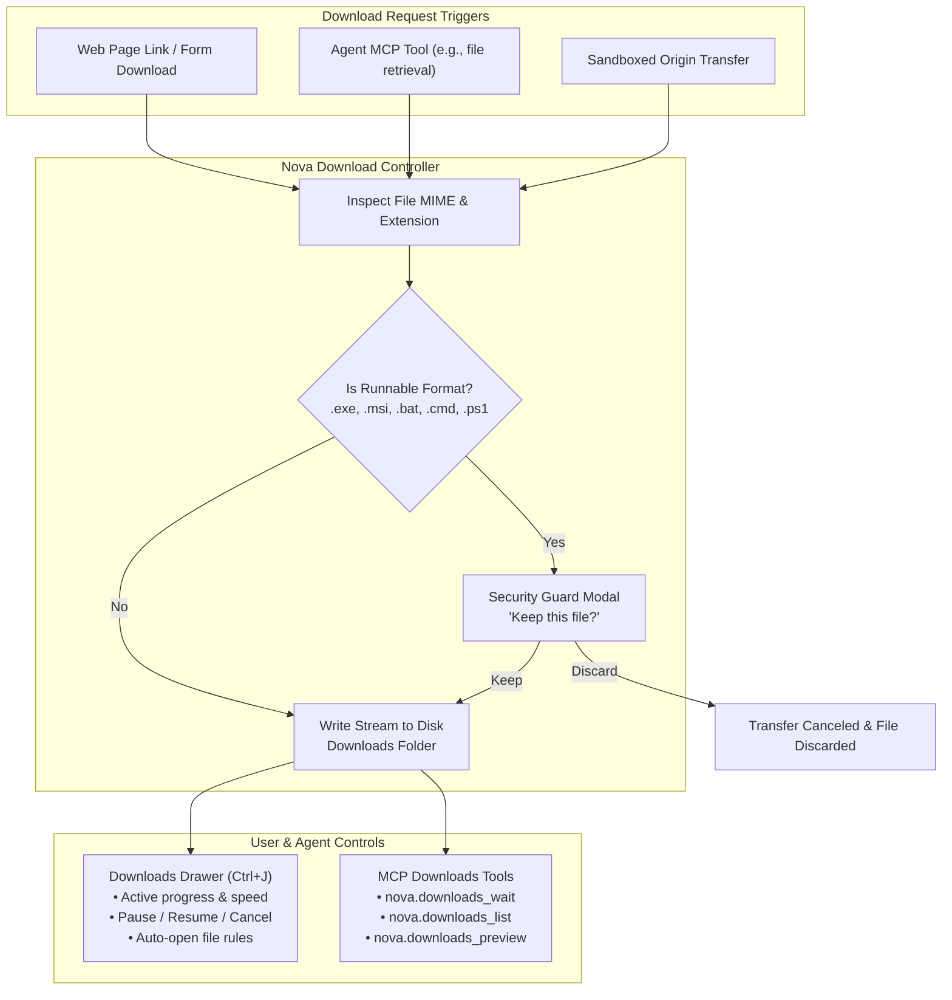

# Downloads Panel & Download Safety

> [!NOTE]
> Nova AI Workspace features a unified **Downloads** drawer that provides real-time transfer tracking, incremental card updates for buttery-smooth performance during heavy downloads, an automated safety barrier for runnable Windows files, and full Model Context Protocol (MCP) tool integration for autonomous agents.

---

## 1. High-Level Architecture: The Download Pipeline

Nova coordinates downloads across human browsing, isolated sandboxes, and autonomous AI agents through a dedicated download management engine:



---

## 2. The Downloads Panel (`Ctrl+J`)

Open the downloads panel at any time by pressing <kbd>Ctrl</kbd>+<kbd>J</kbd>, choosing **Menu → Downloads**, or clicking the **Downloads** button in the main toolbar (which appears automatically whenever downloads are active or recent).

```
+-------------------------------------------------------------------+
|  Downloads                             [ 3 active ]   [ Close (X) ]|
|  Route: Direct connection (or SOCKS5: Corporate Proxy)            |
|-------------------------------------------------------------------|
|  [v] kubernetes-client-x64.zip                         [ Open (v) ]|
|      142.5 MB of 210.0 MB | 4.8 MB/s | 14s remaining              |
|      [==============================--------] 68%                 |
|      Origin: github.com | Sandbox: Work                           |
|      [ Pause ]  [ Cancel ]  [ Details ]                           |
|-------------------------------------------------------------------|
|  [*] quarterly-report.pdf                                [ Done ] |
|      4.2 MB | Completed 2 minutes ago                             |
|      Origin: finance.corp.local | Sandbox: Shared                 |
|      [ Open ]  [ Open folder ]  [ Preview ]  [ Remove ]           |
|-------------------------------------------------------------------|
|  [ Pause all ]   [ Resume all ]   [ Cancel all ]   [ Clear list ] |
+-------------------------------------------------------------------+
```

### 2.1 Drawer Interface Highlights
* **Right-Side Slide-Out Drawer:** Slides smoothly over the right edge of the browser viewport without resizing the active webpage or shifting its layout.
* **Network Route Indicator:** Displays the egress network path under the title bar (e.g., *Route: Direct* or *Route: SOCKS5: Corporate Staging*). This ensures you always know if a download was routed through an enterprise proxy or direct ISP connection.
* **Summary Status Pill:** Summarizes the active state at a glance (*3 active*, *All completed*, *1 failed*).
* **Incremental Card Updates:** Nova uses an event-driven incremental rendering architecture. Progress ticks update text and progress bars in place without rebuilding the DOM tree or freezing the UI thread, ensuring zero lag even with multiple concurrent gigabit transfers.

### 2.2 Download Card States
Every transfer card indicates its current lifecycle phase:
* **Active:** Actively receiving bytes over the network, displaying real-time transfer speed and remaining time estimate.
* **Queued:** Waiting for an available network connection slot.
* **Paused:** Temporarily halted; transfer can be resumed from the exact byte offset if supported by the server (`Range` headers).
* **Done:** File fully downloaded, verified, and saved to disk.
* **Failed:** Transfer halted due to network timeout, HTTP error, or connection reset. The card displays the failure reason.
* **Canceled:** Transfer intentionally terminated by user or agent.

---

## 3. Controlling Individual Downloads

Each download card provides context-sensitive quick actions:

### 3.1 Primary Actions
* **Open:** Launches the downloaded file using Windows' default registered application (e.g., Acrobat Reader for `.pdf`, Word for `.docx`).
* **Open folder:** Reveals the downloaded file directly in Windows File Explorer with the file selected.
* **Preview:** Opens the file in a new Nova browser tab via a secure local `file://` URI (ideal for viewing PDFs, Markdown files, SVGs, or images immediately).
* **Pause & Resume:** Halts or restarts active byte streaming.
* **Cancel:** Aborts the transfer and deletes any partial temporary download files (`.crdownload` / `.tmp`).
* **Retry:** Re-initiates a failed or interrupted transfer from scratch.
* **Remove:** Removes the card from the download history list. The downloaded file **remains safely on your hard drive**.

### 3.2 The Details Flyout
Clicking **Details** on any card opens a context flyout with technical metadata:
* **Copy URL:** Copies the source web address from which the file was fetched.
* **Copy path:** Copies the absolute local filesystem path of the saved file to your clipboard.
* **Copy error:** If the transfer failed, copies the exact network stack error message for diagnostics.
* **Always open {type} files:** Toggles the automatic opening preference for files with that specific extension.

---

## 4. Bulk Controls & History Management

Manage multiple downloads simultaneously using the global drawer buttons:

* **Pause All:** Pauses all currently active transfers in a single click.
* **Resume All:** Resumes all paused transfers.
* **Cancel All:** Cancels all in-flight transfers and discards partial data.
* **Clear List:** Clears completed, failed, and canceled entries from the drawer list after a confirmation prompt. Downloaded files on your hard drive are **never deleted**.
* **Load More:** If you have extensive download history, clicks load older archived transfer records.

---

## 5. Executable Safety Barrier: "Keep this file?"

Downloading executable binaries or script files from the internet carries substantial security risks. Nova intercepts all runnable file types before they are written to disk:

```
+-------------------------------------------------------------------+
|  Keep this file?                                                  |
|  "setup-worker-node.exe" (14.2 MB)                                |
|  Downloaded from: https://builds.internal-cluster.org             |
|                                                                   |
|  This type of file can harm your computer if from an unknown      |
|  source. Confirm that you trust this provider.                    |
|                                                                   |
|  [ Discard ]                                             [ Keep ] |
+-------------------------------------------------------------------+
```

### 5.1 Intercepted File Formats
Nova evaluates file extensions and MIME headers to intercept all executable types, including:
* **Executables & Installers:** `.exe`, `.msi`, `.msp`, `.com`, `.scr`
* **Windows Scripts:** `.bat`, `.cmd`, `.ps1`, `.vbs`, `.vbe`, `.js`, `.jse`, `.wsf`
* **System Files & Shortcuts:** `.lnk`, `.reg`, `.inf`, `.pif`, `.hta`

### 5.2 Security Enforcements
1. **Zero Pre-Selection:** When the prompt opens, neither button has default keyboard focus. Pressing <kbd>Enter</kbd> will not accidentally approve the file.
2. **Keyboard Dismissal:** Pressing <kbd>Esc</kbd> immediately discards the download.
3. **Unattended Protection:** If an executable download is triggered in a background tab or on a surface with no active human or agent focus, Nova automatically **refuses and discards** the file to protect against drive-by download attacks.
4. **Agent Resolution:** Agents can resolve the prompt via [`nova.ui_download_security_prompt_resolve`](../../mcp-reference/tools/app-shell-and-ui/nova-ui-download-security-prompt-resolve.md) (`decision="keep"` or `decision="discard"`). All decisions are recorded in the security audit trail.

> [!WARNING]
> Choosing **Keep** only confirms that you intend to save the file; it does not constitute a malware scan or guarantee safety. Always verify hashes or scan binaries with antivirus software before running them.

---

## 6. Auto-Open Configuration & Preferences

Under **Settings → General → Downloads**, you can customize download behavior:

* **Download Folder Location:** Choose between your system's default Windows Downloads folder (`%USERPROFILE%\Downloads`) or set a custom directory.
* **Always Ask Where to Save:** Toggle whether Nova prompts for a destination folder on every individual download.
* **Auto-Open File Types:** Review the extensions configured to launch automatically upon completion (e.g., `.pdf`, `.png`).
* **Security Prohibition:** Executable formats (`.exe`, `.bat`, etc.) are strictly prohibited from the auto-open list. Nova will reject any attempt to add an executable extension.

---

## 7. Working Beside AI Agents

Autonomous agents interacting with Nova via MCP have full programmatic control over downloads:

* **Monitoring Transfers:** Agents inspect download progress, paths, and completion status using [`nova_downloads_list`](../../mcp-reference/tools/downloads/nova-downloads-list.md) and [`nova_downloads_wait`](../../mcp-reference/tools/downloads/nova-downloads-wait.md).
* **Controlling Transfers:** Agents can pause, resume, cancel, or retry downloads via dedicated MCP tools.
* **File Operations:** Agents can open or preview downloaded assets in browser tabs to inspect rendered output.
* **InPrivate Downloads:** Files downloaded while in an InPrivate tab remain saved in the local downloads folder after the private session closes.

---

## Related Documentation

* **[General Settings](../settings/general.md)** — Configuring download directories and auto-open lists.
* **[Certificates, Auth & Prompts](../identity-and-security/certificates-and-auth.md)** — Security prompts and download warnings.
* **[MCP Reference: Downloads Tools](../../mcp-reference/tools/downloads/README.md)** — Complete API documentation for download automation.
* **[Workspace Layout & Chrome](tabs-and-windows.md)** — Toolbar layout and quick action buttons.

---

[Back to Browser](README.md) · [All user guides](../README.md)
