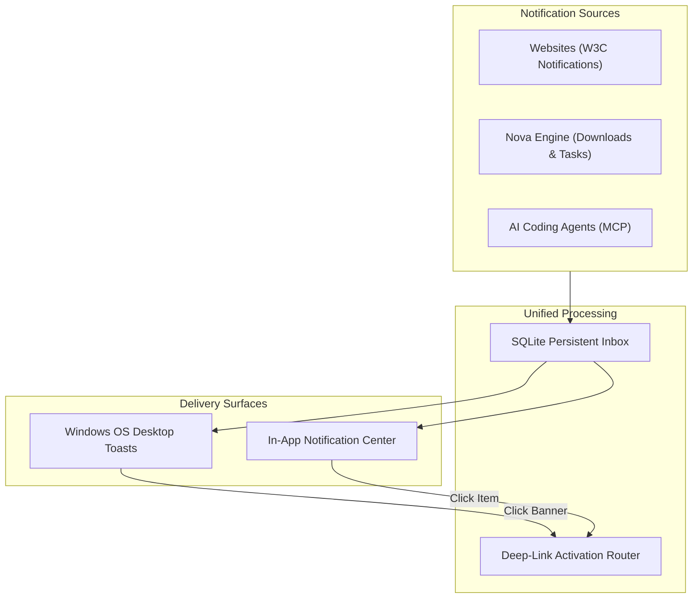

# Desktop Notifications & Notification Center

> [!NOTE]
> Nova AI Workspace unifies alerts from websites, background downloads, scheduled tasks, and local AI coding agents into a central Notification Center and delivers native Windows desktop toast banners.

---

## 1. Overview

In conventional browsers, website notifications appear as transient operating system popups that disappear if missed. Nova AI Workspace introduces a unified notification architecture that bridges web applications, host system events, and AI agent dispatches into a single persistent inbox.

Whether a website alerts you to a new message, a background file download completes, or an AI agent requests your input on a long-running research task, all notifications are collected and managed in one place.

---

## 2. The In-App Notification Center

You can access your notifications at any time from anywhere in the browser interface:

* **Toolbar Bell Icon:** Located in the top window header beside the main menu.
* **Unread Counter Badge:** When you have unread notifications, a badge displays the count of unread items directly on the bell icon.
* **Slide-Out Drawer:** Clicking the bell icon opens the Notification Center drawer, sliding smoothly out from the right side of the window without disrupting your open web tabs.
* **Chronological Inbox:** Alerts are listed chronologically, showing:
  * **Source Badge:** Clearly identifies whether the alert came from a **Website**, the **Nova Host**, or an **AI Agent**.
  * **Title & Message Body:** The complete content of the notification.
  * **Origin & Sandbox:** Shows the source website domain and which sandbox profile generated the alert.
  * **Timestamp:** When the alert was delivered.

---

## 3. Managing Notifications in the Inbox

The Notification Center provides full control over your inbox:

* **Mark as Read / Unread:** Clicking an alert automatically marks it as read and decrements the toolbar unread badge. You can also toggle read status manually.
* **Dismissing Individual Alerts:** Click the **Dismiss** (`X`) button on any item to remove it from the active inbox view.
* **Clear All Notifications:** Click **Clear all** at the top of the drawer to dismiss all historical alerts in a single action.
* **Filtering:** Switch between viewing all notifications or only unread items.

---

## 4. Website Permission Prompts & Controls

Websites must ask for your explicit permission before they can send notifications:

* **In-Tab Permission Banner:** When a site requests notification privileges, Nova displays an approval banner:
  * **Allow once:** Permits notifications for the current browsing session only.
  * **Always allow:** Remembers the permission for this origin across future sessions.
  * **Block:** Silently denies the request and prevents future popups from that domain.
* **Site Info Quick Access:** Click the **Site info** button (lock/tune icon) beside the address bar while visiting any website to inspect or change its notification permission instantly.
* **Global Defaults & Overview:** Open **Menu → Settings → Site permissions** to configure the fallback policy for unknown sites (`Ask`, `Allow`, or `Block`) or clear saved decisions. See [Site Permissions Settings](../settings/site-permissions.md) for details.

---

## 5. Windows OS Toasts & Deep-Link Routing

In addition to the in-app drawer, Nova integrates with the Windows App SDK to deliver native desktop toast notifications:

* **Desktop Banner Alerts:** Appear in the lower-right corner of your Windows desktop and inside the Windows Action Center (`Win+N`).
* **Deep-Link Click Activation:** Clicking either a Windows toast banner or an entry inside Nova's Notification Center triggers smart tab routing:
  * **Focus Existing Tab:** If the originating tab is still open, Nova immediately switches focus to it.
  * **Sandbox-Isolated Tab Restoration:** If the tab was closed, Nova opens a new tab navigating to the notification's target URL strictly within the originating sandbox profile (e.g., an alert from Sandbox B will never open inside Sandbox A).
  * **Web Event Feedback:** For website alerts, clicking the notification triggers the standard JavaScript `onclick` event on the web page.

---

## 6. Do Not Disturb & Focus Assist

To maintain focus during meetings, deep coding sessions, or presentations:

* **In-App Do Not Disturb:** Toggle Do Not Disturb in **Settings → Site permissions** to mute all notification sounds and suppress toast popups while keeping incoming alerts saved to your inbox.
* **Windows Focus Assist Integration:** Nova respects active Windows Focus Assist modes (Priority Only and Alarms Only). Routine website notifications are suppressed during Focus Assist.
* **Urgent Override:** Critical notifications flagged with urgent priority (such as security warnings or failed background tasks) escalate through Focus Assist to ensure you never miss essential events.

---

## 7. AI Agent Parity & Automation

Nova enforces strict Human-Agent Parity across notifications:

* **Agent Alerts:** Connected AI coding agents can send you desktop notifications when they finish code audits, complete background research, or require manual verification using [`nova.notifications_send`](../../mcp-reference/tools/notifications/nova-notifications-send.md).
* **Agent Inbox Inspection:** Agents can read, list, and dismiss notifications on your behalf using the 11 notification MCP tools without interrupting your active browsing.
* **Learn More:** For architectural details and database schemas, see the [Desktop Notifications Architecture Guide](../../core-features/notifications/README.md).

---

[Back to this section](README.md) · [Site permissions settings](../settings/site-permissions.md) · [Downloads panel](downloads.md) · [All user guides](../README.md)
