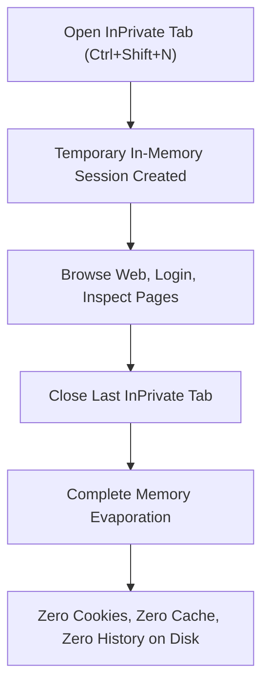
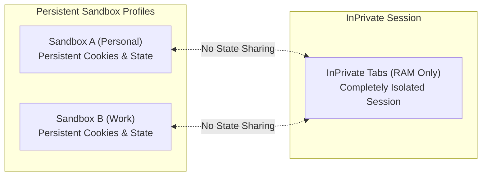

# InPrivate Browsing & Ephemeral Sessions

> [!NOTE]
> Open **Menu → New private tab** or press `Ctrl+Shift+N` to browse in an ephemeral, memory-only session that leaves no persistent trace on disk after the last private tab closes.

---

## 1. Overview & Ephemeral Lifecycle

InPrivate Browsing provides a completely temporary browsing environment. Whether you are conducting sensitive research, testing a web application from a clean-slate perspective, or logging into a temporary account on a shared machine, InPrivate tabs ensure that your session data is never committed to persistent storage.

### The Ephemeral Lifecycle
* **Session Initialization:** The first InPrivate tab you open instantiates an isolated, in-memory Chromium session container.
* **Shared InPrivate Session:** Additional InPrivate tabs opened in the same window share this temporary session, allowing you to navigate across multiple tabs or test multi-page workflows under a single temporary login.
* **Session Evaporation:** The moment the last InPrivate tab is closed, Nova instantly releases the session from RAM. All session cookies, DOM storage, and temporary caches are erased immediately.

---

## 2. Zero Disk Footprint

Unlike standard tabs which preserve session state to allow crash recovery and seamless restarts, InPrivate browsing enforces a strict zero-disk guarantee:

| Data Type | Normal Tabs | InPrivate Tabs |
|---|---|---|
| **Browsing History** | Persisted to SQLite database (`history.db`) | **Never persisted.** No visit URLs or page titles are written. |
| **Cookies & Session Tokens** | Saved per-sandbox in local profile | **In-memory only.** Erased immediately upon closing. |
| **Web Storage (localStorage, IndexedDB)** | Persisted across application restarts | **In-memory only.** Erased upon session termination. |
| **Temporary Cache & Images** | Cached to disk for fast page reloads | **In-memory only.** Purged on exit. |
| **Address Bar Search History** | Suggested in omnibox dropdown | **Not recorded.** InPrivate searches never appear in suggestions. |
| **Downloads Records** | Tracked in the Downloads panel history | **Not tracked.** Files saved to disk remain, but list history is wiped. |

> [!IMPORTANT]
> **Downloaded Files:** If you download a file (such as a PDF or image) while in an InPrivate tab, the file itself is saved to your chosen download folder on your Windows computer. However, the download record inside Nova's history shelf is wiped when the private session ends.

---

## 3. Multi-Sandbox Isolation

Nova's core architecture relies on persistent, isolated sandbox profiles (such as Sandbox A for personal browsing and Sandbox B for work logins). InPrivate browsing operates on a distinct plane:

* **Complete Profile Separation:** InPrivate tabs do not inherit, read, or alter cookies, sessions, or saved passwords from Sandbox A, Sandbox B, or any other user profile.
* **Testing Clean States:** When debugging authentication flows or testing websites without existing cookie history, opening an InPrivate tab guarantees that no residual session state interferes with the test.
* **No Persistence After Restart:** If Nova is restarted or updated, InPrivate tabs are discarded and will **not** be restored, ensuring that temporary sessions never accidentally persist.

---

## 4. In-Memory Permission Evaluation

Websites visited within InPrivate tabs can still request access to hardware capabilities—such as your camera, microphone, or location:

* **Ephemeral Grants:** If you grant permission (such as clicking **Allow once** or **Always allow**) on a prompt inside an InPrivate tab, that permission applies strictly to that temporary session in RAM.
* **Zero Policy Persistence:** The decision is **never written to `settings.json`** or the persistent Permissions Manager. The next time you open an InPrivate tab, the domain will prompt you again.
* **Device Safety:** Operating in an InPrivate tab does not make webcam or microphone capture harmless; always inspect the requesting origin before granting access.

---

## 5. Enhanced Tracking Prevention

To protect your privacy against invasive digital advertising networks, Nova automatically enables Chromium's **Strict Tracking Prevention** within all InPrivate tabs:

* **Third-Party Tracker Blocking:** Cross-site tracking cookies, hidden pixels, and tracking beacons are blocked from executing.
* **Cryptomining & Fingerprinting Protection:** Embedded scripts designed to covertly mine cryptocurrency or calculate hardware canvas/audio fingerprints are actively suppressed.
* **Referrer Stripping:** When navigating from one website to another, sensitive referrer query strings are trimmed to avoid leaking personal data across domains.

---

## 6. Visual Identification in Window Chrome

To ensure you always know when you are browsing in private mode:

* **InPrivate Pill Badge:** The window title bar and tab header display a distinct purple **InPrivate** pill.
* **Dark-Tinted Window Header:** The window chrome shifts to a darkened aesthetic to visually distinguish private tabs from standard sandbox profiles.
* **New Tab Splash:** Opening a new tab in private mode displays the InPrivate overview screen with quick tips and tracking statistics.

---

## 7. What InPrivate Browsing Does NOT Protect Against

While InPrivate browsing prevents anyone with physical access to your PC from seeing what you browsed after the window closes, it is important to understand its limitations:

* **Network & ISP Visibility:** InPrivate does not encrypt your network traffic. Your Internet Service Provider (ISP), network administrator, or Wi-Fi operator can still see the domain names and IP addresses you connect to.
* **Web Server Logging:** The websites you visit can still log your public IP address, the time of your visit, and any information you submit via forms.
* **Corporate Surveillance:** If you are using a managed corporate computer with enterprise endpoint monitoring software, company monitoring tools may still log activity.
* **Need True Wire Anonymity?** If your threat model requires concealing your IP address or routing traffic through secure egress tunnels, configure an encrypted proxy tunnel under **Settings → Network & proxies**. See [Proxies & Network Tunnels](../identity-and-security/proxies.md) for full setup instructions.

---

[Back to browser](README.md) · [Sandboxes and profiles](../identity-and-security/sandboxes-and-profiles.md) · [Proxies and network tunnels](../identity-and-security/proxies.md) · [Website permissions](../identity-and-security/permissions.md) · [All user guides](../README.md)
