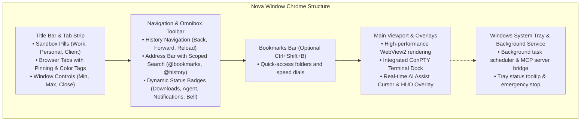

# Workspace Layout & Window Chrome

> [!NOTE]
> Nova AI Workspace is built with native Windows 11 WinUI 3 chrome. It combines the familiar ergonomics of a modern web browser with developer-focused workspace tools: side-by-side sandbox pills, an integrated ConPTY terminal dock, AI activity indicators, and seamless background execution.

---

## 1. Visual Anatomy of Nova

Nova organizes its workspace across five distinct visual and functional planes:

```
+-----------------------------------------------------------------------------------+
|  [ Work (Blue) ] [ Personal ] [+] | [Tab 1] [Tab 2 (AI)] [+]          [_] [O] [X] |
+-----------------------------------------------------------------------------------+
|  [<-] [->] [Reload] [Home] | [Lock] https://internal.dev/app [Star] | [v] [!] [Menu]|
+-----------------------------------------------------------------------------------+
|  [★ Docs]  [★ Dashboard]  [★ GitHub]  [★ AWS Console]                             |
+-----------------------------------------------------------------------------------+
|                                                                                   |
|                              Active Web Page Viewport                             |
|                                                                                   |
|   +---------------------------------------------------------------------------+   |
|   | ConPTY Terminal Dock (PowerShell / Claude Code / Codex)                   |   |
|   +---------------------------------------------------------------------------+   |
+-----------------------------------------------------------------------------------+
```



---

## 2. Title Bar, Sandbox Pills & Tab Strip

The top row of the window hosts Nova's identity partitioning and tab management controls.

### 2.1 Sandbox Pills (Left of Tabs)
Each active sandbox appears as an elegant pill element in the title bar:
* **Instant Account Switching:** Click any pill to switch the active viewport to that sandbox's current URL without opening separate windows.
* **Custom Visual Marking:** Right-click a pill and choose **Mark** to display an **Accent Color**, live **Site Favicon**, or clean typography.
* **Searchable Palette:** Click **Find a sandbox** to open a fast searchable palette (`Search sandboxes`, `Manage sandboxes...`) for setups managing dozens of profiles.
* **Pill Context Menu:**
  * **Mark:** Configure color or site icon display.
  * **Proxy:** Connect, disconnect, or view active proxy routing.
  * **Allow tabs in this sandbox:** Toggle whether new windows and popups open as sandbox tabs.
  * **Hide from toolbar:** Hides the pill to save space while preserving all session data.
  * **Clear sandbox data...:** Selectively wipe cache, cookies, or history.
  * **Release agent:** Revokes any active agent claim on this sandbox.

### 2.2 Tab Strip & Tab Anatomy
Browser tabs sit immediately to the right of the sandbox pills:
* **Favicon & Title:** Shows the page favicon, loading spinner, and page title.
* **Audio & Media Indicator:** Displays a speaker icon when media is playing (click to mute), or a pulsing red/green glyph when the microphone or camera is active.
* **Sandbox Tab Badges:** When a page inside a sandbox opens a link in a new tab, Nova creates a **Sandbox Tab** carrying the badge: *Tab of sandbox {name} — shares its session*. This preserves OAuth, SSO, and payment sessions without leaking into your shared profile.
* **InPrivate Badges:** Ephemeral private browsing tabs display a distinct purple badge and run in an isolated in-memory RAM session.
* **Agent Markers:** A tab held or operated by an AI agent displays a distinctive pulsing indicator. Hovering over the badge shows:
  * *Agent active:* Tool call currently executing.
  * *Agent recently active:* Command completed within the last few seconds.
  * *Agent reserved:* Exclusive lease held while the agent deliberates.

### 2.3 Tab Management & Context Menu
Right-click any tab for complete management options:
* **Pin tab:** Shrinks the tab to its favicon and locks it to the far left of the tab strip. Pinned tabs cannot be accidentally closed and reload automatically on launch.
* **Color tab:** Assign a vibrant visual accent color from the palette to categorize related tabs into logical task groups.
* **Mute / Unmute tab:** Silences all HTML5 audio output from that tab without affecting your Windows master volume.
* **Duplicate tab:** Clones the active URL into a new tab in the same session.
* **Close other tabs / Close tabs to the right:** Fast bulk cleanup for clutter-free browsing.
* **Reopen closed tab (<kbd>Ctrl</kbd>+<kbd>Shift</kbd>+<kbd>T</kbd>):** Restores recently closed tabs in chronological order.

---

## 3. Navigation Toolbar & Address Bar (Omnibox)

The second row hosts essential browsing navigation, security information, and dynamic utility buttons.

### 3.1 History Navigation & Reload
* **Back (<kbd>Alt</kbd>+<kbd>Left</kbd>):** Navigates to the previous page in history.
* **Forward (<kbd>Alt</kbd>+<kbd>Right</kbd>):** Navigates forward.
* **Reload (<kbd>Ctrl</kbd>+<kbd>R</kbd> / <kbd>F5</kbd>):** Refreshes the page. Right-click or press <kbd>Ctrl</kbd>+<kbd>Shift</kbd>+<kbd>R</kbd> for a **Hard reload** (bypasses browser cache).
* **Home:** Navigates to your configured start page or New Tab Page.

### 3.2 Address Bar & Omnibox Capabilities
Focus the address bar quickly with <kbd>Ctrl</kbd>+<kbd>L</kbd>, <kbd>Alt</kbd>+<kbd>D</kbd>, or <kbd>F4</kbd>:
* **Site Info Padlock:** Click the lock icon to inspect TLS connection encryption, certificate thumbprints, and active origin permissions (camera, microphone, location) with one-click toggles.
* **Scoped Search Prefixes:**
  * Type `@bookmarks ` to search exclusively within your saved bookmarks.
  * Type `@history ` to search visited page history.
* **Bookmark Star (<kbd>Ctrl</kbd>+<kbd>D</kbd>):** Opens the favorites dialog to edit title, destination folder, and speed dial properties.

### 3.3 Dynamic Status Buttons & Quick Utilities
Buttons appear dynamically in the toolbar when their respective subsystems have active information:
* **Downloads Button:** Shows active transfer progress and opens the downloads drawer (<kbd>Ctrl</kbd>+<kbd>J</kbd>).
* **Activity Flyout:** Displays active agent leases, target tab IDs, and one-click lease release buttons.
* **Notification Bell:** Displays an unread badge counter and opens the unified notification center.
* **Proxy Status:** Shows when a global or sandbox proxy tunnel is routing network traffic.
* **Terminal Toggle:** Opens or collapses the integrated developer terminal dock.
* **Main Menu (`...`):** Provides instant access to New Private Tab (<kbd>Ctrl</kbd>+<kbd>Shift</kbd>+<kbd>N</kbd>), History (<kbd>Ctrl</kbd>+<kbd>H</kbd>), Downloads (<kbd>Ctrl</kbd>+<kbd>J</kbd>), Favorites, Zoom, Print, View settings (AI visualization toggle, Bookmark bar toggle), Settings (<kbd>Ctrl</kbd>+<kbd>,</kbd>), Developer Tools (<kbd>F12</kbd>), and **Emergency stop**.

---

## 4. Viewport Overlays & Integrated Tools

Nova allows developer tools to exist directly inside the browser viewport rather than in detached, floating windows:

### 4.1 The ConPTY Terminal Dock
Open the terminal dock using the **Terminal** toolbar button:
* **In-Context Execution:** Run PowerShell 7, Command Prompt, Claude Code, or Codex side by side with the page you are developing.
* **Three Dock Modes:**
  * *Expanded:* Full interactive pseudo-console over the bottom half of the viewport.
  * *Collapsed:* Minimizes to a sleek tab strip above the page, keeping background scripts running.
  * *Hidden:* Hides the dock completely while background processes continue execution.
* **Separate Window:** Pop out any terminal tab into its own independent window with **Open in a separate window**.

### 4.2 AI Assist Visual Overlay
When an agent is actively controlling a tab, Nova projects an animated **AI Assist Cursor**, target reticle, HUD action captions (*Searching target...*, *Target locked*), and a multi-step **Step Card** directly over the page. See [AI Visualization](../agents/watching-agent-work.md).

---

## 5. Window Behavior & Background Execution

Nova is engineered to serve as both an interactive desktop browser and a continuous background host for agent workloads.

### 5.1 Fullscreen Mode (<kbd>F11</kbd>)
* Press <kbd>F11</kbd> to enter immersive fullscreen mode, hiding window borders and chrome.
* To exit fullscreen, press <kbd>F11</kbd> again or hold <kbd>Esc</kbd> for one second.

### 5.2 Closing Behavior & System Tray Integration
When you click the window close button (`X`) while scheduled background tasks or agent sessions are active, Nova prompts you with **Close Nova?**:
* **Keep running in the background:** The browser window closes, but Nova's lightweight host process moves to the **Windows System Tray** (notification area). In this mode:
  * The Model Context Protocol (MCP) server remains live and accessible to external agents.
  * Scheduled background tasks and crawlers continue their scheduled execution.
  * Hovering over the tray icon displays: *Nova AI Workspace: an agent is working*.
  * Right-clicking the tray icon allows you to restore the window, trigger **Emergency stop**, or quit.
* **Quit Nova:** Gracefully terminates all background services, shuts down terminal sessions, and closes the application completely.

---

## 6. Co-Browsing Etiquette & Safety Shortcuts

* **Instant Manual Precedence:** Human clicks and keyboard inputs immediately take priority over agent commands.
* **Global Emergency Stop:** Press <kbd>Ctrl</kbd>+<kbd>Alt</kbd>+<kbd>Esc</kbd> at any time to instantly revoke all agent tab claims, pause running terminals, and freeze automation across the entire workspace.

---

## Related Documentation

* **[Keyboard Shortcuts Reference](keyboard-shortcuts.md)** — Complete list of hotkeys.
* **[Sandboxes & Profile Isolation](../identity-and-security/sandboxes-and-profiles.md)** — Multi-profile setup and title bar pills.
* **[Downloads Panel & Safety](downloads.md)** — Managing downloads and executable file barriers.
* **[Desktop Notifications](notifications.md)** — Notification center and Windows toasts.
* **[AI Visualization & Watching Agent Work](../agents/watching-agent-work.md)** — Real-time assist cursor and HUD overlays.
* **[Terminal Dock Guide](../tools/terminal.md)** — ConPTY terminal workspaces and developer commands.

---

[Back to Browser](README.md) · [All user guides](../README.md)
