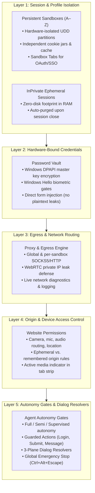

# Identity & Security

> [!NOTE]
> Nova AI Workspace is architected from the ground up for high-trust environments where human developers and autonomous AI agents collaborate side by side. Nova provides hardware-bound credential protection, multi-sandbox session partitioning, granular origin permissions, and a non-blocking three-plane dialog engine to ensure all browsing operations remain secure, isolated, and strictly auditable.

---

## 1. Architectural Overview: The Five Security Layers

Nova's defense-in-depth model spans five coordinated security layers:

---

## 2. Security Guides & Reference Matrix

Explore the comprehensive guides covering each facet of Nova's identity and security subsystems:

| Guide | Primary Focus | Key Security Capabilities & Controls |
| :--- | :--- | :--- |
| **[Sandboxes & Profile Isolation](sandboxes-and-profiles.md)** | Session Partitioning | Multi-account isolation without container extensions, title-bar sandbox pills, Sandbox Tabs for seamless SSO/OAuth, boundary traversal guards (*"This page wants to leave the sandbox"*), and disk-anchor crash recovery. |
| **[Passwords & Vault](passwords-and-vault.md)** | Credential Protection | Local DPAPI encryption, password vault management, Windows Hello biometric prompts, form autofill, and secure secret injection for agents without exposing plaintext keys to LLM contexts. |
| **[Proxies & Network Routing](proxies.md)** | Egress & Privacy | Dedicated per-sandbox proxies (HTTP, HTTPS, SOCKS5), WebRTC private IP leak prevention, PAC script support, live connection logging, and DNS leak shielding. |
| **[Website & Agent Permissions](permissions.md)** | Access Control & Gates | The dual-pillar model separating origin device access (camera, microphone, speaker routing, location) from agent autonomy levels (*Fully automatic*, *Semi-automatic*, *Supervised*), guarded actions, and session grants. |
| **[Agent Identification](agent-identification.md)** | Telling Sites an Agent Acts | Lets an agent mark its own tab as an agent on sites you list (such as Amazon, which asks for it), with your normal browser identity unchanged everywhere else. |
| **[Certificates, Auth & Prompts](certificates-and-auth.md)** | System & Native Dialogs | The 3-plane dialog engine: resolving HTTP 401 Basic/Digest challenges, handling untrusted SSL/TLS certificate warnings, selecting enterprise mTLS client certificates, native Win32 file pickers, and download security guards. |

---

## 3. Human-in-the-Loop Safeguards

Nova guarantees that human users maintain complete sovereignty over the browser at all times:

1. **Clear Visual Feedback:** Any tab, sandbox, or device accessed by an AI agent displays unambiguous real-time visual indicators (tab markers, pulsing assist overlays, media glyphs).
2. **Instant Claim Release:** Users can click on any agent-claimed tab or sandbox pill to immediately revoke the agent's lease and take manual control.
3. **Fail-Safe Emergency Stop:** Pressing <kbd>Ctrl</kbd>+<kbd>Alt</kbd>+<kbd>Esc</kbd> or selecting **Menu → Emergency stop** instantly halts all agent tool calls, pauses terminal sessions, revokes active leases, and freezes execution across the entire workspace.

---

## Related Documentation

* **[User Guide Overview](../README.md)** — Comprehensive navigation across all browser features.
* **[Agent Collaboration Hub](../agents/README.md)** — Setting up, observing, and directing AI agents.
* **[Taking Over & Emergency Stop](../agents/taking-over-and-emergency-stop.md)** — Manual takeover procedures and safety stops.
* **[Core Features: Sandbox Isolation Architecture](../../core-features/sandbox-isolation/README.md)** — Technical deep dive into profile storage.
* **[Core Features: Password Vault Architecture](../../core-features/privacy/vault-and-secrets/README.md)** — Cryptographic details of Nova's DPAPI implementation.

---

[Back to User Guide](../README.md)
