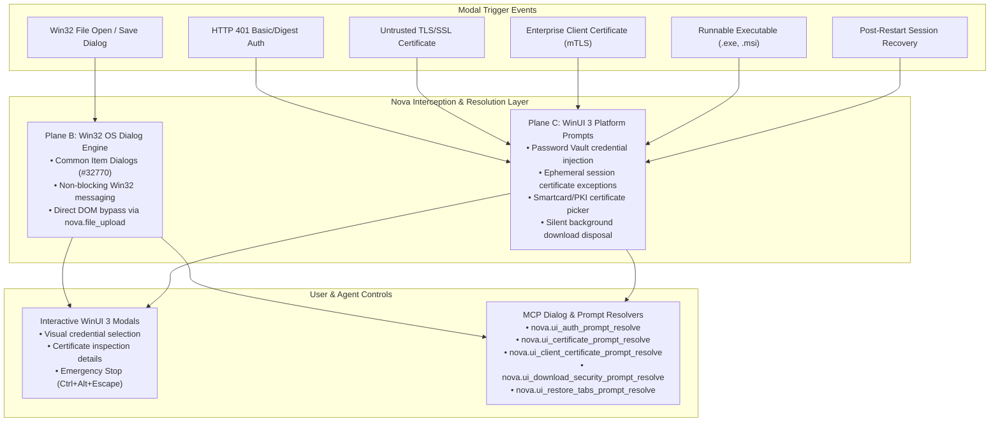

# System Prompts, Server Authentication & Certificates

> [!NOTE]
> Web applications frequently trigger modal dialogs that live completely outside the page's HTML Document Object Model (DOM). Nova AI Workspace intercepts and standardizes operating system file pickers, HTTP server sign-in prompts, TLS security warnings, client certificates, and download guards so that both human users and autonomous AI agents can interact with them reliably.

---

## 1. High-Level Architecture: The Three Modal Planes

Traditional browser automation tools fail when a website triggers native OS dialogs or security prompts because these surfaces do not exist in the DOM and freeze the JavaScript execution thread. Nova addresses this with a unified, three-plane dialog architecture:



---

## 2. Server Authentication (HTTP 401 Basic & Digest Auth)

### Sign in to a server

Certain corporate intranets, router configuration panels, staging environments, and legacy APIs protect pages with HTTP Basic or Digest authentication rather than an HTML login form. These challenges trigger a native browser authentication prompt before any webpage content is rendered.

```
+-------------------------------------------------------------------+
|  Sign in to: internal-gateway.corp.local                          |
|  The server reports realm: "Engineering Staging"                  |
|                                                                   |
|  [!] Connection is not encrypted (HTTP)                           |
|                                                                   |
|  Saved login:  [ staging-admin (Password Vault)             [v] ] |
|  User name:    [ staging-admin                                  ] |
|  Password:     [ ******************                             ] |
|                                                                   |
|  [x] Save in password vault                                       |
|                                                                   |
|  [ Cancel ]                                           [ Sign in ] |
+-------------------------------------------------------------------+
```

### Key Behaviors & Safety Controls

1. **Origin & Realm Identification:** The prompt clearly displays the requesting host and the server-defined realm name, verifying exactly which resource is requesting credentials.
2. **Unencrypted Connection Warning:** If the prompt is triggered over plaintext HTTP, Nova highlights this with a visible warning to prevent accidental transmission of cleartext credentials across untrusted networks.
3. **Password Vault Integration:** If matching credentials exist in Nova's local DPAPI-encrypted password vault, Nova presents them in a dropdown for instant selection. Entering a new credential with **Save in password vault** checked automatically stores it for future visits.
4. **Agent Resolution:** When an agent is working in the tab, it can inspect the prompt and resolve it using [`nova.ui_auth_prompt_resolve`](../../mcp-reference/tools/app-shell-and-ui/nova-ui-auth-prompt-resolve.md) with `username` and `password`. If credentials are stored in Nova's vault, agents can reference the vault without needing to see plaintext secrets in their prompt context.

---

## 3. SSL/TLS Certificate Warnings & Overrides

When you or an agent navigate to a site whose SSL/TLS certificate cannot be validated—such as internal development servers using self-signed certificates, private internal CAs, or expired certificates—Nova halts navigation and presents a security warning.

### Understanding the Warning

* **Certificate Verification Failure:** Common reasons include `CertAuthorityInvalid` (self-signed or unknown CA), `CertCommonNameInvalid` (domain name mismatch), or `CertExpired`.
* **Show Details:** Clicking **Show details** reveals the certificate's Subject, Issuer, SHA-256 thumbprint, validity dates, and Subject Alternative Names (SANs).
* **Decision Options:**
  * **Go back (Recommended):** Immediately terminates navigation and returns to the previous safe page.
  * **Continue anyway:** Grants a **temporary runtime exception** for that specific certificate on that specific host.

> [!WARNING]
> A certificate override granted via **Continue anyway** is valid **only for the current browsing session** and is never permanently written to the Windows Certificate Store. Once Nova is closed or restarted, the exception is cleared. Never bypass certificate warnings on public websites or services where financial or personal credentials are exchanged.

### Agent Handling

Autonomous agents can inspect the error details and choose to accept dev/test certificates via [`nova.ui_certificate_prompt_resolve`](../../mcp-reference/tools/app-shell-and-ui/nova-ui-certificate-prompt-resolve.md) (`decision="allow"` or `decision="deny"`). If the active autonomy mode is set to *Supervised*, Nova prompts the human user before permitting an agent to override a certificate failure.

---

## 4. Client Certificate Authentication (mTLS)

Enterprise environments and government portals frequently require Mutual TLS (mTLS), where the client browser must present a cryptographic X.509 certificate to authenticate the user's identity.

```
+-------------------------------------------------------------------+
|  Identify yourself to: portal.internal.company.com                |
|  The server requests a client certificate.                        |
|                                                                   |
|  Select a certificate:                                            |
|  (o) Joel Aniol (Employee ID: 9481)                               |
|      Issuer: Company Internal Root CA 2026                        |
|      Valid until: 2027-12-31 | Serial: 4a:2e:99:b1                |
|                                                                   |
|  ( ) Joel Aniol (Dev Smartcard Token)                             |
|      Issuer: Dev Infrastructure Sub-CA                            |
|      Valid until: 2026-11-15 | Serial: 1c:88:ef:04                |
|                                                                   |
|  [ Details ]           [ Send none ]              [ Send selected ]|
+-------------------------------------------------------------------+
```

### Certificate Discovery & Selection

* **Windows Certificate Store Integration:** Nova queries the Windows personal certificate store (`CurrentUser\My`) and connected hardware tokens (smartcards, YubiKeys).
* **Selective Transmission:** You can review the exact Subject, Issuer, and Serial Number before transmitting. Clicking **Send none** informs the server that no client certificate will be provided.
* **Agent Operations:** Agents can inspect available certificates and select the appropriate credential via [`nova.ui_client_certificate_prompt_resolve`](../../mcp-reference/tools/app-shell-and-ui/nova-ui-client-certificate-prompt-resolve.md) using the certificate thumbprint.

---

## 5. Windows File Pickers & Native File Uploads

When an application triggers `<input type="file">`, `window.showOpenFilePicker()`, or a Save As download dialog, Windows displays a native Win32 Common Item Dialog (`#32770`). Standard DOM selectors cannot see or interact with this window.

### Human vs. Agent Pathways

1. **Interactive Human Browsing:** Users navigate standard Windows Explorer folders, select files, and confirm or cancel with native OS buttons.
2. **Agent Win32 Automation:** Agents can query dialog status via [`nova.ui_inspect_native_dialog`](../../mcp-reference/tools/app-shell-and-ui/nova-ui-inspect-native-dialog.md), populate file paths with [`nova.ui_set_native_dialog_file_name`](../../mcp-reference/tools/app-shell-and-ui/nova-ui-set-native-dialog-file-name.md), and confirm with [`nova.ui_confirm_native_dialog`](../../mcp-reference/tools/app-shell-and-ui/nova-ui-confirm-native-dialog.md). Nova uses non-blocking Win32 messaging with a 1.5-second safety timeout to prevent deadlocks.
3. **High-Performance DOM Bypass:** Whenever possible, agents should bypass OS pickers entirely by invoking [`nova.file_upload`](../../mcp-reference/tools/browser-automation/nova-file-upload.md), which injects the file paths directly into the targeted HTML input element via Chrome DevTools Protocol (CDP) without opening a Win32 dialog.

---

## 6. Executable Download Safety Prompts ("Keep this file?")

When a download involves an executable or script format that Windows can run directly—such as `.exe`, `.msi`, `.bat`, `.cmd`, `.ps1`, `.vbs`, `.reg`, or `.lnk`—Nova pauses before writing the file to disk and displays a prominent warning prompt:

```
+-------------------------------------------------------------------+
|  Keep this file?                                                  |
|  "setup-worker-node.exe" (14.2 MB)                                |
|  Downloaded from: https://builds.internal-cluster.org             |
|                                                                   |
|  This type of file can harm your computer if from an unknown      |
|  source. Confirm that you trust this provider.                    |
|                                                                   |
|  [ Discard ]                                             [ Keep ] |
+-------------------------------------------------------------------+
```

### Safety Guardrails

* **Zero Pre-Selection:** No default button has keyboard focus when the dialog opens; pressing <kbd>Esc</kbd> automatically discards the file.
* **Unattended Protection:** If an executable download is initiated in a background tab or on a surface that has no human or agent focus, Nova automatically discards the file to prevent drive-by download attacks.
* **Agent Resolution:** Agents can resolve the prompt via [`nova.ui_download_security_prompt_resolve`](../../mcp-reference/tools/app-shell-and-ui/nova-ui-download-security-prompt-resolve.md) with `decision="keep"` or `decision="discard"`. Every resolution is logged to the security audit trail.

---

## 7. Tab & Session Restoration Prompts

If Nova is closed unexpectedly, restarted following an OS update, or crashes due to hardware failure, it detects the ungraceful shutdown on next boot and presents the session restoration prompt:

* **Restore previous tabs:** Re-opens all previously active tabs, sandbox sessions, and URLs.
* **Start fresh:** Discards the previous session state and opens the default home page.
* **Agent Automation:** In headless or developer automation environments, agents can resolve this prompt immediately using [`nova.ui_restore_tabs_prompt_resolve`](../../mcp-reference/tools/app-shell-and-ui/nova-ui-restore-tabs-prompt-resolve.md) (`decision="restore"` or `decision="discard"`).

---

## 8. Human-in-the-Loop Oversight & Emergency Stop

Because system prompts affect security boundaries and credential exposure, Nova provides clear oversight mechanisms:

1. **Visual Activity Indicator:** Whenever an agent is waiting on or resolving a system prompt, the tab strip and title bar display an active prompt indicator.
2. **Manual Takeover:** You can click any prompt button directly at any time. A manual human click immediately satisfies the prompt, cancelling any pending agent request.
3. **Emergency Stop:** Pressing <kbd>Ctrl</kbd>+<kbd>Alt</kbd>+<kbd>Esc</kbd> or selecting **Menu → Emergency stop** immediately revokes all agent claims, dismisses pending automated actions, and freezes agent execution.

---

## Related Documentation

* **[Passwords & Vault](passwords-and-vault.md)** — Local DPAPI credential encryption and autofill.
* **[Website & Agent Permissions](permissions.md)** — Origin device permissions and agent autonomy policies.
* **[Sandboxes & Profiles](sandboxes-and-profiles.md)** — Session partitioning and multi-account isolation.
* **[Downloads Panel & Safety](../browser/downloads.md)** — Download management and executable file policies.
* **[Core Features: Native Dialogs & Prompts](../../core-features/native-dialogs-and-prompts/README.md)** — In-depth architectural details of the dialog subsystem.

---

[Back to this section](README.md) · [All user guides](../README.md)
