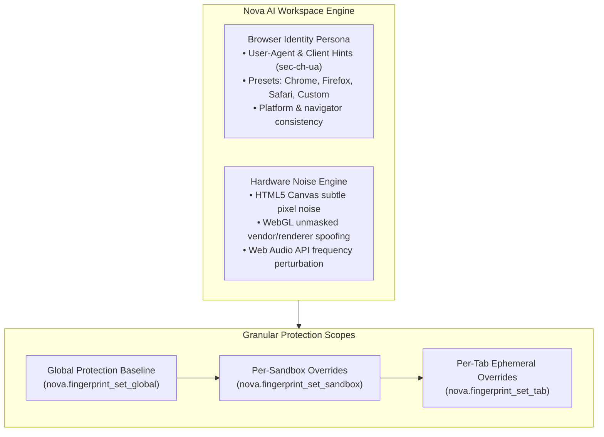

# Browser Fingerprinting & Identity Management

> [!NOTE]
> Nova AI Workspace includes native browser fingerprint protection and identity management. Operators and AI agents can configure entropy-masking noise across HTML5 Canvas, WebGL, and Web Audio APIs, assign distinct hardware personas per sandbox, and synchronize Client Hints to prevent tracking across browsing sessions.

---

## 1. Overview & Anti-Tracking Architecture

Modern websites and commercial tracking networks use browser fingerprinting to track devices across domains even when third-party cookies and local storage are blocked. By measuring subtle differences in GPU rendering, canvas rasterization, audio frequency processing, and system hardware properties, tracking scripts calculate a persistent identifier for your machine.

Nova counters fingerprint tracking through a multi-tier protection engine:



* **Noise Injection vs. Outright Blocking:** Instead of outright disabling Canvas or WebGL (which breaks modern web applications and triggers anti-bot alarms), Nova injects imperceptible, non-destructive mathematical noise into readback APIs (`toDataURL`, `getImageData`, audio frequency buffers), rendering calculated hash fingerprints unique and unstable across sessions.
* **Granular Scoping:** Apply protection globally across the browser, bind specific profiles to individual sandboxes, or override settings on a single tab during automated testing.
* **Full MCP Control:** Connected AI agents can audit current protection levels, toggle presets, and query available personas programmatically.

---

## 2. Protection Levels (`off`, `standard`, `strict`)

Nova provides three calibrated protection levels:

| Level | APIs Covered | Anti-Tracking Behavior | Compatibility Impact |
| :--- | :--- | :--- | :--- |
| **`off`** | None | Exposes raw native GPU and hardware parameters directly from Windows. | 100% native compatibility. Useful for local web graphics development. |
| **`standard`** | Canvas, Web Audio | Injects subtle, non-deterministic mathematical noise into HTML5 Canvas rasterization and Web Audio oscillator frequency buffers. | Zero visual artifacts; normal websites and streaming audio behave seamlessly. |
| **`strict`** | Canvas, WebGL, Audio, Hardware, Screen | Adds WebGL unmasked vendor/renderer spoofing, normalizes screen resolution dimensions, masks font enumeration lists, and standardizes CPU core counts (`navigator.hardwareConcurrency`). | Maximizes anti-tracking resistance for sensitive research workflows. |

---

## 3. Scope Hierarchy & MCP Governance

Protection levels can be applied at three distinct scopes:

### 3.1 Global Baseline ([`nova.fingerprint_set_global`](../../mcp-reference/tools/site-data-and-identity/nova-fingerprint-set-global.md))
Sets the default protection level across all sandboxes and tabs:

```json
{
  "name": "nova.fingerprint_set_global",
  "arguments": {
    "level": "standard"
  }
}
```

### 3.2 Per-Sandbox Binding ([`nova.fingerprint_set_sandbox`](../../mcp-reference/tools/site-data-and-identity/nova-fingerprint-set-sandbox.md))
Isolate client profiles by configuring different protection levels per sandbox partition (e.g. strict protection for competitive intelligence in Sandbox B, standard for general browsing in Sandbox A):

```json
{
  "name": "nova.fingerprint_set_sandbox",
  "arguments": {
    "sandboxId": "sandbox-research",
    "level": "strict"
  }
}
```

### 3.3 Ephemeral Tab Overrides ([`nova.fingerprint_set_tab`](../../mcp-reference/tools/site-data-and-identity/nova-fingerprint-set-tab.md))
Temporarily modify the protection level of an individual tab for diagnostic testing:

```json
{
  "name": "nova.fingerprint_set_tab",
  "arguments": {
    "tabId": "tab-102",
    "level": "off"
  }
}
```

### 3.4 Inspecting Effective Fingerprints ([`nova.fingerprint_get`](../../mcp-reference/tools/site-data-and-identity/nova-fingerprint-get.md))
Query the active fingerprint protection level for any sandbox or tab:

```json
{
  "name": "nova.fingerprint_get",
  "arguments": {
    "sandboxId": "sandbox-research"
  }
}
```

---

## 4. Browser Personas & Client Hints Parity

Fingerprint defense requires maintaining absolute consistency between the HTTP `User-Agent` header, JavaScript navigator properties, and Chromium Client Hints (`sec-ch-ua`, `sec-ch-ua-platform`, `sec-ch-ua-mobile`). Inconsistencies between these headers trigger instant fraud detection flags on modern web platforms.

Nova resolves this by maintaining verified **Browser Personas**:

### 4.1 Inspecting Available Presets ([`nova.identity_presets`](../../mcp-reference/tools/site-data-and-identity/nova-identity-presets.md))
Retrieve available persona presets and their supported browser versions:

```json
{
  "name": "nova.identity_presets",
  "arguments": {}
}
```

Presets include:
* **`default`:** Native Microsoft Edge / WebView2 identity with current Windows build details.
* **`chrome`:** Emulates Google Chrome on Windows, spoofing `sec-ch-ua` branding and version strings.
* **`firefox`:** Emulates Mozilla Firefox, suppressing Chromium-specific client hints while adjusting navigator properties.
* **`safari`:** Emulates Apple Safari.
* **`custom`:** Allows free-form User-Agent string injection while sanitizing control characters.

### 4.2 Setting Browser Personas ([`nova.identity_set`](../../mcp-reference/tools/site-data-and-identity/nova-identity-set.md))

Switch the active browser identity across future tab instantiations:

```json
{
  "name": "nova.identity_set",
  "arguments": {
    "preset": "chrome",
    "version": "latest"
  }
}
```

Nova automatically aligns:
* HTTP request `User-Agent` and `Sec-CH-UA` headers.
* `navigator.userAgent`, `navigator.appVersion`, and `navigator.userAgentData`.
* Underlying JavaScript engine features matching the target persona.

---

## 5. Distinction: Privacy vs. Transparent Agent Announcement

It is essential to distinguish between **Fingerprint Protection** and **Agent Identification**:

* **Fingerprint Protection & Personas:** Defends your device against unauthorized tracking networks, canvas fingerprinting, and hardware profiling across normal websites.
* **Agent Identification ([`agent-identification.md`](agent-identification.md)):** An explicit, transparent announcement (`Agent/NovaAIWorkspace`) used strictly on user-approved sites (such as Amazon) where terms of service require automated software to announce itself.

---

## 6. Summary Tool Matrix

| Tool | Capability | Primary Use Case |
| :--- | :--- | :--- |
| [`nova.fingerprint_get`](../../mcp-reference/tools/site-data-and-identity/nova-fingerprint-get.md) | Query fingerprint status | Inspect active protection levels for a specific sandbox or tab. |
| [`nova.fingerprint_set_global`](../../mcp-reference/tools/site-data-and-identity/nova-fingerprint-set-global.md) | Set global protection | Apply baseline protection (`off`, `standard`, `strict`) across the workspace. |
| [`nova.fingerprint_set_sandbox`](../../mcp-reference/tools/site-data-and-identity/nova-fingerprint-set-sandbox.md) | Set sandbox protection | Bind strict hardware noise to an isolated client research profile. |
| [`nova.fingerprint_set_tab`](../../mcp-reference/tools/site-data-and-identity/nova-fingerprint-set-tab.md) | Set tab protection | Temporarily disable noise for canvas rendering tests on a specific page. |
| [`nova.identity_get`](../../mcp-reference/tools/site-data-and-identity/nova-identity-get.md) | Query identity persona | Check currently configured User-Agent and Client Hints persona. |
| [`nova.identity_presets`](../../mcp-reference/tools/site-data-and-identity/nova-identity-presets.md) | List available personas | Discover verified Chrome, Firefox, and Safari persona versions. |
| [`nova.identity_set`](../../mcp-reference/tools/site-data-and-identity/nova-identity-set.md) | Set identity persona | Apply synchronized User-Agent and Client Hints across the browser. |

---

## 7. Related Documentation

* **[Privacy & Fingerprinting Architecture](../../core-features/privacy/fingerprint-and-identity/README.md)** — Architectural internals of canvas, audio, and WebGL noise injection.
* **[Sandboxes & Profile Isolation](sandboxes-and-profiles.md)** — Session isolation and sandbox data directories.
* **[Agent Identification Guide](agent-identification.md)** — Transparent User-Agent announcement on approved merchant domains.
* **[Proxies & Network Routing](proxies.md)** — IP masking and WebRTC leak protection.

---

[Back to Identity & Security](README.md) · [All user guides](../README.md)
