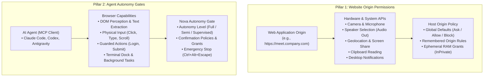

# Website & Agent Permissions

> [!NOTE]
> Nova AI Workspace enforces a strict dual-pillar security model that separates **Website Origin Permissions** (what web pages may access on your computer) from **Agent Autonomy Gates** (what AI assistants are permitted to do in the browser). Granting a website access to your microphone does not give an AI agent permission to record audio, and granting an agent autonomy does not lower web security standards.

---

## 1. High-Level Architecture: The Dual-Pillar Permission Model

Understanding the separation between website capabilities and agent control is essential for safe browsing:



---

## 2. Website Origin Permissions

When a website requests access to local hardware sensors or operating system capabilities, Nova intercepts the request and presents a permission prompt.

### Supported Capabilities & Device APIs

* **Camera & Microphone:** Audio/video capture for video conferencing and media tools.
* **Speaker Selection:** Audio output routing; allows sites to choose a specific output device (e.g., a headset instead of default speakers). This is strictly separate from microphone input.
* **Geolocation:** Location coordinates via Windows Location Services.
* **Screen Capture:** Sharing an entire display or specific application window.
* **Clipboard Reading:** Reading text or images from the system clipboard. Writing to the clipboard requires user activation.
* **Notifications:** Desktop toast notifications and background alert events.
* **MIDI Devices:** Musical instrument digital interface hardware access.

```
+-------------------------------------------------------------------+
|  meet.company.com wants to:                                       |
|  [O] Use your microphone (Realtek High Definition Audio)          |
|  [O] Use your camera (Integrated Webcam HD)                       |
|                                                                   |
|  [ Allow once ]           [ Always allow ]              [ Block ] |
+-------------------------------------------------------------------+
```

### Decision Options

* **Allow once:** Grants temporary access for the active browsing session or single request. As soon as the tab closes or page reloads, the grant expires.
* **Always allow:** Persists an origin-specific override that automatically permits access on future visits without prompting.
* **Block:** Refuses access and remembers the decision, preventing future prompts from that origin.

### Managing Site Permissions

1. **In-Page Site Info Button:** Click the **Site info** (padlock) button immediately to the left of the address bar to view all active permissions for the current page and toggle them with a single click.
2. **Settings Hub:** Open **Settings → Site permissions** to configure global fallback defaults (e.g., set default microphone behavior to `Block` for all unknown sites) and review or delete saved origin overrides.
3. **Active Media Indicators:** Any tab actively capturing audio, video, or screen sharing displays an animated media glyph in its tab strip. Hovering over the icon identifies the active devices.
4. **Private Browsing Invariant:** In InPrivate tabs, all permission decisions are evaluated strictly in ephemeral RAM. No granted permissions or blocked rules are ever written to disk.

---

## 3. Agent Autonomy Levels

Agent access governs what an external AI program connected via the Model Context Protocol (MCP) can do in Nova. Configure these policies under **Settings → AI & agents → Access & rules**.

### Master Switch: Browser Control

* **Enable agent control of Nova:** The authoritative master toggle. When disabled, Nova rejects all MCP tool calls with an access error, rendering the browser completely read-only to external tools.

### The Three Autonomy Levels

| Autonomy Level | Read-Only Tools (`perceive`, `read_text`) | Interactive Input (`click`, `input_text`) | Guarded Actions (`login`, `submit_form`) | System Prompts & File Dialogs |
| :--- | :--- | :--- | :--- | :--- |
| **Fully automatic** | Allowed autonomously | Allowed autonomously | Evaluated by confirmation policy | Allowed autonomously |
| **Semi-automatic** | Allowed autonomously | **Prompts user approval** | **Prompts user approval** | **Prompts user approval** |
| **Supervised** | Allowed autonomously | **Prompts user approval** | **Strict interactive prompt** | **Strict interactive prompt** |

* **Fully automatic:** Optimized for autonomous coding and research agents. The agent navigates, clicks, fills forms, and extracts data freely within configured safety boundaries.
* **Semi-automatic:** Ideal for paired human-agent workflows. The agent can perceive the DOM and read text freely, but pauses and requests explicit confirmation in the UI before clicking or typing.
* **Supervised:** Maximum human control. Any action that alters page state, navigates to external domains, or interacts with system dialogs requires explicit human confirmation.

> [!NOTE]
> *Supervised* mode does not prompt for passive, read-only perception tools (such as inspecting the DOM structure or measuring layout). It gates state-altering and mutating operations.

---

## 4. Guarded Actions & High-Stakes Operations

Certain browser operations carry irreversible real-world consequences—such as submitting checkout forms, sending chat messages, logging into accounts, or switching between isolated sandboxes. Nova categorizes these as **Guarded Actions**:

* [`nova_guarded_send_message`](../../mcp-reference/tools/guarded-actions/nova-guarded-send-message.md) — Submits messages in web-based communication tools (Slack, Teams, Discord).
* [`nova_guarded_submit_form`](../../mcp-reference/tools/guarded-actions/nova-guarded-submit-form.md) — Submits web forms (purchases, data updates, settings changes).
* [`nova_guarded_login`](../../mcp-reference/tools/guarded-actions/nova-guarded-login.md) — Authenticates into websites using stored credentials.
* [`nova_guarded_switch_sandbox`](../../mcp-reference/tools/guarded-actions/nova-guarded-switch-sandbox.md) — Switches agent execution across isolated profile sandboxes.
* [`nova_guarded_switch_model`](../../mcp-reference/tools/guarded-actions/nova-guarded-switch-model.md) — Alters model or inference endpoints in web AI surfaces.

### Confirmation Policies

Under **Settings → AI & agents → Confirmations & audit**, you can customize how guarded actions behave:

1. **Always Prompt:** The agent displays an in-app confirmation modal detailing the action, parameters, and target element.
2. **Session Grant:** Approving a guarded action can optionally grant permission for the duration of the current session, allowing the agent to complete repetitive tasks without interrupting you repeatedly.
3. **Standing Grant:** Explicitly configured rules allowing trusted tools or specific domains to proceed automatically.

---

## 5. Site-Data Access vs. Device Permissions

A common source of confusion in browser automation is the distinction between a website accessing user hardware and an agent inspecting website data:

* **Website Access:** Governed by Pillar 1. A website cannot activate your webcam or read your clipboard without an origin grant.
* **Agent Site-Data Access:** Governed by Pillar 2. An agent needs permission to read session cookies, local storage entries, or cached network requests via MCP.
* **Password Vault Protection:** When an agent invokes login automation, Nova injects credentials from the DPAPI-encrypted password vault directly into the targeted form inputs. Plaintext passwords are **never returned to the agent context**, protecting your secrets from being transmitted to external AI providers.

---

## 6. Client-Side Approvals vs. Nova Host Gates

AI clients such as Claude Code, OpenAI Codex, and Google Antigravity have their own built-in approval mechanisms (for example, terminal prompts asking `Allow tool: nova_click_selector [y/n]?`).

* **Client Approvals:** Exist inside the client terminal or UI. Nova cannot bypass or suppress these prompts.
* **Host Gates:** Exist inside Nova. Even if a client automatically approves a tool call, Nova's internal autonomy level and guarded action policies still evaluate and protect the operation.
* **Defense in Depth:** The two layers operate independently. Configuring an autonomy level in Nova does not alter client-side CLI configurations.

---

## 7. Staying in Control & Emergency Stop

At all times during agent automation, human control takes absolute precedence:

* **Surgical Tab Claim Release:** Click the agent indicator on any claimed tab or sandbox pill to revoke the agent's lease instantly, returning the tab to normal manual browsing.
* **Global Emergency Stop:** Press <kbd>Ctrl</kbd>+<kbd>Alt</kbd>+<kbd>Esc</kbd> or choose **Menu → Emergency stop**. This immediately:
  1. Revokes all active tab claims and sandbox leases.
  2. Freezes in-flight MCP tool executions.
  3. Pauses running ConPTY terminal sessions.
  4. Dismisses any pending automated confirmation prompts.

---

## Related Documentation

* **[Site Permissions Settings](../settings/site-permissions.md)** — Detailed configuration of global defaults and origin lists.
* **[AI & Agents Settings](../settings/ai-and-agents.md)** — Autonomy levels, terminal permissions, and audit logs.
* **[Taking Over & Emergency Stop](../agents/taking-over-and-emergency-stop.md)** — Step-by-step procedures for live takeover and safety stops.
* **[Certificates, Auth & Prompts](certificates-and-auth.md)** — HTTP Basic auth, client certificates, and download guards.
* **[Sandboxes & Profiles](sandboxes-and-profiles.md)** — Profile isolation and multi-account identity management.

---

[Back to this section](README.md) · [All user guides](../README.md)
