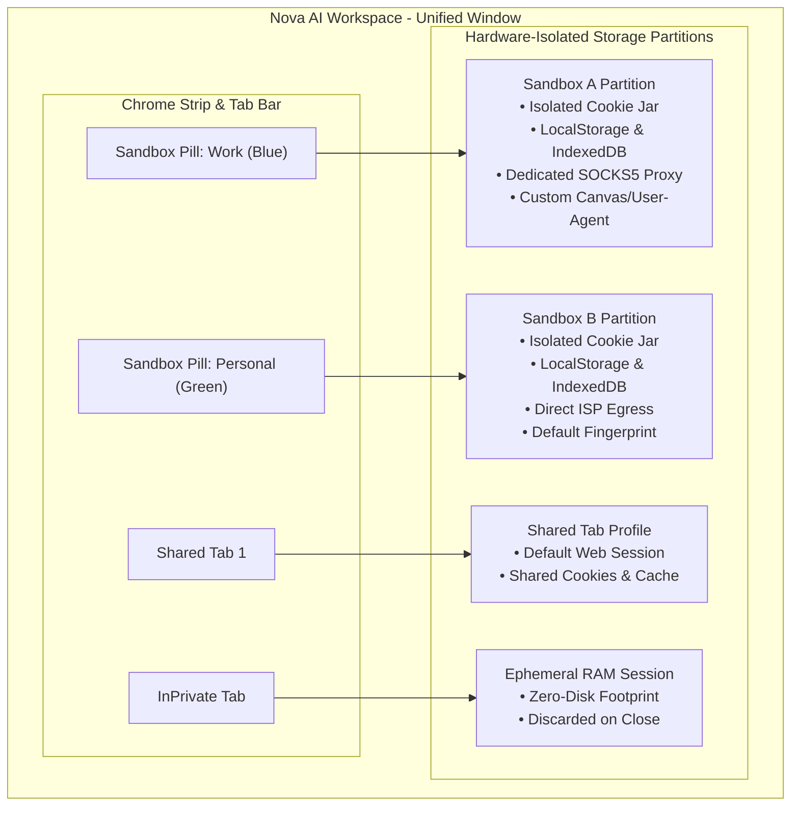

# Sandboxes & Profile Isolation

> [!NOTE]
> In Nova AI Workspace, you never need to launch separate browser instances, swap between user profiles, or install brittle container extensions to manage multiple accounts. **Sandboxes** provide hardware-isolated, side-by-side browser sessions directly within a single unified window.

---

## 1. What Are Sandboxes?

Sandboxes allow you to keep distinct, persistent web identities completely isolated from one another in the same window. For example, you can maintain a corporate work profile in **Sandbox A**, a personal account in **Sandbox B**, and an external client session in **Sandbox C**—all active simultaneously without repeated logins or cookie conflicts.



### Profile Isolation Comparison Matrix

| Capability | Shared Normal Tabs | Persistent Sandboxes (A–Z) | Ephemeral InPrivate Tabs |
| :--- | :--- | :--- | :--- |
| **Session Lifetime** | Persistent across restarts | Persistent across restarts | Discarded when session closes |
| **Cookie Jar** | Shared among all normal tabs | **Strictly isolated per sandbox** | Isolated in-memory only |
| **Storage & Cache** | Shared default partition | **Dedicated disk directory** | Ephemeral RAM only |
| **Proxy Egress** | Global proxy setting | **Dedicated per-sandbox proxy** | Inherits global or direct |
| **Fingerprint Masking** | Global setting | **Customizable per sandbox** | Strict anti-fingerprinting |
| **Multi-Tab Support** | Yes (standard tab strip) | **Yes (Sandbox Tabs)** | Yes (ephemeral session) |
| **Vault Autofill** | Enabled | Configurable per sandbox | Manual selection only |

---

## 2. Working with Sandboxes in the User Interface

Nova seamlessly blends sandboxed environments into the main browser window without adding visual clutter.

```
+-----------------------------------------------------------------------------------+
|  [ Work (Blue) ] [ Personal (Green) ] [ Client X ] | [Tab 1] [Tab 2] [+]  [_] [O] [X] |
+-----------------------------------------------------------------------------------+
|  [<-] [->] [Reload] | [Site info] https://corp-portal.company.com      | [Menu]   |
+-----------------------------------------------------------------------------------+
```

### 2.1 Sandbox Pills in the Title Bar
* **Pill Elements:** Each active sandbox appears as an elegant "pill" in the title bar immediately to the left of your browser tabs.
* **Instant Switching:** Clicking a sandbox pill immediately switches the viewport to that sandbox's active page.
* **Visual Marking:** Right-click any pill and choose **Mark** to assign:
  * **Accent Color:** A custom color indicator (Blue, Green, Purple, Orange, etc.) matching your workflow.
  * **Site Icon (Favicon):** The live favicon of the current webpage.
  * **Clean Name:** Pure typography without icons.

### 2.2 Finding & Managing Sandboxes
* **Searchable Palette:** If you operate numerous sandboxes, click **Find a sandbox** to open a fast, searchable command palette (`Search sandboxes`, `Manage sandboxes...`).
* **Start URLs & Fresh Sandboxes:** If a newly created sandbox has no saved history, Nova displays **Sandbox needs a start page**, prompting you for a default destination URL.

### 2.3 Creating and Configuring Sandboxes
Under **Settings → Sandboxes**, you can manage up to 100 independent sandboxes:
* **Add Sandbox (`+`):** Create a new environment by specifying its **Name**, visual accent color, and **Start URL**.
* **Proxy Binding:** Assign a dedicated HTTP, HTTPS, or SOCKS5 proxy tunnel exclusive to that sandbox.
* **Fingerprint Masking:** Enable specialized Canvas noise, User-Agent overrides, or locale spoofing for specific testing scenarios.
* **Password Vault Autofill:** Configure whether credentials from Nova's DPAPI vault should autofill within this environment.

---

## 3. Sandbox Tabs & Multi-Tab Workflows

A common limitation of profile containers in other browsers is the inability to handle popups or multi-page flows gracefully. Nova solves this with **Sandbox Tabs**:

* **Session Continuity:** When a page inside a sandbox opens a link in a new window (`target="_blank"`) or triggers an OAuth popup, Nova opens a dedicated **Sandbox Tab**.
* **Visual Badge:** Sandbox tabs are marked with a distinct badge: *Tab of sandbox {name} — shares its session*.
* **Preserving Complex Flows:** Single Sign-On (SSO) redirects, two-factor authentication popups, and 3D Secure payment gateways stay within the sandbox's isolated cookie jar, preventing authentication failures.
* **Configuration Toggle:** Right-click any pill to toggle **Allow tabs in this sandbox** (enabled by default).

---

## 4. The Boundary Guard: "This page wants to leave the sandbox"

To prevent accidental cross-contamination or unintended external navigation, Nova monitors domain boundaries within active sandboxes:

```
+-------------------------------------------------------------------+
|  This page wants to leave the sandbox "Work"                     |
|  Current origin:   https://internal-docs.company.com              |
|  Target origin:    https://external-service.partner.org/auth      |
|                                                                   |
|  Do you want to permit this navigation within this sandbox?       |
|                                                                   |
|  [ Allow for this step ]                   [ Always in this sandbox ] |
|  [ Cancel Navigation ]                                            |
+-------------------------------------------------------------------+
```

* **Allow for this step:** Grants a one-time navigation exception (essential for transient OAuth callbacks or identity provider redirects).
* **Always in this sandbox:** Whitelists the target domain for that specific sandbox, allowing seamless cross-domain navigation within enterprise ecosystems.
* **Cancel Navigation:** Halts the request and preserves the current page state.

---

## 5. Maintenance, Storage & Disk Anchors

Nova ensures that sandbox data is easy to clean, highly resilient, and never lost during system crashes.

### 5.1 Hiding vs. Deleting
* **Hide from Toolbar:** Right-click a pill and select **Hide from toolbar**. The sandbox disappears from the top bar to save space, but all sessions, cookies, and local data remain intact. Hidden sandboxes can be unhidden anytime in **Settings → Sandboxes**.
* **Delete Sandbox:** Permanently removes the sandbox configuration and deletes its isolated disk directory (`profile_storage\Sandbox_{id}`) from your PC.

### 5.2 Selective Data Clearing
Right-click a pill and choose **Clear sandbox data...** to selectively wipe:
* **Cache:** Clears temporary cached images and scripts without logging you out.
* **Cookies and Site Data:** Removes stored cookies and local databases for that sandbox only.
* **History and Last URL:** Clears the navigation history trail.
* **Reset Entire Sandbox:** Restores the sandbox to its initial pristine state.

### 5.3 Resilience via Disk Anchors
Nova writes lightweight disk metadata anchors into each sandbox directory on disk. If an unexpected Windows power failure or application crash occurs, Nova automatically discovers existing disk anchors during the next boot and reconciles your sandboxes, ensuring your configured accounts are never dropped into an orphaned state.

---

## 6. Working Beside AI Agents in Sandboxes

Autonomous agents integrated via MCP can safely operate within specific sandboxes without touching your personal browsing:

* **Targeted Leases:** Agents claim tabs or sandboxes explicitly via [`nova.tab_claim`](../../mcp-reference/tools/browser-automation/nova-tab-claim.md).
* **Visual Claim Indicators:** When an agent holds a lease on a sandbox, the pill displays an active agent pulse.
* **Guarded Sandbox Switching:** Agents cannot jump between sandboxes undetected; switching execution contexts requires [`nova.guarded_switch_sandbox`](../../mcp-reference/tools/guarded-actions/nova-guarded-switch-sandbox.md), which enforces configured confirmation policies.
* **Manual Release:** Right-click the claimed sandbox pill and select **Release agent** to revoke the agent's lease immediately and take full manual control.

---

## Related Documentation

* **[Core Features: Sandbox Isolation Architecture](../../core-features/sandbox-isolation/README.md)** — Low-level profile architecture and UDD management.
* **[Proxies & Network Routing](proxies.md)** — Assigning dedicated network tunnels to sandboxes.
* **[Passwords & Vault](passwords-and-vault.md)** — Protecting and autofilling credentials across profiles.
* **[Private Browsing Guide](../browser/private-browsing.md)** — Understanding ephemeral RAM sessions.
* **[Website & Agent Permissions](permissions.md)** — Access control and autonomy gates.

---

[Back to this section](README.md) · [All user guides](../README.md)
