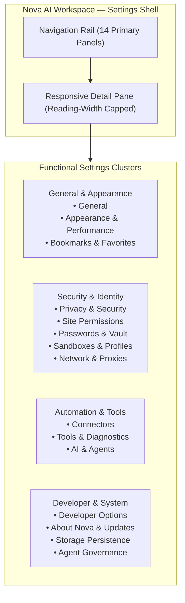

# Settings

> [!NOTE]
> Open **Menu → Settings** (or press `Alt+F` / `Alt+E` and select **Settings**) to configure workspace preferences, multi-profile sandboxes, security guardrails, and AI agent permissions. AI agents can also open the settings drawer programmatically via `nova.ui_open_settings(section='general')`.

---

## 1. Overview

Nova AI Workspace features a centralized, responsive settings center built directly into the WinUI 3 desktop shell. Unlike fragmented preference menus in traditional browsers, Nova organizes all user preferences, security policies, multi-sandbox profiles, and AI agent permissions into 14 structured panels accessible via a unified navigation rail.

Settings in Nova operate under a dual-layer security model: human users maintain absolute administrative authority over browser configuration, while connected AI agents operate through a strictly governed Model Context Protocol (MCP) catalog that permits updating user preferences while preventing agents from disabling their own supervisory guardrails.

---

## 2. Complete Settings Directory

### General & Appearance
| Panel | What It Covers | Key Options |
| :--- | :--- | :--- |
| **[General Settings](general.md)** | Language, search engine, startup & tray behaviors, downloads, and user diagnostics. | UI language, default search engine, `continueWhereLeftOff`, `closeBehavior`, download directory, auto-open rules. |
| **[Appearance & Performance](appearance.md)** | Hardware rendering, memory-saving sleeping tabs, background execution, and AI visualization overlays. | WebView2 GPU acceleration, `sleepingTabsEnabled`, `antiThrottlingEnabled`, assist cursor, HUD timeline. |
| **[Bookmarks & Favorites](bookmarks.md)** | Bookmarks bar display preferences, New Tab speed dial grid, and folder hierarchy. | Bookmarks bar visibility, speed dial shortcuts, folder tree management, HTML import/export. |

### Security & Identity
| Panel | What It Covers | Key Options |
| :--- | :--- | :--- |
| **[Privacy & Security](privacy-and-security.md)** | Omnibox search suggestions, browsing data clearance, browser identity presets, and audit logs. | `urlBarRemoteSearchSuggestions`, cache/cookie purge, Chrome/Firefox/Safari user-agent presets, `recordAgentBrowsingInHistory`. |
| **[Site Permissions](site-permissions.md)** | Permission Center defaults, media hardware selection, notifications, and remembered overrides. | Camera, microphone, speaker, location defaults (`ask`/`allow`/`deny`), DND quiet hours, agent data grants. |
| **[Passwords & Vault](passwords-and-vault.md)** | Local encrypted credential vault, master password, browser autofill, and agent credential access. | Argon2id + AES-256-GCM encryption, master passphrase, autofill toggle, `agentMayUseSavedPasswords`, CSV/JSON import/export. |
| **[History & Retention](history-and-retention.md)** | History lifespan limits, dual-record logging (human vs agent), and selective purges. | Retention periods (30 days to indefinite), `recordAgentBrowsingInHistory`, sandbox filtering, history scrub. |
| **[Sandboxes & Profiles](sandboxes.md)** | Hardware-isolated browser partitions, tab strip badges, start pages, and host boundary rules. | Adding/renaming sandboxes, color accents, `showAccountNamesInTabs`, start URL suggestions, allowed external hosts. |
| **[Network & Proxies](network-and-proxies.md)** | Custom proxy endpoints, per-sandbox proxy tunneling, traffic log retention, and SSL/TLS diagnostics. | HTTP/HTTPS/SOCKS5 proxy profiles, per-sandbox routing, proxy log retention days, `nova.tls_inspect`. |

### Automation & Tools
| Panel | What It Covers | Key Options |
| :--- | :--- | :--- |
| **[Connectors](connectors.md)** | External service pipelines: Mail, remote SSH shells, SFTP/FTP file sync, and external MCP servers. | IMAP/SMTP endpoints, recipient allowlists, SSH host keys, SFTP transfers, external MCP server registration. |
| **[Tools & Diagnostics](tools-and-diagnostics.md)** | Interactive MCP tool catalog browser, capability bundle management, and hardware probes. | Tool schema inspector, risk level indicators (`safe`, `normal`, `high_hazard`), audio/video loopback diagnostics. |
| **[AI & Agents](ai-and-agents.md)** | Master browser control kill-switch, autonomy levels, tab claim protection, and live audit logs. | `mcpRemoteControlEnabled`, autonomy levels (automatic/semi-automatic/supervised), tab claim timeouts, confirmation policies. |

### Developer & System
| Panel | What It Covers | Key Options |
| :--- | :--- | :--- |
| **[Developer Options](developer-options.md)** | DevTools launch preferences, mobile emulation viewport framing, diagnostic logging, and crash dumps. | `developerOptionsEnabled`, DevTools auto-launch, `emulationViewportFrameEnabled`, Serilog log level, minidumps. |
| **[About Nova & Updates](about-and-updates.md)** | Product branding, .NET 10 / WinUI 3 runtime architecture, license activation, and engine updates. | Version display, license key activation, alpha trial status, `autoApplyWebViewRuntimeUpdate`, diagnostic probes. |

---

## 3. Agent Governance Guide

For administrators and developers integrating autonomous AI agents:

* **[Agent Settings Governance & MCP Access](agent-governance-and-mcp.md)**:
  Examines how AI agents interact programmatically with settings via `nova.app_settings_get`, `nova.app_settings_set`, `nova.ui_open_settings`, and `nova.ui_close_settings`. Details the curated catalog dividing settings into **Writable Preferences** (which agents may adjust on request) and **Protected Security Switches** (which agents are strictly blocked from writing with `reasonCode: "app_settings.protected"`).

---

## 4. Find the Right Setting

| You want to configure … | Open this panel |
| :--- | :--- |
| UI language (English/Deutsch), default search engine, or startup tabs | **[General](general.md)** |
| What happens when clicking the window close button (`X`) | **[General](general.md)** (`closeBehavior`) |
| Download folder location, save-as prompts, or auto-opening file types | **[General](general.md)** |
| Hardware acceleration, sleeping idle tabs, or background execution speed | **[Appearance & Performance](appearance.md)** |
| The on-screen AI assist cursor, step HUD cards, or agent tempo pacing | **[Appearance & Performance](appearance.md)** |
| Address-bar search suggestion query privacy or clearing browsing data | **[Privacy & Security](privacy-and-security.md)** |
| Browser user-agent identity masking (Chrome, Firefox, Safari) | **[Privacy & Security](privacy-and-security.md)** |
| Default camera, microphone, speaker, or location permissions | **[Site Permissions](site-permissions.md)** |
| Blocking unprompted website media capture or setting Do Not Disturb | **[Site Permissions](site-permissions.md)** |
| Stored passwords, master password encryption, or agent credential access | **[Passwords & Vault](passwords-and-vault.md)** |
| History retention lifespan or ensuring agent visits remain auditable | **[History & Retention](history-and-retention.md)** |
| Creating sandboxes, assigning colors, or showing sandbox names on tabs | **[Sandboxes & Profiles](sandboxes.md)** |
| Routing a specific sandbox through a SOCKS5 proxy tunnel | **[Network & Proxies](network-and-proxies.md)** |
| Setting up IMAP/SMTP email sync, SSH shells, or external MCP tools | **[Connectors](connectors.md)** |
| Inspecting MCP tool schemas or running hardware diagnostic tests | **[Tools & Diagnostics](tools-and-diagnostics.md)** |
| Agent autonomy levels, high-impact confirmations, or emergency stop | **[AI & Agents](ai-and-agents.md)** |
| Auto-opening DevTools or rendering emulation screen outlines | **[Developer Options](developer-options.md)** |
| Bookmarks bar visibility, speed dial shortcuts, or importing bookmarks | **[Bookmarks & Favorites](bookmarks.md)** |
| License key activation, trial status, or WebView2 runtime updates | **[About Nova & Updates](about-and-updates.md)** |

---

## 5. Programmatic Control (MCP Quick Reference)

Connected AI agents can interact with the settings ecosystem using dedicated tools:

* **Query Settings:** Call `nova.app_settings_get(keys=['...'])` to inspect settings values, types, and write permissions.
* **Update Preferences:** Call `nova.app_settings_set(values={'...': ...})` to modify writable preferences.
* **Open Drawer for User:** Call `nova.ui_open_settings(section='site_permissions')` to present the settings UI to the user at a specific section.
* **Dismiss Drawer:** Call `nova.ui_close_settings()` to close the settings overlay when work resumes.

---

[All User Guides](../README.md) · [Connecting an Agent](../agents/connecting-an-agent.md) · [Watching Agent Work](../agents/watching-agent-work.md)
