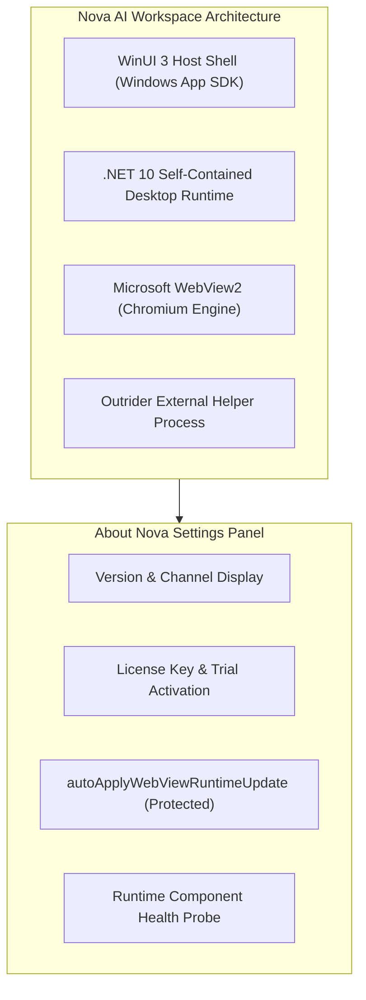

# About Nova & Updates Settings

> [!NOTE]
> Open **Menu → Settings → About Nova** (or press `Alt+F` / `Alt+E` and select **Settings → About**) to verify version details, inspect underlying runtime components, manage software licenses, and configure browser engine update policies.

---

## 1. Overview

The **About Nova** panel provides authoritative system information regarding your active installation of **Nova AI Workspace** (`NovaAIWorkspace.exe`). It details the exact versions of the user interface shell, underlying rendering engine, and background helper processes, while offering one-click license activation and diagnostic verification.

---

## 2. Product Identity & Runtime Architecture

Nova AI Workspace is built on modern, performant Windows desktop technologies:

* **Application Shell:** WinUI 3 powered by the Windows App SDK, providing fluid Windows design, dark/light theme integration, and hardware-accelerated desktop windowing.
* **Core Framework:** Modern **.NET 10** running self-contained, ensuring high-speed concurrency and memory safety without external runtime dependencies.
* **Rendering Engine:** Microsoft WebView2 (Evergreen Chromium), delivering compatibility with modern web standards, HTML5 video, WebAssembly, and CSS grid layouts.
* **Outrider Process:** `NovaBrowser.Outrider.exe`, Nova's external native helper process used for isolated hardware probes, crash isolation, and process sandboxing.

---

## 3. License Activation & Trial Management

Under **License Information**, you can manage your software subscription:

* **License Status:** Displays whether Nova is running under an active Enterprise license, Professional subscription, or Alpha Trial period.
* **Activate License:** Enter your customer license key and registration email to unlock full workspace capabilities.
* **Alpha Trial Access:** During the public alpha release, a pre-configured trial key is available for community testing and feedback.
* **Offline Activation:** For air-gapped development machines or restricted enterprise networks, Nova supports cryptographically verified offline activation tokens without requiring outbound internet access.

---

## 4. Protected Engine Updates (`autoApplyWebViewRuntimeUpdate`)

Maintaining an up-to-date web rendering engine is essential for safeguarding against newly discovered zero-day browser vulnerabilities:

* **Automatic WebView2 Updates:** When enabled, Nova automatically coordinates with Microsoft's Evergreen WebView2 installer to apply security patches and rendering improvements as soon as they are published.
* **The Protected Setting Invariant:**
  * Key Name: `autoApplyWebViewRuntimeUpdate`
  * In the agent settings catalog, this switch is strictly **protected**.
  * Connected AI agents can read its state via `nova.app_settings_get(keys=['autoApplyWebViewRuntimeUpdate'])`.
  * AI agents cannot disable automatic runtime updates programmatically via `nova.app_settings_set`. Any attempt returns `reasonCode: "app_settings.protected"` with the rationale *Engine updates carry security fixes.*
  * Only human administrators may alter runtime update policies.

---

## 5. Runtime Component Health Probe

The About panel includes an automated diagnostic probe that tests the health of all core subsystem boundaries:

* **Component Reachability:** Verifies that the WinUI 3 message loop, WebView2 environment, and Outrider process are communicating cleanly.
* **MCP Server Listener:** Confirms that Nova's internal Model Context Protocol listener is active and ready to accept connections from local AI agents.
* **Disk Space & Memory Check:** Measures available disk space on the profile volume and checks RAM allocation to ensure sufficient operating overhead.

---

## 6. Related Documentation

* **[Settings Hub](README.md)** — Main overview of all 14 settings panels.
* **[Developer Options Settings](developer-options.md)** — DevTools launch behaviors and minidumps.
* **[Tools & Capabilities Settings](tools-and-diagnostics.md)** — Capability bundles and diagnostic probes.
* **[Agent Governance & MCP](agent-governance-and-mcp.md)** — Programmatic settings access and protected switches.
