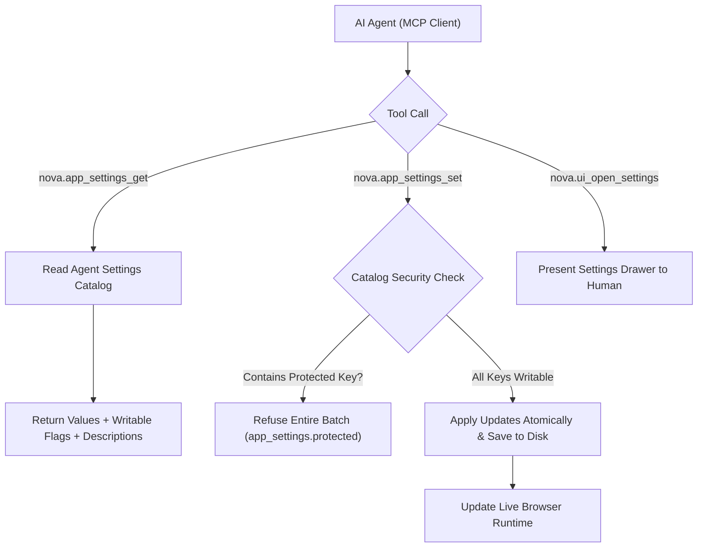

# Agent Settings Governance & MCP Access

> [!NOTE]
> This guide explains how AI agents read and modify browser configuration through Nova's Model Context Protocol (MCP) interface, details the curated agent settings catalog, and outlines the security invariants that protect human supervision safeguards.

---

## 1. Overview

Nova AI Workspace provides direct MCP tools for inspecting and updating application preferences. Rather than forcing agents to navigate the graphical user interface like a human or edit raw configuration files on disk, Nova exposes structured programmatic endpoints:

* **Inspection:** `nova.app_settings_get` queries active preferences and returns their types, descriptions, allowed enum values, and write permissions.
* **Modification:** `nova.app_settings_set` applies updates transactionally, triggering immediate runtime re-configuration across all open tabs.
* **Drawer Navigation:** `nova.ui_open_settings` and `nova.ui_close_settings` allow agents to present or dismiss specific settings panels in the graphical user interface for human review.



---

## 2. The Curated Agent Settings Catalog

To balance flexibility against security, Nova exposes a carefully curated subset of application preferences through `nova.app_settings_get` and `nova.app_settings_set`. Every entry in the catalog is classified into one of two categories:

1. **Writable Preferences:** Standard user-experience preferences that an agent may adjust when requested by the user.
2. **Protected Switches:** Critical security, supervisory, and credential safeguards that are strictly **read-only** for agents.

---

## 3. Writable Preferences Reference

When an agent calls `nova.app_settings_set(values={...})`, it can pass any combination of the following writable keys:

| Setting Key | Type | Allowed Values | Settings UI Location | Description |
| :--- | :--- | :--- | :--- | :--- |
| `continueWhereLeftOff` | `boolean` | `true`, `false` | Settings > General > Startup and closing | Reopen previous session tabs without asking after a normal exit. |
| `closeBehavior` | `string` | `ask`, `quit`, `minimizeToTray` | Settings > General > Startup and closing | What closing the main window does: ask once, quit, or minimize to system tray. |
| `externalLinkOpenMode` | `string` | `ask`, `newTab`, `privateTab` | Settings > General > Links from other programs | Where links clicked in external programs (email, chat) open. |
| `defaultSearchEngine` | `string` | `Google`, `Bing`, `DuckDuckGo` | Settings > General > Search engine | Default search provider for omnibox and New Tab searches. |
| `urlBarRemoteSearchSuggestions` | `boolean` | `true`, `false` | Settings > Privacy & Security | Send typed omnibox text to search provider for remote suggestions. |
| `downloadAskForLocation` | `boolean` | `true`, `false` | Settings > General > Downloads | Prompt with a file save dialog for each download instead of auto-saving. |
| `showAccountNamesInTabs` | `boolean` | `true`, `false` | Settings > Sandboxes | Display the sandbox account name badge on tab strip headers. |
| `sleepingTabsEnabled` | `boolean` | `true`, `false` | Settings > Appearance & performance | Automatically suspend idle background tabs to conserve system memory. |
| `sleepingTabsRestoreAsDiscarded` | `boolean` | `true`, `false` | Settings > Appearance & performance | Restored tabs from previous sessions load as stubs and hydrate on click. |
| `antiThrottlingEnabled` | `boolean` | `true`, `false` | Settings > Appearance & performance | Prevent background tabs from being throttled by timer and render limits. |
| `emulationViewportFrameEnabled` | `boolean` | `true`, `false` | Settings > Developer options | Render a visible high-contrast device outline around emulated screens. |
| `gpuIncidentNoticesEnabled` | `boolean` | `true`, `false` | Settings > Appearance & performance | Show an explanatory banner when automatic GPU crash recovery triggers. |

---

## 4. Protected Security Switches (Agent Read-Only)

Protected switches govern the very mechanisms designed to supervise, constrain, or audit AI agents. **Agents are strictly forbidden from writing these keys**:

| Protected Key | Type | Settings UI Location | Security Rationale |
| :--- | :--- | :--- | :--- |
| `mcpRemoteControlEnabled` | `boolean` | Settings > AI & agents | Agent access itself is the user's decision. |
| `mcpConfirmHighImpact` | `string` | Settings > AI & agents | An agent must not switch off the approval that is meant to stop it. |
| `recordAgentBrowsingInHistory` | `boolean` | Settings > Privacy & Security | The agent's trail in history is how the user sees what agents did. |
| `developerOptionsEnabled` | `boolean` | Settings > Developer options | Unlocks powerful debugging tools; the human user decides. |
| `vaultEnabled` | `boolean` | Settings > Passwords & autofill | Credential storage and decryption is the human user's decision. |
| `blockNonUserInitiatedMediaRequests` | `boolean` | Settings > Site permissions | A core defense against silent, unauthorized camera/microphone capture. |
| `autoApplyWebViewRuntimeUpdate` | `boolean` | Settings > About Nova | Browser engine updates carry vital security and vulnerability fixes. |

### The Atomic Rejection Protocol
If an agent attempts to write a batch of settings that includes even a single protected key:
1. Nova immediately halts execution without applying any changes.
2. The entire call is rejected with `reasonCode: "app_settings.protected"`.
3. None of the other requested values in that batch are written to disk.
4. The error response explicitly identifies which keys were refused, their human-readable rationale, and the exact UI path where the user can adjust them manually.

---

## 5. Controlling the Settings Drawer via MCP

When an agent needs human assistance or wants to direct the user's attention to a specific configuration section, it can control the settings drawer overlay:

### Opening Settings (`nova.ui_open_settings`)
An agent can open the settings drawer directly to a specific section using the `section` parameter:

```json
{
  "name": "nova_ui_open_settings",
  "arguments": {
    "section": "site_permissions"
  }
}
```

**Allowed Section Names:**
`general`, `appearance_performance`, `privacy_security`, `site_permissions`, `passwords`, `sandboxes`, `proxies`, `connectors`, `tools`, `ai_agents`, `developer`, `bookmarks`, `about`.

### Dismissing Settings (`nova.ui_close_settings`)
Once configuration is complete or when resuming autonomous navigation, the agent can dismiss the settings drawer:

```json
{
  "name": "nova_ui_close_settings",
  "arguments": {}
}
```

---

## 6. Dedicated MCP Configuration Endpoints

Preferences outside the general catalog are managed through specialized, domain-specific MCP tools:

* **Site Permissions:** `nova.permission_center_get` and `nova.permission_center_set` configure global camera, microphone, and location defaults.
* **Auto-Reload:** `nova.auto_reload_get` and `nova.auto_reload_set` configure periodic tab refreshes.
* **Terminal Styling:** `nova.terminal_settings_get` and `nova.terminal_settings_set` adjust console themes, font sizes, and color output.
* **Notification Policies:** `nova.notifications_permission_default_set` configures baseline web notification rules.

---

## 7. Related Documentation

* **[Settings Hub](README.md)** — Main overview of all 14 settings panels.
* **[AI & Agents Settings](ai-and-agents.md)** — Master autonomy and tool confirmation policies.
* **[Privacy & Security Settings](privacy-and-security.md)** — History recording and search suggestion privacy.
