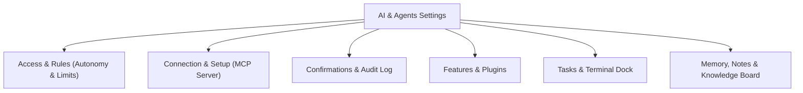
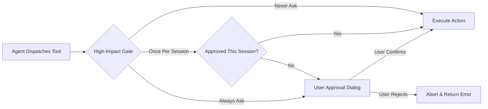

# AI & Agents Settings

> [!NOTE]
> Open **Menu → Settings → AI & agents** to configure local browser control, set autonomy levels, establish tool confirmation gates, and inspect audit logs of agent actions.

---

## 1. Overview

Nova AI Workspace is built from the ground up for seamless human-agent collaboration. Unlike conventional browsers where automation tools run in external headless environments, Nova connects directly with local AI coding agents (such as Claude Code, Codex, or custom MCP clients) within your actual browser windows.

The **AI & agents** settings panel gives you complete governance over what connected agents are allowed to do, when they must ask for your explicit approval, and how long they can reserve tabs.

---

## 2. Master Browser Control & Autonomy Levels

Under the **Access & rules** sub-tab, you establish the baseline autonomy policy for all connected AI agents:

* **Master Browser Control:** The top-level toggle (**Allow agents to control the browser**) acts as a software kill-switch. When disabled, the internal MCP server rejects all incoming agent tool commands, preventing any agent from inspecting or manipulating browser tabs.
* **Autonomy Levels:**
  * **Fully Automatic (Recommended):** The agent executes tasks independently within the bounds of granted permissions and configured confirmation policies. Ideal for smooth, multi-step research and automated workflows.
  * **Semi-Automatic:** The agent can navigate and inspect pages independently, but prompts you with an approval dialog before clicking buttons, submitting forms, or typing text.
  * **Supervised:** Requires explicit human confirmation for every action that lacks an existing standing approval.

> [!TIP]
> **Client-Level Approvals:** The autonomy level configured in Nova controls Nova's internal policy gates. Your external AI program (such as Claude Code or Codex) maintains its own client-side confirmation settings. Changing Nova's autonomy level to Fully Automatic does not override client-side safety prompts.

---

## 3. Advanced Agent Capabilities

To prevent rogue automation from interfering with your active work, Nova provides granular operational limits:

* **Agent May Open New Tabs:** Allows agents to spawn new browser tabs during multi-source research tasks without hijacking your current page.
* **Agent May Navigate in Other Tabs:** Governs whether an agent can redirect or navigate tabs other than the currently active tab.
* **Claim Interaction Protection:** When an agent claims a tab to execute a sequence of actions, Nova temporarily protects the tab from accidental human keyboard and mouse input. This ensures that you do not unintentionally disrupt an ongoing form fill or checkout flow.
* **Tab Claim Idle Timeout:** Automatically releases an agent's exclusive claim on a tab if no tool commands are issued within a specified number of minutes (default is 5 minutes; set to `0` to disable timeout).
* **Agent May Use Saved Passwords:** Determines whether an agent can request credentials from the encrypted [Nova Vault](../identity-and-security/passwords-and-vault.md) to log into authorized websites automatically.

---

## 4. Built-In Tools & Approval Timeouts

* **File and Command Access Mode:**
  * **Browser-only (Recommended):** Restricts the agent strictly to web browsing, tab navigation, and DOM interaction. Local shell commands and filesystem access through Nova's terminal dock are disabled.
  * **Filesystem Access:** Allows the agent to read and write files within designated working directories.
  * **Full Terminal Access:** Enables agent execution of CLI commands and terminal runners.
* **Approval Timeout:** Configures how long Nova waits for you to respond to an interactive confirmation prompt:
  * `0` (Default): Waits indefinitely until you click **Allow** or **Deny**.
  * `5 – 3600 seconds`: Automatically denies and cancels the action if you do not respond within the designated window, preventing unattended workflows from hanging indefinitely.

---

## 5. Confirmations, Gates & Audit Log

Under the **Confirmations & audit** sub-tab, you define precise safety boundaries for high-risk operations:

* **High-Impact Tools Confirmation:** Configure whether high-consequence operations (such as clearing browsing history, changing browser proxy settings, or triggering financial forms) require confirmation:
  * **Always ask:** Displays a confirmation prompt every single time.
  * **Once per session:** Asks on the first occurrence and remembers the grant until Nova is closed.
  * **Never ask:** Bypasses prompts for fully automated environments.
* **Granular Policy Categories:** Set independent confirmation rules for:
  * **Mutating Remote Operations:** Submitting forms, executing remote API calls, or modifying online accounts.
  * **Persistent Disk Writes:** Modifying local settings, writing session recordings, or exporting data.
  * **Sensitive Data Reads:** Reading stored passwords, dumping session cookies, or extracting clipboard history.
* **Ambient Auto-Apply:** Controls whether learned background actions (such as closing cookie banners) can execute automatically without prompting.
* **Persistent & Session Grants:** Review all active permission allowances granted during the current session, with one-click revocation buttons.
* **Live Audit Log:** A real-time, searchable chronological log recording every tool invocation, timestamp, payload, and result code received by Nova's MCP server.

---

## 6. Shared Knowledge Board

Under the **Knowledge board** sub-tab, you can enable Nova's experimental multi-agent memory feature:

* **Cross-Session Discoveries:** Allows agents to publish verified findings, site-specific navigation notes, and operational tips to a shared local database.
* **Human Visibility:** Review, inspect, and delete stored knowledge cards at any time.
* **Server Dependency:** The Knowledge Board requires the local MCP server to be active.

---

## 7. Immediate Intervention: Emergency Stop

If an agent behaves unexpectedly, you have two primary ways to take back control immediately:

1. **Global Emergency Stop:** Click **Menu → Emergency stop** to immediately terminate all active MCP tool requests, halt running scripts, interrupt terminal docks, and revoke all tab claims. See [Staying in control](../agents/taking-over-and-emergency-stop.md#3-staying-in-control).
2. **Tab Claim Release:** To take over a single tab without killing all background work, click the **Release agent** button on the tab's sandbox pill in the title bar.

---

[Back to settings](README.md) · [Connecting an agent](../agents/connecting-an-agent.md) · [Watching agent work](../agents/watching-agent-work.md) · [Staying in control](../agents/taking-over-and-emergency-stop.md#3-staying-in-control) · [Terminal dock](../tools/terminal.md) · [All user guides](../README.md)
