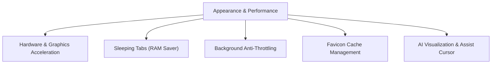
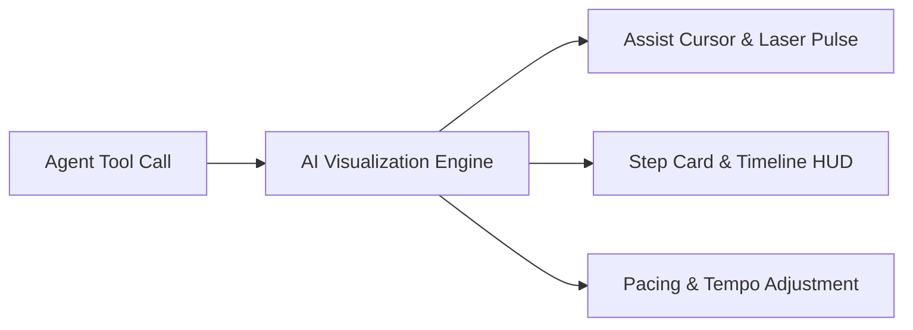

# Appearance & Performance Settings

> [!NOTE]
> Open **Menu → Settings → Appearance & performance** to manage graphics acceleration, memory-saving sleeping tabs, background script execution, and on-screen AI visualization.

---

## 1. Overview

Nova AI Workspace combines a responsive desktop browser with automated agent workflows. To keep the workspace smooth and memory-efficient while juggling heavy web applications, background tasks, and real-time agent observation, the **Appearance & performance** settings panel offers granular control over hardware resources and visual feedback.

You can also quickly toggle the visual overlay at any time via **Menu → View → AI visualization**.

---

## 2. Graphics & Hardware Acceleration

Hardware acceleration offloads web page rendering, CSS animations, and canvas operations to your computer's dedicated graphics card (GPU):

* **WebView2 Hardware Acceleration:** Enabled by default. Uses Direct3D and GPU rasterization for smooth scrolling and video playback. Turning this off forces software CPU rendering, which is useful when diagnosing visual glitches or incompatible graphics drivers.
* **Restart Requirement:** Changes to hardware acceleration take effect after restarting Nova.
* **GPU Incident Recovery Mode:** If your graphics card or display driver repeatedly crashes, Nova automatically starts the subsequent session once in software-rendering mode to prevent crash loops and displays a diagnostic banner. Once stability is restored, acceleration switches back on automatically.
* **Incident Notices:** Toggle whether Nova displays an explanatory banner whenever automatic GPU crash recovery triggers.

---

## 3. Sleeping Tabs & Memory Optimization

Multi-tab research across multiple sandboxes can consume significant system RAM. Sleeping tabs automatically suspend idle web views to free up system memory:

* **Enable Sleeping Tabs:** When active, background tabs that have not been viewed for a designated period are put to sleep, releasing their active memory footprint.
* **Inactivity Timeout:** Configure the idle threshold before a tab is suspended (e.g., 5, 15, 30, or 60 minutes).
* **Restore as Discarded:** When opening Nova with previously open tabs, tabs are loaded as discarded stubs rather than loading every page simultaneously into memory.
* **Transparent Re-hydration:** Clicking a sleeping tab immediately wakes it up and restores the webpage. If an AI agent targets a sleeping tab via an MCP tool call, Nova wakes and re-hydrates the tab transparently before executing the action.

> [!IMPORTANT]
> **Safety Invariants:**
> * **Protected Tabs:** The currently active tab, pinned tabs, and any tab actively playing audio or media are **never** put to sleep.
> * **Form Data Consideration:** Unsaved input in web forms on idle tabs may be lost when the tab is discarded. Save your progress before leaving long-running form pages in the background.

---

## 4. Background Anti-Throttling

Modern Chromium-based engines throttle JavaScript timers, requestAnimationFrame cycles, and network polling in background tabs to conserve battery and CPU power:

* **Anti-Throttling Mode:** Keeps background tabs running at full execution speed even when Nova is minimized, covered by other windows, or running in the notification area.
* **Use Cases:** Essential when running long-running agent workflows, background web scrapers, continuous real-time data feeds, or automated downloads that require uninterrupted execution.
* **Immediate Effect:** Unlike hardware acceleration changes, toggling anti-throttling applies immediately without requiring an application restart.

---

## 5. Favicon Cache Management

Nova caches website icons (favicons) locally to provide instant visual identification in the tab strip, bookmarks bar, and New Tab speed dials:

* **Clear Favicon Cache:** Purges all cached site icons from the local profile.
* **Automatic Reload:** When the cache is cleared, open tabs, saved favorites, and speed dial shortcuts automatically fetch fresh icons upon their next load, resolving stale, corrupted, or missing logos.

---

## 6. AI Visualization & Assist Controls

The **AI visualization** suite (formerly known as Live Assist) renders live visual overlays showing what an AI agent is doing on the page in real time:

* **Assist Cursor:** Overlays a dedicated on-screen cursor labelled **AI** that moves to targeted buttons, input fields, and links before clicking or typing. Visual pulses highlight the exact moment of interaction.
* **Reduced Motion:** Calms down animation speeds and transitions for users sensitive to rapid cursor movement or flashing indicators.
* **Step Cards & Timeline HUD:** Displays a floating on-screen card indicating the current task phase (e.g., *Step 2/5: Click Submit*), upcoming actions, and whether a verification step succeeded.
* **Tempo Presets:** Adjusts the pacing and delay between sequential agent actions, allowing you to slow down operations to follow along comfortably or speed them up for maximum productivity.

For an in-depth walkthrough of observing live agent interactions and taking manual control, see [Watching Agent Work](../agents/watching-agent-work.md).

---

## 7. Related Documentation

* **[Settings Hub](README.md)** — Main overview of all 14 settings panels.
* **[General Settings](general.md)** — Startup restoration and window close behaviors.
* **[Developer Options Settings](developer-options.md)** — Emulation viewport framing and DevTools.
* **[Agent Governance & MCP](agent-governance-and-mcp.md)** — Programmatic settings access and curated keys.
* **[Watching Agent Work](../agents/watching-agent-work.md)** — Real-time visual overlay and live agent inspection.

---

[Back to settings](README.md) · [Watching agent work](../agents/watching-agent-work.md) · [All user guides](../README.md)
