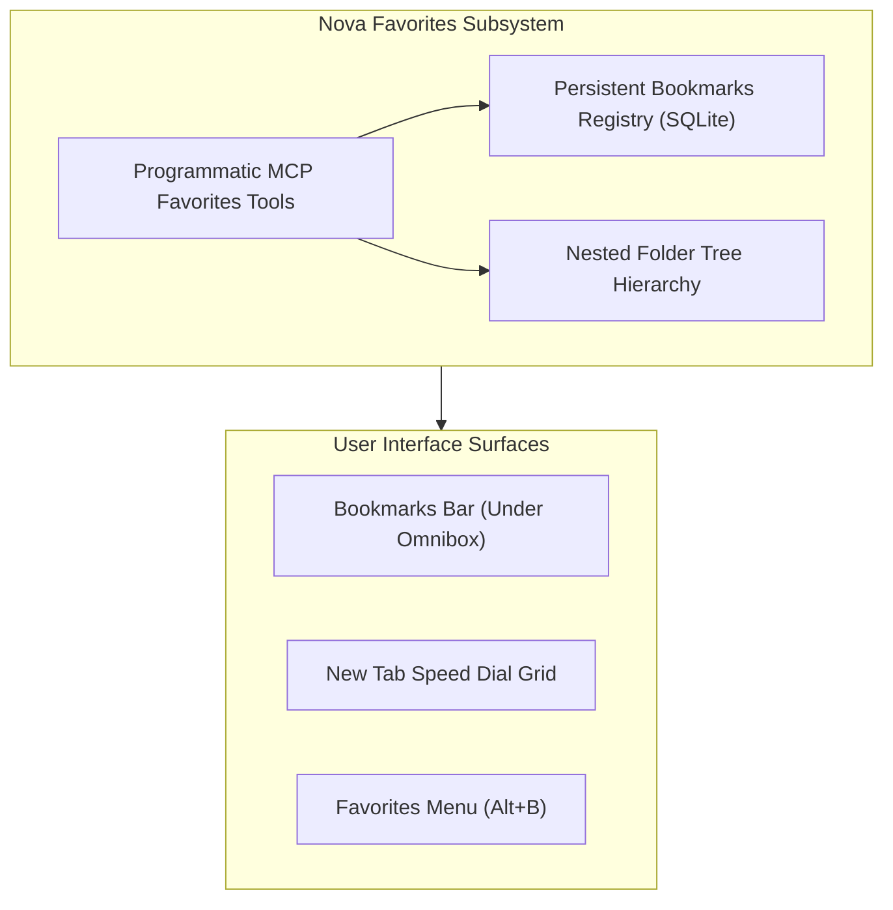

# Bookmarks, Favorites & Folder Hierarchy

> [!NOTE]
> Open **Menu → Settings → Bookmarks** (or press `Alt+F` / `Alt+E` and select **Settings → Bookmarks**) to manage saved web favorites, configure bookmarks bar visibility, customize New Tab speed dials, organize folder structures, and automate bookmarks over MCP.

---

## 1. Overview & Surfaces

Nova AI Workspace provides an integrated favorites and bookmarking engine. Whether curating technical documentation links, organizing client portals, or customizing speed-dial tiles on the New Tab page, Nova gives both human operators and autonomous agents complete control over the bookmark hierarchy.



---

## 2. Bookmarks Bar Display Preferences

The bookmarks bar provides instant single-click access to your most frequently used websites directly below the omnibox address bar:

* **Always Show:** Keeps the bookmarks bar visible at all times across all web tabs.
* **Show Only on New Tab (Default):** Displays the bookmarks bar on blank New Tab pages while hiding it on active websites to maximize vertical screen real estate.
* **Never Show:** Completely hides the bookmarks bar; favorites remain accessible via the `Alt+B` menu or the favorites toolbar icon.
* **Show Favicons Only:** Condenses bookmarks on the bar to their site icons, fitting dozens of quick links onto a single line.

---

## 3. Speed Dial Shortcuts Management

The New Tab page displays a configurable grid of speed-dial shortcut tiles:

* **Customizing Tiles:** Add, edit, or remove shortcut tiles directly from the settings panel or on the New Tab page.
* **Sandbox Scoping:** Speed-dial shortcuts can be scoped to specific sandboxes, displaying development links in your Work sandbox and media sites in your Personal sandbox.
* **Automatic Most-Visited Tiles:** Toggle whether Nova automatically populates empty speed-dial slots with your most frequently visited sites.

---

## 4. Folder Hierarchy & Organization

Under **Manage Bookmarks**, you can organize your saved links into a clean, searchable tree:

* **Nested Folders:** Create nested folder structures (e.g. *Projects → Cloud Consoles → Production*).
* **Search & Duplicates Filter:** Quickly locate specific bookmarks across large collections and find duplicate URLs with one click.
* **Batch Editing:** Move, re-tag, or delete multiple bookmarks simultaneously.

---

## 5. Programmatic Bookmarks Automation over MCP

Connected AI agents can inspect, organize, and navigate bookmarks using Nova's dedicated MCP favorites tools:

### 5.1 Querying & Managing Favorites
* **List Favorites ([`nova.favorites_list`](../../mcp-reference/tools/app-shell-and-ui/nova-favorites-list.md)):** Search bookmarks by keyword or folder:
  ```json
  {
    "query": "documentation",
    "maxResults": 10
  }
  ```
* **Add Favorite ([`nova.favorites_add`](../../mcp-reference/tools/app-shell-and-ui/nova-favorites-add.md)):** Save a URL with custom title, destination folder, and optional New Tab pinning:
  ```json
  {
    "url": "https://example.com/api/docs",
    "title": "API Documentation",
    "pinToNewTab": true
  }
  ```
* **Open Favorite ([`nova.favorites_open`](../../mcp-reference/tools/app-shell-and-ui/nova-favorites-open.md)):** Navigate the browser directly to a saved bookmark:
  ```json
  {
    "url": "https://example.com/api/docs",
    "openInNewTab": true
  }
  ```
* **Move Favorite ([`nova.favorites_move`](../../mcp-reference/tools/app-shell-and-ui/nova-favorites-move.md)):** Relocate a bookmark to a target folder.
* **Remove Favorite ([`nova.favorites_remove`](../../mcp-reference/tools/app-shell-and-ui/nova-favorites-remove.md)):** Delete a bookmark by ID or URL.

### 5.2 Managing Folder Hierarchies
* **List Folders ([`nova.bookmarks_folders_list`](../../mcp-reference/tools/app-shell-and-ui/nova-bookmarks-folders-list.md)):** Retrieve the complete directory tree of bookmark folders.
* **Create Folder ([`nova.bookmarks_folder_create`](../../mcp-reference/tools/app-shell-and-ui/nova-bookmarks-folder-create.md)):** Create a new folder or subfolder (`name`, `parentId`).
* **Rename Folder ([`nova.bookmarks_folder_rename`](../../mcp-reference/tools/app-shell-and-ui/nova-bookmarks-folder-rename.md)):** Update folder display names.
* **Delete Folder ([`nova.bookmarks_folder_delete`](../../mcp-reference/tools/app-shell-and-ui/nova-bookmarks-folder-delete.md)):** Remove a folder and manage child item retention.

---

## 6. Import & Export Utilities

Migrating your favorites between browsers is seamless:

* **Import Bookmarks:** Import bookmarks from a standard HTML bookmarks file exported from Google Chrome, Mozilla Firefox, Microsoft Edge, or Safari.
* **Export Bookmarks:** Export your entire Nova favorites tree as a universal `bookmarks.html` file for backup or cross-browser synchronization.
* **Folder Destination:** During import, choose whether imported links merge into your existing root or place themselves inside a dedicated `Imported Bookmarks` folder.

---

## 7. Summary Tool Matrix

| Tool | Capability | Primary Use Case |
| :--- | :--- | :--- |
| [`nova.favorites_list`](../../mcp-reference/tools/app-shell-and-ui/nova-favorites-list.md) | Search favorites | Find saved links matching queries or folder IDs. |
| [`nova.favorites_add`](../../mcp-reference/tools/app-shell-and-ui/nova-favorites-add.md) | Add favorite | Save a web link with custom folder and speed dial options. |
| [`nova.favorites_open`](../../mcp-reference/tools/app-shell-and-ui/nova-favorites-open.md) | Navigate to favorite | Open a saved bookmark in the active tab or a new tab. |
| [`nova.favorites_move`](../../mcp-reference/tools/app-shell-and-ui/nova-favorites-move.md) | Move favorite | Organize links into target folders. |
| [`nova.favorites_remove`](../../mcp-reference/tools/app-shell-and-ui/nova-favorites-remove.md) | Remove favorite | Delete obsolete bookmarks. |
| [`nova.bookmarks_folders_list`](../../mcp-reference/tools/app-shell-and-ui/nova-bookmarks-folders-list.md) | List folders | Inspect bookmark category trees. |
| [`nova.bookmarks_folder_create`](../../mcp-reference/tools/app-shell-and-ui/nova-bookmarks-folder-create.md) | Create folder | Create nested folders for project links. |
| [`nova.bookmarks_folder_rename`](../../mcp-reference/tools/app-shell-and-ui/nova-bookmarks-folder-rename.md) | Rename folder | Update folder titles. |
| [`nova.bookmarks_folder_delete`](../../mcp-reference/tools/app-shell-and-ui/nova-bookmarks-folder-delete.md) | Delete folder | Prune unused folder categories. |

---

## 8. Related Documentation

* **[App Shell & Bookmarks Architecture](../../core-features/app-shell-and-window-management/README.md)** — Architectural specification for bookmark hierarchies, folder IDs, and MCP favorites lifecycle.
* **[Browser Favorites User Guide](../browser/favorites.md)** — Interactive desktop instructions for organizing bookmarks and speed dials.
* **[Settings Hub](README.md)** — Main overview of all 14 settings panels.
* **[General Settings](general.md)** — Search engine defaults and download destinations.
* **[Sandboxes & Profiles Settings](sandboxes.md)** — Profile isolation and sandbox start pages.

---

[Back to Settings Hub](README.md) · [All user guides](../README.md)
