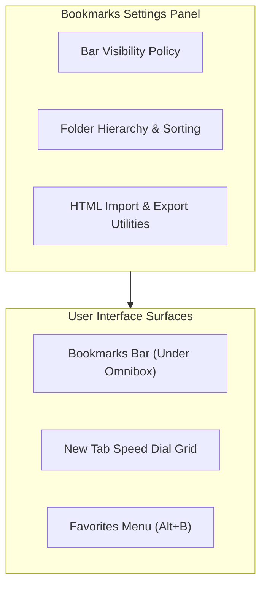

# Bookmarks & Favorites Settings

> [!NOTE]
> Open **Menu → Settings → Bookmarks** (or press `Alt+F` / `Alt+E` and select **Settings → Bookmarks**) to manage your saved web favorites, toggle bookmarks bar visibility, customize New Tab speed dials, and import/export bookmarks.

---

## 1. Overview

Nova AI Workspace provides a comprehensive favorites and bookmarking engine. Whether organizing hundreds of technical documentation links, pinning everyday web tools, or curating speed-dial shortcuts on your New Tab page, the **Bookmarks** settings panel gives you complete structural control over your collection.

---

## 2. Bookmarks Bar Display Preferences

The bookmarks bar provides instant single-click access to your most frequently used websites directly below the omnibox address bar:

* **Always Show:** Keeps the bookmarks bar visible at all times across all web tabs.
* **Show Only on New Tab (Default):** Displays the bookmarks bar on blank New Tab pages while hiding it on active websites to maximize vertical screen real estate.
* **Never Show:** Completely hides the bookmarks bar; favorites remain accessible via the `Alt+B` menu or the favorites button.
* **Show Favicons Only:** Condenses bookmarks on the bar to their site icons, fitting dozens of quick links onto a single line.

---

## 3. Speed Dial Shortcuts Management

The New Tab page displays a configurable grid of speed-dial shortcuts:

* **Customizing Tiles:** Add, edit, or remove shortcut tiles directly from the settings panel or on the New Tab page.
* **Sandbox Association:** Speed-dial shortcuts can be scoped to specific sandboxes, displaying development links in your Work sandbox and media sites in your Personal sandbox.
* **Automatic Most-Visited Tiles:** Toggle whether Nova automatically populates empty speed-dial slots with your most frequently visited sites.

---

## 4. Folder Hierarchy & Organization

Under **Manage Bookmarks**, you can organize your saved links into a clean, searchable tree:

* **Nested Folders:** Create nested folder structures (e.g. *Projects → Cloud Consoles → Production*).
* **Search & Duplicates Filter:** Quickly locate specific bookmarks across large collections and find duplicate URLs with one click.
* **Batch Editing:** Move, re-tag, or delete multiple bookmarks simultaneously.

---

## 5. Import & Export Utilities

Migrating your favorites between browsers is seamless:

* **Import Bookmarks:** Import bookmarks from a standard HTML bookmarks file exported from Google Chrome, Mozilla Firefox, Microsoft Edge, or Safari.
* **Export Bookmarks:** Export your entire Nova favorites tree as a universal `bookmarks.html` file for backup or cross-browser synchronization.
* **Folder Destination:** During import, choose whether imported links merge into your existing root or place themselves inside a dedicated `Imported Bookmarks` folder.

---

## 6. Related Documentation

* **[Settings Hub](README.md)** — Main overview of all 14 settings panels.
* **[General Settings](general.md)** — Search engine defaults and download destinations.
* **[Sandboxes & Profiles Settings](sandboxes.md)** — Profile isolation and sandbox start pages.
