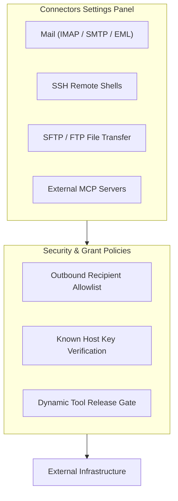

# Connectors Settings

> [!NOTE]
> Open **Menu → Settings → Connectors** (or press `Alt+F` / `Alt+E` and select **Settings → Connectors**) to configure external service pipelines, manage SSH/SFTP endpoints, set up email synchronization, and register third-party MCP servers.

---

## 1. Overview

Nova AI Workspace extends beyond traditional web browsing by providing built-in **Connectors** for enterprise infrastructure. Instead of requiring external command-line utilities or background daemons, Nova features integrated connectors for Mail (IMAP/SMTP), remote servers (SSH/SFTP), file servers (FTP/FTPS), and external Model Context Protocol (MCP) servers.

The **Connectors** settings panel allows you to configure connection credentials, test remote server reachability, define email recipient allowlists, and manage tool release governance.

---

## 2. Mail Connector (IMAP / SMTP)

The Mail connector enables automated email workflows—such as retrieving verification codes during signup flows, backing up messages to EML archives, or sending automated notifications:

* **IMAP Configuration:** Server hostname, port (e.g. 993 with SSL/TLS), username, and encrypted password.
* **SMTP Configuration:** Outgoing mail server (e.g. port 587 with STARTTLS or 465 with SSL), sender address, and credentials.
* **Test Connection:** Verify mailbox authentication and incoming folder synchronization before activating agent mail tools.
* **Outbound Recipient Allowlists:** To prevent automated spam or unintended data exfiltration, you can restrict outgoing email delivery to specific pre-approved recipient domains or addresses.

---

## 3. Remote Server Connectors (SSH, SFTP, FTP)

Nova allows agents and operators to interact directly with remote server infrastructure:

* **SSH Connector:**
  * Define remote Linux/Unix host endpoints, port (default 22), username, and private key or password authentication.
  * Used for executing remote administrative commands, deploying artifacts, and monitoring server health without giving up credential control.
* **SFTP & FTP/FTPS Connectors:**
  * Establish secure file transfer pipelines for uploading web assets, retrieving server log bundles, or syncing test artifacts.
  * Supports directory navigation, file permissions (`chmod`, `chown`), and bandwidth-throttled transfers.
  * **Checksum Verification:** Supports SHA-256 integrity validation (`verifySha256`) to ensure uploaded or downloaded files match remote storage exactly.
  * **Automatic Transfer Resumption:** Enable "Continue interrupted file transfers after Nova starts" under Connectors Settings to automatically resume partial file transfers 30 seconds after application startup.
* **Remote Database Management (MySQL & MariaDB over SSH):**
  * Configured via **Settings > Connectors > SFTP > Databases…** (or via `nova.connector_database_set`).
  * Connects to MySQL/MariaDB instances running on the SSH host (via localhost, Unix domain sockets, or internal container networks).
  * Stores database usernames, schemas, and passwords securely in DPAPI or resolves them from the Nova Vault (`passwordFromVault`).
  * Enables agents to run SQL statements via `nova.db_query` with strict safety envelopes (AST validation, read-only transaction envelopes) without shell access (`process.exec`).
  * Supports automated database exports and backups via `nova.db_export` (governed by the `db.export` capability), producing compressed `.sql.gz` or `.sql` dumps with optional `portable=true` sanitization (stripping `DEFINER` clauses for phpMyAdmin/shared-hosting import compatibility).
  * Restores such an export with `nova.db_restore` (permission **Restore database exports**, `db.restore`). Nova backs up the current state first and asks you before every restore, even when the permission is set to "always"; "always" only means it is not blocked.
* **Connection Notes & Infrastructure Context:**
  * Each connector profile includes a dedicated note field (`note`, up to 500 characters) for documenting hosting provider names, data center locations, management panel URLs (cPanel, Plesk), or server roles.
  * Notes are visible to agents via `nova.connector_list` as plain text operational metadata without exposing credentials.

---

## 4. External MCP Servers & Dynamic Tool Release

In addition to Nova's own native tools, Nova can act as an MCP aggregator, connecting to external MCP servers running on your machine or local network:

* **Adding an External Server:** Specify a friendly server name, transport type (e.g. stdio or SSE), executable command, and environment variables.
* **Tool Discovery & Release Management:**
  * When an external server connects, Nova inspects its declared tools and lists them in the settings panel.
  * **Tool Release Toggle:** You can selectively enable or disable individual external tools, ensuring that only trusted capabilities are exposed to your AI agents.
* **Process Lifecycle:** Nova monitors external server processes, providing one-click restarts and displaying real-time stderr logs if an external server fails.

---

## 5. Security & Permission Grants

All connector actions operate under Nova's strict agent governance model:

* **Explicit Grant Requirements:** Agents cannot initiate outbound SSH connections, send emails, or transfer files unless the corresponding connector has been granted permission in Settings.
* **Stepped Confirmation:** Destructive operations—such as deleting remote files via SFTP or transmitting emails—can be configured to require stepped user approval in the UI.

---

## 6. Related Documentation

* **[Settings Hub](README.md)** — Main overview of all 14 settings panels.
* **[Network & Proxies Settings](network-and-proxies.md)** — Proxy routing and TLS inspection.
* **[Tools & Capabilities Settings](tools-and-diagnostics.md)** — Built-in capability bundles and tool inspector.
* **[Agent Governance & MCP](agent-governance-and-mcp.md)** — Programmatic settings access and curated keys.
