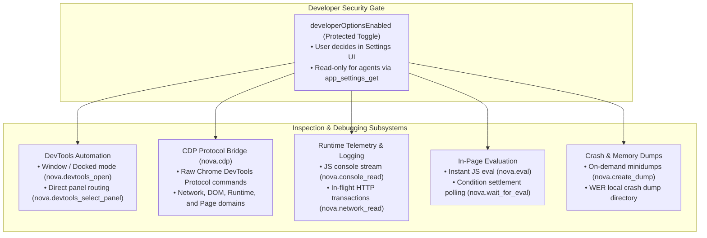

# Developer Options, DevTools & Runtime Diagnostics

> [!NOTE]
> Open **Menu → Settings → Developer options** (or press `Alt+F` / `Alt+E` and select **Settings → Developer**) to configure DevTools launch preferences, mobile emulation framing, diagnostic logging verbosity, CDP protocol access, and crash dump management.

---

## 1. Overview & Architecture

Nova AI Workspace provides an integrated runtime debugging and developer suite engineered for web developers, software engineers, and QA automation teams. It bridges standard Chromium DevTools with programmatic Model Context Protocol (MCP) inspection capabilities, allowing humans and autonomous agents to diagnose frontend rendering, network traffic, and DOM lifecycle events.



---

## 2. Protected Master Toggle (`developerOptionsEnabled`)

Because developer capabilities grant unthrottled access to internal browser memory and DOM execution contexts, the master switch is guarded by a human-in-the-loop protection policy:

* **Protected Configuration Key:** `developerOptionsEnabled` can be inspected by AI agents via `nova.app_settings_get(keys=['developerOptionsEnabled'])`.
* **Tamper Resistance:** Connected agents cannot enable developer options programmatically via `nova.app_settings_set`. Any attempt returns `reasonCode: "app_settings.protected"` (*Unlocks powerful tools; the user decides.*).
* **Enabling in the UI:** Open **Settings → Developer options** and toggle **Enable developer options** to **On**.

---

## 3. Chromium DevTools Automation

When developing frontend applications or guiding an agent through complex layouts, you can launch and direct DevTools programmatically or automate its behavior:

### 3.1 Launching DevTools ([`nova.devtools_open`](../../mcp-reference/tools/app-shell-and-ui/nova-devtools-open.md))
Opens the Chromium DevTools inspector for a target tab in either detached window or docked mode:

```json
{
  "name": "nova.devtools_open",
  "arguments": {
    "targetId": "tab-101",
    "mode": "window"
  }
}
```

### 3.2 Direct Panel Routing ([`nova.devtools_select_panel`](../../mcp-reference/tools/app-shell-and-ui/nova-devtools-select-panel.md))
Directly focus a specific DevTools panel without manual clicking:

```json
{
  "name": "nova.devtools_select_panel",
  "arguments": {
    "targetId": "tab-101",
    "panel": "network"
  }
}
```

Supported panels include: `"elements"`, `"console"`, `"sources"`, `"network"`, `"performance"`, `"memory"`, `"application"`, and `"security"`.

---

## 4. Chrome DevTools Protocol (CDP) Bridge ([`nova.cdp`](../../mcp-reference/tools/app-shell-and-ui/nova-cdp.md))

For advanced test automation, Nova exposes a raw Chrome DevTools Protocol bridge. Connected agents can issue low-level CDP commands across the `Page`, `DOM`, `Runtime`, `Network`, and `Emulation` domains:

```json
{
  "name": "nova.cdp",
  "arguments": {
    "targetId": "tab-101",
    "method": "Runtime.evaluate",
    "params": {
      "expression": "window.performance.timing.loadEventEnd - window.performance.timing.navigationStart",
      "returnByValue": true
    }
  }
}
```

This unlocks capabilities such as setting custom cookie policies, capturing raw layout metrics, or inspecting shadow DOM boundaries.

---

## 5. Runtime Telemetry: Console & Network Activity

Nova captures console and network streams directly inside its diagnostic bus, allowing operators and agents to audit errors without opening visual DevTools:

### 5.1 JavaScript Console Streaming ([`nova.console_read`](../../mcp-reference/tools/dom-and-reading/nova-console-read.md))
Inspect logged console statements (`console.log`, `console.warn`, `console.error`), uncaught exceptions, and unhandled promise rejections:

```json
{
  "name": "nova.console_read",
  "arguments": {
    "targetId": "tab-101",
    "maxEntries": 50,
    "clear": false
  }
}
```

### 5.2 Network Activity Inspection ([`nova.network_read`](../../mcp-reference/tools/dom-and-reading/nova-network-read.md))
Inspect outgoing HTTP requests, response status codes, timing metrics, and payloads:

```json
{
  "name": "nova.network_read",
  "arguments": {
    "targetId": "tab-101",
    "onlyFailed": true,
    "includeBodies": false
  }
}
```

Filter network traces by URL patterns (`urlContains`), GraphQL operations (`graphqlOperation`), or HTTP methods (`methods`).

---

## 6. In-Page Runtime Evaluation

* **Synchronous Evaluation ([`nova.eval`](../../mcp-reference/tools/dom-and-reading/nova-eval.md)):** Execute JavaScript expressions within the page's execution context and return serialized results:
  ```json
  {
    "name": "nova.eval",
    "arguments": {
      "targetId": "tab-101",
      "expression": "document.querySelectorAll('.data-row').length"
    }
  }
  ```
* **Settlement Polling ([`nova.wait_for_eval`](../../mcp-reference/tools/dom-and-reading/nova-wait-for-eval.md)):** Poll an expression until it evaluates to truthy (ideal for single-page applications with asynchronous data loading):
  ```json
  {
    "name": "nova.wait_for_eval",
    "arguments": {
      "targetId": "tab-101",
      "expression": "document.querySelector('#checkout-complete') !== null",
      "timeoutMs": 10000
    }
  }
  ```

---

## 7. Emulation Viewport Framing (`emulationViewportFrameEnabled`)

When testing responsive layouts or simulating mobile screens (`nova.emulation_use_device` or `nova.emulation_set_device_metrics`):
* **Visual Device Boundary:** Nova renders a high-contrast physical frame around the emulated screen dimensions, clearly separating the active viewport from unused desktop letterboxing.
* **Agent Configuration:** Agents can toggle this visual indicator via `nova.app_settings_set(values={'emulationViewportFrameEnabled': True})`.

---

## 8. Diagnostic Logging & Minidump Management

For diagnosing performance bottlenecks or application faults:

* **Log Files:** Nova writes structured Serilog diagnostic events to `%LOCALAPPDATA%\NovaBrowser\Logs\`.
* **Crash Dumps & WER Minidumps:**
  * When native errors occur, Windows Error Reporting writes minidumps to `%LOCALAPPDATA%\nova-cognitive\CrashDumps\`.
  * **On-Demand Minidump Generation ([`nova.create_dump`](../../mcp-reference/tools/app-shell-and-ui/nova-create-dump.md)):** Create a diagnostic memory dump on demand to capture thread state and memory footprints during testing.

---

## 9. Summary Tool Matrix

| Tool | Capability | Primary Use Case |
| :--- | :--- | :--- |
| [`nova.devtools_open`](../../mcp-reference/tools/app-shell-and-ui/nova-devtools-open.md) | Open DevTools | Launch Chromium DevTools in windowed or docked mode. |
| [`nova.devtools_select_panel`](../../mcp-reference/tools/app-shell-and-ui/nova-devtools-select-panel.md) | Focus DevTools panel | Direct DevTools immediately to Network, Console, or Elements. |
| [`nova.cdp`](../../mcp-reference/tools/app-shell-and-ui/nova-cdp.md) | Raw CDP protocol | Execute low-level Chrome DevTools Protocol commands directly. |
| [`nova.console_read`](../../mcp-reference/tools/dom-and-reading/nova-console-read.md) | Stream console logs | Retrieve JavaScript console messages, warnings, and errors. |
| [`nova.network_read`](../../mcp-reference/tools/dom-and-reading/nova-network-read.md) | Inspect HTTP activity | Audit in-flight requests, failed endpoints, and status codes. |
| [`nova.eval`](../../mcp-reference/tools/dom-and-reading/nova-eval.md) | In-page JS execution | Evaluate JavaScript expressions directly in the active DOM. |
| [`nova.wait_for_eval`](../../mcp-reference/tools/dom-and-reading/nova-wait-for-eval.md) | Poll expression settlement | Wait until an asynchronous frontend condition becomes true. |
| [`nova.create_dump`](../../mcp-reference/tools/app-shell-and-ui/nova-create-dump.md) | Capture minidump | Generate an on-demand memory dump for diagnostic analysis. |

---

## 10. Related Documentation

* **[Settings Hub](README.md)** — Main overview of all 14 settings panels.
* **[Tools & Diagnostics Settings](tools-and-diagnostics.md)** — Capability bundles and diagnostic probes.
* **[Agent Governance & MCP](agent-governance-and-mcp.md)** — Programmatic settings access and curated keys.
* **[DOM Perception Architecture](../../core-features/dom-perception/README.md)** — DOM querying and element resolution pipelines.

---

[Back to Settings Hub](README.md) · [All user guides](../README.md)
