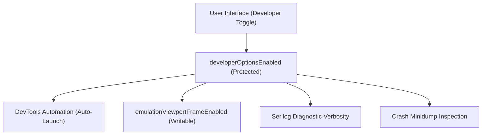

# Developer Options Settings

> [!NOTE]
> Open **Menu → Settings → Developer options** (or press `Alt+F` / `Alt+E` and select **Settings → Developer**) to configure DevTools launch preferences, mobile emulation viewport framing, diagnostic logging levels, and crash dump management.

---

## 1. Overview

Nova AI Workspace includes powerful developer and diagnostic utilities tailored for software engineers, web developers, and QA automation teams. These features allow you to inspect internal WebView2 events, monitor agent-driven DOM mutations, and debug responsive layouts.

Because developer tools grant deep system access and unthrottled inspection capabilities, the developer options suite is guarded by a human-only authorization toggle.

---

## 2. Enabling Developer Options (`developerOptionsEnabled`)

* **Protected Switch:** In Nova's agent settings catalog, `developerOptionsEnabled` is strictly protected:
  * An AI agent can read its state using `nova.app_settings_get(keys=['developerOptionsEnabled'])`.
  * An agent cannot enable or disable developer options programmatically via `nova.app_settings_set`. Any attempt returns `reasonCode: "app_settings.protected"` with the rationale *Unlocks powerful tools; the user decides.*
* **Enabling in the UI:** To unlock developer features, navigate to **Settings → Developer options** and flip the master toggle to **On**.

---

## 3. DevTools Automation & Docking Behavior

When developing web applications or debugging agent workflows, you can automate how developer tools open:

* **Auto-Open DevTools:** Automatically launches the Chromium DevTools inspection window whenever a new browser tab is created.
* **Docking Layout:** Choose whether DevTools launches as an embedded pane beside the webpage or as an independent floating desktop window.
* **Console Synchronization:** Directs JavaScript console messages and network errors into Nova's diagnostic stream for retrospective analysis.

---

## 4. Emulation Viewport Framing (`emulationViewportFrameEnabled`)

When testing mobile, tablet, or custom device layouts using Nova's emulation tools (such as `nova.emulation_use_device` or `nova.emulation_set_device_metrics`):

* **Visual Device Boundary:** When `emulationViewportFrameEnabled` is enabled, Nova renders a crisp, high-contrast device outline around the active viewport area, visually distinguishing the emulated screen dimensions from the rest of the window.
* **Agent Configuration:** This setting is fully writable by AI agents in the curated catalog. An agent can toggle this visual frame using:
  * `nova.app_settings_set(values={'emulationViewportFrameEnabled': True})`

---

## 5. Diagnostic Logging & Minidump Management

For troubleshooting unexpected errors or performance bottlenecks:

* **Logging Verbosity:** Adjust the diagnostic log level of Nova's internal logger (`Debug`, `Information`, `Warning`, or `Error`).
* **Open Logs Directory:** One-click shortcut to open `%LOCALAPPDATA%\nova-cognitive\Nova\Logs` in Windows File Explorer.
* **Crash Dumps & Minidumps:**
  * After a native crash, Windows Error Reporting leaves a minidump in `%LOCALAPPDATA%\nova-cognitive\CrashDumps` (see [Diagnostics](../../troubleshooting/diagnostics.md#1-local-filesystem-locations)).
  * The settings panel provides a dump viewer displaying creation timestamps, process IDs, and fault codes.

---

## 6. Related Documentation

* **[Settings Hub](README.md)** — Main overview of all 14 settings panels.
* **[Tools & Capabilities Settings](tools-and-diagnostics.md)** — Capability bundles and diagnostic probes.
* **[Agent Governance & MCP](agent-governance-and-mcp.md)** — Programmatic settings access and curated keys.
* **[About Nova & Updates](about-and-updates.md)** — Engine runtime probe and versioning.
