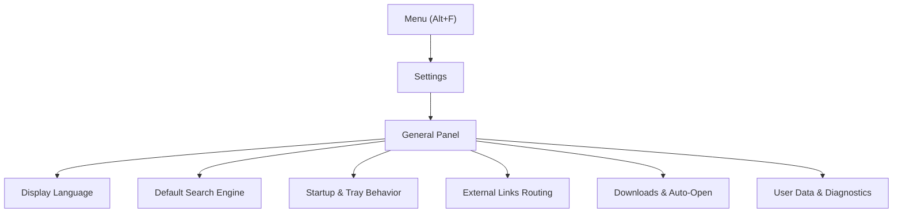

# General Settings

> [!NOTE]
> Open **Menu → Settings → General** to configure Nova's language, default search engine, startup and closing behavior, download management, and user data diagnostics.

---

## 1. Overview

The **General** settings panel provides the foundational controls for your daily browser experience. Unlike sandbox-specific options, general settings apply globally across the workspace and control how Nova interacts with the Windows operating system, handles downloaded files, and restores your working state across reboots.

To open this panel:
1. Click the **Menu** button (or press `Alt+F` / `Alt+E`).
2. Select **Settings**.
3. Choose **General** from the left navigation rail.

---

## 2. Display Language

Nova AI Workspace supports both English and German for its user interface:

* **UI Language:** Choose between English and Deutsch in the language dropdown.
* **Restart Requirement:** Language changes take effect the next time Nova launches.
* **State Preservation:** When you restart the application to apply a new language, Nova automatically restores your open tabs, active sandbox bindings, and split-screen layouts.

---

## 3. Default Search Engine

The default search provider governs how web queries are processed when entered directly into the omnibox address bar or the New Tab page search box:

* **Supported Providers:** Choose from leading privacy-respecting and general search engines, including DuckDuckGo, Google, Bing, and Ecosia.
* **Address Bar Integration:** Typing non-URL queries into the address bar automatically redirects to the chosen provider without needing to visit the search engine homepage first.
* **Scoped Search Shortcuts:** You can also use temporary search prefixes in the address bar (such as `@bookmarks` or `@history`) to query internal browser data instead of the web.

---

## 4. Startup & System Tray Behavior

> [!NOTE]
> **Continue where you left off** comes with 1.0.0-alpha.21 (not published yet).

Nova includes integrated background services—such as [Scheduled Tasks](../tools/scheduled-tasks.md)—that can automate web workflows even while you are not actively browsing. The startup and close settings ensure these tasks continue executing reliably:

* **Continue where you left off** (on by default): Nova reopens the tabs of your last session at startup without asking. After a crash Nova still asks first, so a page that brought Nova down does not come back on every start. Tabs an AI agent opened and left behind do not come back by themselves; they wait under **History → Open last session**. When disabled, Nova starts with a new tab and keeps the last session there.
* **Start with Windows:** When enabled, Nova launches automatically when you log into Windows, starting minimized in the system notification area (system tray). This allows scheduled scraping, monitoring, and agent routines to start immediately after a machine reboot.
* **Window Close Behavior:** Choose what happens when you click the window close button (`X`):
  * **Quit Nova:** Completely terminates the browser process and all background worker threads.
  * **Minimize to Notification Area (Tray):** Closes the visible desktop window while keeping Nova alive in the Windows notification area. Background downloads, scheduled tasks, and agent connections remain active. Double-clicking the tray icon or selecting **Open Nova** restores the window.

---

## 5. External Web Links

When Nova is configured as your default Windows web browser, clicking a web link in an external desktop application (such as Microsoft Outlook, Discord, Slack, or Word) hands the URL over to Nova:

* **Active Sandbox Opening:** Opens the incoming link in a new tab within your currently focused sandbox profile.
* **Dedicated Sandbox Routing:** Allows you to configure incoming external links to always route into a specific sandbox profile (e.g., Sandbox A for general personal browsing) rather than accidentally opening inside an isolated work sandbox.

---

## 6. Downloads Configuration & Auto-Open

Nova provides centralized control over how downloaded files are saved and opened:

* **Download Location:** Displays the absolute path of the current target directory.
  * **Choose Download Folder:** Opens a standard Windows folder picker to choose a custom directory.
  * **Use Default Downloads Folder:** Resets the target location to your standard Windows `Downloads` user directory.
  * **Open Folder:** Instantly opens the active download folder in Windows File Explorer.
* **Ask Where to Save Each File:** When checked, Nova displays a file save dialog before every transfer, allowing you to choose the destination file name and path manually.
* **Download Proxy:** Configure whether file transfers route through your active sandbox proxy tunnel or connect directly to the origin server.

### Automatic File Opening (`Auto-open file types`)
In the download panel, you can choose to automatically open specific non-executable file types once their transfer finishes:

* **Managed List:** View and manage the file extensions currently configured to open immediately after download (e.g., `.pdf`, `.docx`).
* **Security Protection:** Executable file formats (including `.exe`, `.msi`, `.bat`, `.cmd`, `.ps1`, `.lnk`, and `.reg`) are strictly blocked from being added to the auto-open list. When downloading an executable, Nova always prompts you with a safety confirmation before writing the file to disk. See [Downloads Panel & Safety](../browser/downloads.md) for full details.

---

## 7. User Data, Logs & Diagnostics

The General settings panel provides direct access to Nova's local data stores on your Windows machine, simplifying troubleshooting, log collection, and manual backups:

* **Open User Data:** Opens `%LOCALAPPDATA%\NovaBrowser` in File Explorer, where local preferences, vault keystores, and sandbox state are maintained.
* **Open App Logs:** Opens `%LOCALAPPDATA%\NovaBrowser\logs`, where daily Serilog diagnostic files are stored.
* **Open Dumps:** Opens the crash dump directory containing minidumps created during unexpected terminations.
* **Create Backup Archive:** Generates a compressed snapshot of your profile configurations, bookmarks, and settings for safe migration or disaster recovery.

---

[Back to settings](README.md) · [All user guides](../README.md)
