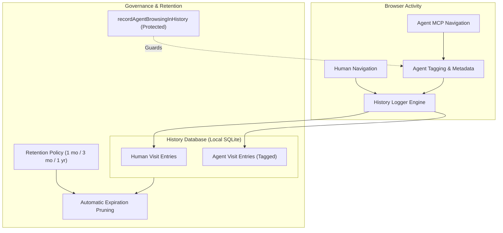

# History & Retention Settings

> [!NOTE]
> Open **Menu → Settings → History** (or press `Alt+F` / `Alt+E` and select **Settings → History**) to configure history retention limits, govern AI agent visit auditing, and perform selective data purges.

---

## 1. Overview

Nova AI Workspace maintains a local, privacy-first database of your browsing history. Unlike conventional browsers where automated background scraping either leaves no trace or clutters your personal history indiscriminately, Nova implements a **Dual-Record History Model**: distinguishing between human-directed browsing and agent-automated browsing.

The **History & retention** settings panel lets you define how long browsing records are preserved, inspect which sandboxes generate history, and guarantee that AI agents cannot obscure their actions.

---

## 2. History Retention Policies

To balance search convenience against local disk usage and privacy, Nova provides configurable data retention periods:

| Retention Period | Behavior | Recommended Use Case |
| :--- | :--- | :--- |
| **30 Days** | Automatically prunes history entries older than one month. | High-volume automated testing, ephemeral research. |
| **90 Days (Default)** | Retains three months of browsing records before automatic expiration. | Balanced daily browsing and task verification. |
| **180 Days** | Retains six months of visited URLs and metadata. | Compliance-focused auditing and long-term project research. |
| **1 Year** | Retains entries for twelve months. | In-depth retrospective review. |
| **Indefinite** | Never automatically prunes history records; manual deletion only. | Archival environments with abundant local storage. |

* **Background Pruning:** Nova executes history pruning routines quietly in the background during idle periods, ensuring that disk space is reclaimed without causing UI stutter.

---

## 3. Agent Audit Trail Safeguard (`recordAgentBrowsingInHistory`)

A critical challenge in agentic browsing is accountability: when an AI agent navigates dozens of pages to perform a task, the human operator must be able to review exactly where the agent went, which forms were submitted, and which external links were followed.

### How Agent Visits are Recorded
* **Visual Differentiation:** In the History viewer (`Ctrl+H`), entries opened or inspected by an AI agent are clearly marked with an **Agent** badge and the name of the requesting agent client.
* **Separation from Omnibox Suggestions:** You can configure whether agent visits appear in your address-bar auto-completion recommendations or remain restricted to the History audit viewer.

### The Protected Setting Invariant
* **Key Name:** `recordAgentBrowsingInHistory`
* **Agent Read-Only:** Connected agents can check if history recording is enabled via `nova.app_settings_get(keys=['recordAgentBrowsingInHistory'])`.
* **Modification Blocked:** If an AI agent attempts to turn off history recording via `nova.app_settings_set`, Nova immediately rejects the call:
  * Status: `refused`
  * Reason Code: `app_settings.protected`
  * Rationale: *The agent's trail in history is how the user sees what agents did.*
* **Security Rationale:** Allowing an autonomous agent to turn off history recording would enable malicious or hijacked agents to browse covertly and erase their operational footprint. This switch belongs exclusively to the human user.

---

## 4. History Search, Filtering & Export

Under **History & downloads**, you can search and manage past activity:

* **Sandbox Filtering:** Filter history records by specific profile (e.g. view only pages visited within Sandbox A or Sandbox B).
* **Date Range Scoping:** Isolate browsing records generated during specific agent execution sessions.
* **Selective Purge:** Delete all records for a specific domain, clear entries within a custom date window, or wipe all history while keeping bookmarks and saved passwords intact.

---

## 5. Related Documentation

* **[Settings Hub](README.md)** — Main overview of all 14 settings panels.
* **[Privacy & Security Settings](privacy-and-security.md)** — Tracking protection and data clearance.
* **[Agent Governance & MCP](agent-governance-and-mcp.md)** — Programmatic settings access and protected switches.
* **[General Settings](general.md)** — Startup restoration and download folder configuration.
