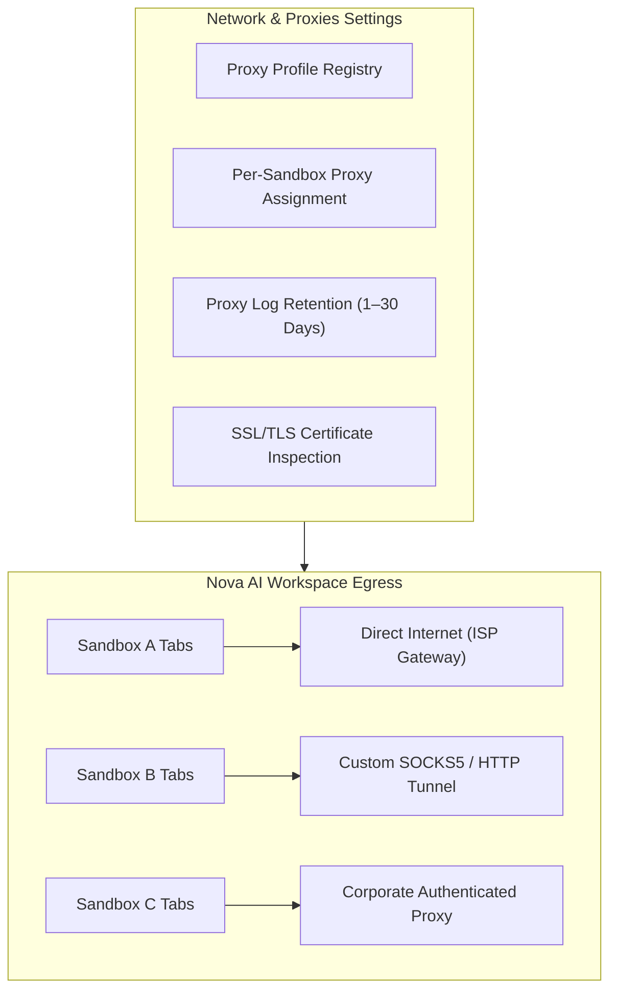

# Network & Proxies Settings

> [!NOTE]
> Open **Menu → Settings → Network & proxies** (or press `Alt+F` / `Alt+E` and select **Settings → Network**) to configure custom proxy tunnels, assign proxies to specific sandboxes, adjust traffic log retention, and inspect SSL/TLS diagnostic certificates.

---

## 1. Overview

Nova AI Workspace includes enterprise-grade network routing capabilities. Unlike standard browsers that force all tabs through the system-wide Windows proxy or require cumbersome external tunneling software, Nova provides per-sandbox proxy routing, dynamic proxy switching over MCP, and deep SSL/TLS diagnostics.

The **Network & proxies** settings panel lets you manage proxy endpoints, audit outgoing traffic logs, and configure network interception rules for automated testing.

---

## 2. Proxy Profiles & Protocol Support

Nova supports multiple proxy protocols with optional authentication:

| Protocol | Port Example | Features & Use Cases |
| :--- | :--- | :--- |
| **Direct Egress** | N/A | Bypasses all proxies; connects directly via your primary internet connection. |
| **HTTP / HTTPS** | `8080`, `8443` | Standard web proxy routing with Basic/Digest authentication support. |
| **SOCKS5** | `1080` | High-performance socket-level proxy supporting TCP streams and UDP tunnels. |
| **SOCKS5 with Auth** | `1080` | Secure SOCKS5 connection with encrypted username and password handshake. |

* **Adding a Proxy Profile:** Under **Proxy Profiles**, click **Add Proxy**, enter the server host, port, protocol, and optional credentials, then click **Save**.
* **Connection Test:** Each configured proxy card includes a **Test Connection** button that measures latency and validates gateway reachability before you assign it to active tabs.

---

## 3. Per-Sandbox Proxy Assignment & Dynamic Switching

Network routing in Nova is decoupled from your underlying Windows operating system settings:

* **Granular Partition Assignment:** You can bind a specific proxy profile to an individual sandbox (e.g. routing Sandbox B through a US proxy while Sandbox A connects directly from your local connection).
* **Dynamic MCP Switching:** Connected AI agents can switch proxy profiles on the fly using `nova.proxy_switch(profileId='...')` and verify active routing with `nova.proxy_status()`.

---

## 4. Traffic Log Retention & Diagnostics

When proxy routing is enabled, Nova maintains an internal diagnostic log of connection requests, DNS resolutions, and egress latency:

* **Proxy Log Retention Days:** Configure how long network connection logs are preserved locally before automatic purging (options include 1, 3, 7, 14, or 30 days).
* **Troubleshooting Connection Drops:** If a proxy server drops connections or returns 502/504 gateway timeouts, you can inspect the timestamped error log directly in the panel to diagnose whether the issue stems from host unreachable errors, DNS resolution failures, or authentication rejections.

---

## 5. SSL/TLS Certificate Inspection

The panel includes built-in diagnostic tools for inspecting SSL/TLS certificates and encrypted handshakes:

* **Certificate Hierarchy Viewer:** View the complete X.509 certificate chain, issuer authority, expiration dates, and cryptographic cipher suites for any visited origin.
* **Probing via MCP:** AI agents can perform deep SSL/TLS diagnostics using `nova.tls_inspect(url='https://example.com')` to diagnose expired certificates, cipher mismatches, or certificate authority revocation issues.

---

## 6. Related Documentation

* **[Settings Hub](README.md)** — Main overview of all 14 settings panels.
* **[Sandboxes & Profiles Settings](sandboxes.md)** — Profile isolation and sandbox network bindings.
* **[Agent Governance & MCP](agent-governance-and-mcp.md)** — Programmatic settings access and curated keys.
* **[Connectors Settings](connectors.md)** — External SFTP, SSH, and mail pipelines.
