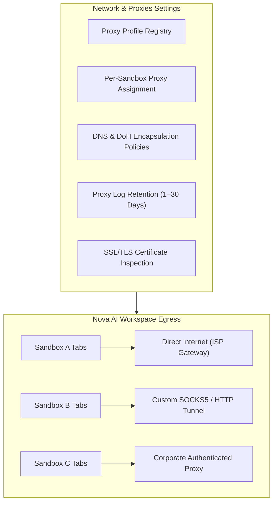

# Network & Proxies Settings

> [!NOTE]
> Open **Menu → Settings → Network & proxies** (or press `Alt+F` / `Alt+E` and select **Settings → Network**) to configure custom proxy tunnels, assign proxies to specific sandboxes, adjust traffic log retention, inspect SSL/TLS diagnostic certificates, and manage DNS resolution policies.

---

## 1. Overview

Nova AI Workspace includes enterprise-grade network routing capabilities. Unlike standard browsers that force all tabs through the system-wide Windows proxy or require cumbersome external tunneling software, Nova provides per-sandbox proxy routing, dynamic proxy switching over MCP, native DNS diagnostics, and deep SSL/TLS inspections.

The **Network & proxies** settings panel lets you manage proxy endpoints, configure DNS and DoH routing, audit outgoing traffic logs, and manage network diagnostic permissions.

---

## 2. Proxy Profiles & Protocol Support

Nova supports multiple proxy protocols with optional authentication:

| Protocol | Port Example | Features & Use Cases |
| :--- | :--- | :--- |
| **Direct Egress** | N/A | Bypasses all proxies; connects directly via your primary internet connection. |
| **HTTP / HTTPS** | `8080`, `8443` | Standard web proxy routing with Basic/Digest authentication support. |
| **SOCKS5** | `1080` | High-performance socket-level proxy supporting TCP streams and UDP tunnels. |
| **SOCKS5 with Auth** | `1080` | Secure SOCKS5 connection with encrypted username and password handshake. |

* **Adding a Proxy Profile:** Under **Proxy Profiles**, click **Add Proxy**, enter the server host, port, protocol, and optional credentials, then click **Save**.
* **Connection Test:** Each configured proxy card includes a **Test Connection** button that measures latency and validates gateway reachability before you assign it to active tabs.

---

## 3. Per-Sandbox Proxy Assignment & Dynamic Switching

Network routing in Nova is decoupled from your underlying Windows operating system settings:

* **Granular Partition Assignment:** You can bind a specific proxy profile to an individual sandbox (e.g. routing Sandbox B through a US proxy while Sandbox A connects directly from your local connection).
* **Dynamic MCP Switching:** Connected AI agents can switch proxy profiles on the fly using [`nova.proxy_switch`](../../mcp-reference/tools/proxy-and-network/nova-proxy-switch.md) and verify active routing with [`nova.proxy_status`](../../mcp-reference/tools/proxy-and-network/nova-proxy-status.md).

---

## 4. DNS Resolution, Nameservers & DoH Routing

Nova provides advanced control over how hostnames are resolved across browser tabs and diagnostic tools:

* **Dual Resolution Pathways:**
  * **Interactive Tabs:** Web tabs resolve addresses using the Windows networking stack or via the active proxy tunnel assigned to their sandbox.
  * **Diagnostic Tools ([`nova.net_dns`](../../mcp-reference/tools/proxy-and-network/nova-net-dns.md)):** Operators and AI agents can query nameservers directly using raw wire-format UDP/TCP or encrypted DNS-over-HTTPS (DoH).
* **DNS-over-HTTPS (DoH) via Proxies:**
  * When DoH is used (`transport: "doh"` or custom DoH endpoint URLs), all DNS queries traverse the active sandbox proxy tunnel. This prevents DNS query leakage over local network interfaces when operating through encrypted tunnels.
  * Supported public providers include Cloudflare (`1.1.1.1`), Google (`8.8.8.8`), and Quad9 (`9.9.9.9`), as well as any RFC 8484 custom endpoint.
* **Intranet Leak Safeguards:**
  * Queries targeting single-label hostnames, local intranet domains (`.local`, `.internal`, `.lan`, `.home.arpa`), and RFC 1918 private subnets are never routed to public resolvers, safeguarding internal network topology.
* **Nameserver Auditing & Delegation:**
  * AI agents can test prospective nameservers (`candidateNameservers`) before registrar cutover, diagnose lame delegations, check DNSSEC signature expirations, and evaluate mail records (SPF, DMARC, DKIM) directly.

---

## 5. Traffic Log Retention & Diagnostics

When proxy routing is enabled, Nova maintains an internal diagnostic log of connection requests, DNS resolutions, and egress latency:

* **Proxy Log Retention Days:** Configure how long network connection logs are preserved locally before automatic purging (options include 1, 3, 7, 14, or 30 days).
* **Troubleshooting Connection Drops:** If a proxy server drops connections or returns 502/504 gateway timeouts, you can inspect the timestamped error log directly in the panel to diagnose whether the issue stems from host unreachable errors, DNS resolution failures, or authentication rejections.

---

## 6. SSL/TLS Certificate Inspection

The panel includes built-in diagnostic tools for inspecting SSL/TLS certificates and encrypted handshakes:

* **Certificate Hierarchy Viewer:** View the complete X.509 certificate chain, issuer authority, expiration dates, and cryptographic cipher suites for any visited origin.
* **Probing via MCP:** AI agents can perform deep SSL/TLS diagnostics using [`nova.tls_inspect`](../../mcp-reference/tools/proxy-and-network/nova-tls-inspect.md) to diagnose expired certificates, cipher mismatches, or certificate authority revocation issues.

---

## 7. Network Scanning & Diagnostic Permissions

Nova includes enterprise-grade network scanning and infrastructure diagnostic capabilities governed by strict operator controls:

* **Local vs. Public Range Governance:**
  * **Private Subnets:** Scanning local subnets (RFC 1918, CGNAT, link-local) is governed by the general agent scan permission (**Settings > AI & agents > Access permissions > Agent may scan the network without asking**).
  * **Public IP Ranges:** Scanning external public IP ranges strictly requires interactive operator approval per target range in the UI. Approvals remain valid for the current Nova session. Unattended scheduled runs targeting public IPs without prior confirmation fail with `scan_approval_required`.
* **Diagnostic Tool Integrations:**
  * **Network Discovery ([`nova.net_scan`](../../mcp-reference/tools/proxy-and-network/nova-net-scan.md)):** Multi-probe detection identifying network devices, open services, and security risks.
  * **Path Diagnostics & Jitter ([`nova.net_ping`](../../mcp-reference/tools/proxy-and-network/nova-net-ping.md)):** Hop-by-hop traceroute, packet loss tracking, Path MTU discovery, and TCP handshake latency.
  * **DNS & Nameserver Audits ([`nova.net_dns`](../../mcp-reference/tools/proxy-and-network/nova-net-dns.md)):** Resolving domain records, comparing propagation across providers, and auditing SPF, DMARC, DKIM, and MTA-STS compliance.
  * **Port Reachability ([`nova.net_probe`](../../mcp-reference/tools/proxy-and-network/nova-net-probe.md)):** High-speed concurrent TCP port checks with session-scoped host approval.

---

## 8. Related Documentation

* **[Network Diagnostics & Tools Guide](../tools/network-and-diagnostics.md)** — User guide for running network scans, DNS queries, ping, and path probes.
* **[Settings Hub](README.md)** — Main overview of all 14 settings panels.
* **[Network Architecture Hub](../../core-features/network/README.md)** — Architectural overview of all 5 network disciplines.
* **[Network Discovery & Inventory Architecture](../../core-features/network/network-discovery-and-inventory/README.md)** — Detailed multi-probe scanning and device inventory.
* **[DNS Diagnostics & Mail Security](../../core-features/network/dns-diagnostics/README.md)** — Wire-format DNS queries, DoH proxy integration, and email security.
* **[Path Diagnostics, MTR & Probing](../../core-features/network/path-diagnostics-and-probing/README.md)** — Hop latency, jitter calculation, and MTU discovery.
* **[Sandboxes & Profiles Settings](sandboxes.md)** — Profile isolation and sandbox network bindings.

---

[Back to Settings Hub](README.md) · [All user guides](../README.md)
