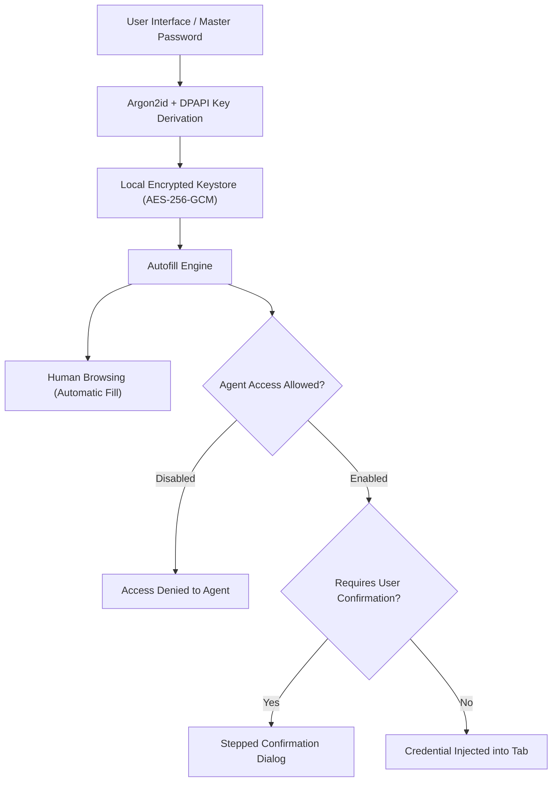

# Passwords & Vault Settings

> [!NOTE]
> Open **Menu → Settings → Passwords & autofill** (or press `Alt+F` / `Alt+E` and select **Settings → Passwords**) to manage your encrypted local credential vault, configure master password protection, toggle browser autofill, and govern AI agent credential access.

---

## 1. Overview

Nova AI Workspace includes a built-in, zero-cloud credential vault. Unlike cloud-synced password managers that transmit secret material over external networks, Nova stores all logins and credentials strictly on your local Windows machine inside an encrypted database.

In autonomous workflows, AI agents often need to authenticate with corporate dashboards, developer consoles, and test environments. The **Passwords & autofill** panel lets you define strict boundaries: deciding whether agents may utilize stored passwords, requiring stepped human confirmations before autofill occurs, and segregating credentials by sandbox profile.

---

## 2. Vault Encryption Architecture

Nova secures stored credentials using industry-standard cryptography:

* **AES-256-GCM Encryption:** Every username, password, token, and note stored in the vault is encrypted with authenticated AES-256 in Galois/Counter Mode, guaranteeing confidentiality and tamper-detection.
* **Key Derivation (Argon2id):** When a master password is configured, cryptographic encryption keys are derived using Argon2id with high memory-cost parameters to defend against brute-force attacks.
* **Windows DPAPI Envelope:** When running without a master password or caching unlock tokens for the session, keys are protected using Windows Data Protection API (DPAPI), binding decryptability to your active Windows user account.
* **Zero Cloud Footprint:** No credentials or encryption keys are ever sent to external cloud servers or analytics pipelines.

---

## 3. Master Password & Session Unlocking

Under **Settings → Passwords & autofill → Vault Security**, you can configure how the vault is unlocked:

* **Enable Master Password:** Adds a dedicated passphrase requirement that must be entered when Nova launches before any stored credentials can be decrypted or autofilled.
* **Session Lock Timeout:** Automatically locks the credential vault after a configured period of inactivity (e.g. 15, 30, or 60 minutes).
* **Resetting the Vault:** If you forget your master password, you can reset the vault from the settings panel. For security reasons, resetting permanently clears all stored credentials; cryptographic security prevents recovery without the master passphrase.

---

## 4. Autofill Behavior & Per-Sandbox Segregation

Nova integrates credential autofill seamlessly into both human and agent browsing:

* **Automatic Form Detection:** When navigating to a login page, Nova identifies standard username and password fields and presents a dropdown of matching credentials for the current domain.
* **Per-Sandbox Autofill Overrides:**
  * In enterprise workflows, you may wish to prevent corporate credentials from accidentally appearing in personal or test sandboxes.
  * You can configure vault autofill on a per-sandbox basis: enabling autofill in **Sandbox A (Corporate)** while keeping it disabled or restricted in **Sandbox B (Client Research)**.

---

## 5. AI Agent Credential Access Governance

Allowing AI agents to log into websites requires rigorous authorization controls:

| Control | Description | Default Policy |
| :--- | :--- | :--- |
| **Agent May Use Saved Passwords** | Master switch governing whether MCP tools can request credentials from the vault to perform automated logins. | `Disabled` |
| **Stepped Confirmation** | Displays an explicit approval banner to the user before the agent can inject stored credentials into a web form. | `Always Ask` |
| **Domain-Specific Access** | Allows restricting agent credential usage to designated test or staging domains while blocking production accounts. | Configurable per credential |

### Protected Setting Invariant
* **`vaultEnabled` is Protected:** The top-level master switch that enables or disables the vault infrastructure is classified as a protected setting in the agent catalog.
* **Agent Read-Only:** Connected AI agents can inspect whether the vault is active via `nova.app_settings_get(keys=['vaultEnabled'])`, but agents cannot turn the vault off or on via `nova.app_settings_set`. Any programmatic attempt to modify `vaultEnabled` is rejected with `reasonCode: "app_settings.protected"`.

---

## 6. Secure Import & Export

The settings panel provides native import and export utilities for migrating your credentials:

* **Import Formats:** Import passwords from standard CSV exports created by Google Chrome, Mozilla Firefox, Microsoft Edge, Bitwarden, or 1Password.
* **Encrypted Export:** Export your stored credentials as a password-protected, encrypted backup file or as a plain CSV file for manual migration.
* **Audit on Import:** Nova flags duplicate usernames or unencrypted HTTP origins during the import process to help maintain credential hygiene.

---

## 7. Related Documentation

* **[Settings Hub](README.md)** — Main overview of all 14 settings panels.
* **[Privacy & Security Settings](privacy-and-security.md)** — Tracking protection and data clearance.
* **[Agent Governance & MCP](agent-governance-and-mcp.md)** — Programmatic settings access and protected switches.
* **[Sandboxes & Profiles Settings](sandboxes.md)** — Profile isolation and sandbox credentials.
