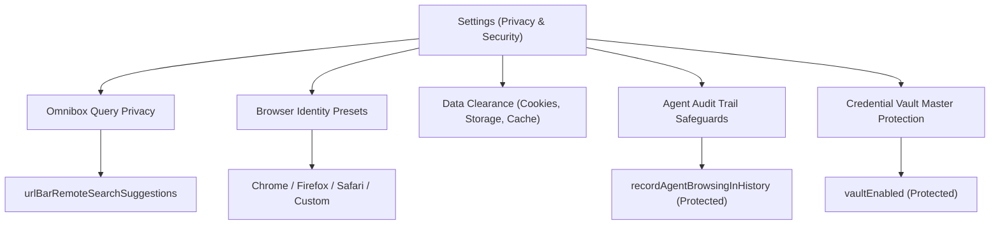

# Privacy & Security Settings

> [!NOTE]
> Open **Menu → Settings → Privacy & Security** (or press `Alt+F` / `Alt+E` and select **Settings → Privacy & Security**) to configure web tracking protection, omnibox search query leakage, browser identity masking, and data clearance routines.

---

## 1. Overview

The **Privacy & Security** panel governs how Nova protects your browsing identity against web trackers, prevents unintended query leakage to third-party search engines, and manages persistent local storage footprints.

Because Nova is designed for autonomous AI agents operating alongside human users, privacy controls in Nova operate under a dual-layer security model: they protect you against external web tracking while simultaneously holding AI agents accountable by preserving audit trails and preventing agents from disabling their own surveillance safeguards.

---

## 2. Omnibox Search Query Privacy

When typing in the omnibox address bar, Nova can query your configured search engine to display predictive auto-complete suggestions:

* **Remote Search Suggestions (`urlBarRemoteSearchSuggestions`):**
  * When enabled, every keystroke typed into the address bar is transmitted to your active default search provider (e.g. Google, DuckDuckGo, Bing) to generate real-time keyword suggestions.
  * When disabled, Nova restricts address-bar auto-completion strictly to local sources (your existing bookmarks, history records, and open tabs). No keystroke data leaves your machine.
* **Agent Configuration:** This setting is part of the curated agent catalog. AI agents can check its state using `nova.app_settings_get` and adjust it using `nova.app_settings_set(values={'urlBarRemoteSearchSuggestions': False})`.

---

## 3. Browsing Data Clearance & Storage Hygiene

Nova provides granular controls for purging cached files, tracking cookies, and web storage objects without corrupting underlying workspace configurations:

| Data Category | What is Removed | Workspace Impact |
| :--- | :--- | :--- |
| **Browsing History** | Chronological record of visited page URLs, page titles, and timestamps. | Resets omnibox visit recommendations; does not affect saved bookmarks. |
| **Download History** | The list of past file transfers in the Downloads manager. | Clears the UI history list only; downloaded files on disk are **not** deleted. |
| **Cookies & Site Data** | HTTP cookies, `localStorage`, `sessionStorage`, and IndexedDB partitions. | Signs you out of active websites in the target profile partition. |
| **Cached Web Content** | Pre-rendered stylesheets, scripts, cached images, and media blobs. | Frees disk space; pages may take slightly longer to render on first visit. |
| **Favicon Cache** | Cached website icons stored in the local profile database. | Tab and bookmark icons re-download fresh on next page navigation. |

### Targeted Scope Clearance
Unlike monolithic browsers that force an all-or-nothing wipe, Nova allows you to clear data on three distinct scopes:
1. **Global Wipe:** Clears shared normal tab data across the workspace.
2. **Sandbox-Isolated Wipe:** Clears data strictly within a specific sandbox partition (e.g. Sandbox B) while preserving logged-in sessions in Sandbox A.
3. **Domain-Specific Purge:** Agents and users can target a specific origin using dedicated tools (such as `nova.cache_clear` and `nova.cookie_clear`).

---

## 4. Browser Identity & Fingerprint Masking

Websites frequently identify visitors through browser fingerprinting—analyzing user-agent strings, platform architectures, screen dimensions, and hardware rendering capabilities.

Under **Settings → Privacy & Security → Browser Identity**, Nova allows you to configure your browser profile's surface identity:

* **Preset Profiles:**
  * **Default (WebView2):** Presents the native platform user-agent matching your installed runtime.
  * **Google Chrome:** Emulates standard desktop Google Chrome on Windows.
  * **Mozilla Firefox:** Emulates modern Firefox desktop headers and navigator properties.
  * **Apple Safari:** Emulates macOS Safari desktop navigation characteristics.
  * **Custom:** Allows defining an explicit User-Agent string and platform token.
* **Per-Sandbox Overrides:** You can assign distinct browser identity presets to different sandboxes—for example, presenting Sandbox A as Chrome and Sandbox B as Firefox—preventing websites from correlating your accounts.

---

## 5. Protected Security Controls (Agent Read-Only Invariants)

To ensure enterprise-grade safety, specific privacy switches cannot be toggled by automated AI agents:

### Agent Browsing Trail (`recordAgentBrowsingInHistory`)
* **Purpose:** Determines whether web pages opened and inspected by an AI agent are recorded into your local browsing history and tagged with an agent visit marker.
* **Security Rationale:** This switch is strictly **protected**. An AI agent can read this property via `nova.app_settings_get(keys=['recordAgentBrowsingInHistory'])`, but any attempt to alter it via `nova.app_settings_set` is immediately rejected with `reasonCode: "app_settings.protected"`.
* **User Protection:** An agent must never be able to erase or suppress its own operational audit trail. The user alone toggles this switch in the Settings UI.

### Credential Vault Protection (`vaultEnabled`)
* **Purpose:** Enables or disables access to the encrypted password vault.
* **Security Rationale:** Strictly read-only for agents. Disabling or re-enabling vault infrastructure is a human administrative decision.

---

## 6. Related Documentation

* **[Settings Hub](README.md)** — Main overview of all 14 settings panels.
* **[Passwords & Vault Settings](passwords-and-vault.md)** — Master password, credential encryption, and autofill.
* **[Agent Governance & MCP](agent-governance-and-mcp.md)** — Programmatic settings access and protected switches.
* **[History & Retention Settings](history-and-retention.md)** — Managing history lifespan and agent audit logs.
