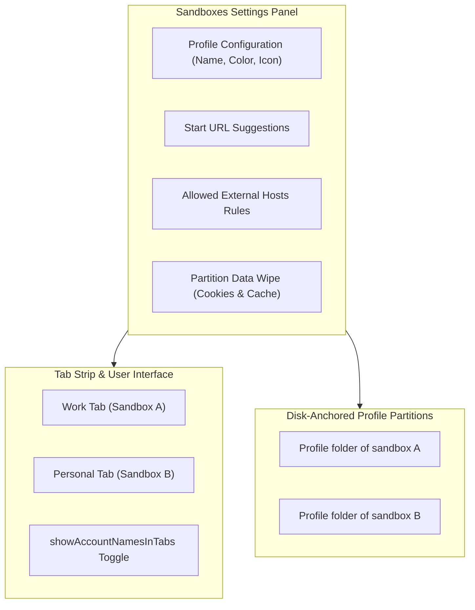

# Sandboxes & Profiles Settings

> [!NOTE]
> Open **Menu → Settings → Sandboxes** (or press `Alt+F` / `Alt+E` and select **Settings → Sandboxes**) to configure multi-profile partitions, assign color badges, customize sandbox start pages, and enforce domain boundary rules.

---

## 1. Overview

Nova's **Sandboxes** architecture eliminates the need for separate browser windows, third-party profile switchers, or brittle container extensions. Each sandbox is a fully partitioned browser environment with its own isolated cookie jars, HTML5 storage, network proxies, and cache systems.

The **Sandboxes** settings panel provides complete management of these persistent profiles, allowing you to fine-tune visual indicators in the tab strip, establish navigation boundaries, and manage profile storage safely.

---

## 2. Managing Sandbox Profiles

Nova supports multiple persistent sandboxes alongside standard shared browsing:

* **Creating a Sandbox:** Click **Add Sandbox** to create a new isolated partition. You can assign a descriptive name (e.g. *Client Testing*, *Social Media*, *Development*) and a unique color accent.
* **Color Badging:** Each sandbox is assigned a distinct visual color badge that outlines tabs belonging to that partition and tints the sandbox pill in the omnibox bar.
* **Deleting a Sandbox:** Deleting a sandbox removes its profile registration and marks its physical storage partition for safe cleanup. Active tabs belonging to that sandbox are closed immediately.

---

## 3. Tab Strip Display Preferences (`showAccountNamesInTabs`)

In multi-tasking workflows, it is vital to know which sandbox profile owns each open tab:

* **Show Account Names in Tabs:**
  * When enabled, the tab header explicitly displays the sandbox badge name (e.g. `[Work] Google Docs` or `[Personal] GitHub`).
  * When disabled, the tab displays only the webpage title and favicon, preserving horizontal tab strip space while maintaining the subtle color accent outline.
* **Agent Configuration:** This setting is part of the curated agent catalog. AI agents can query this preference via `nova.app_settings_get` and adjust it using `nova.app_settings_set(values={'showAccountNamesInTabs': True})`.

---

## 4. Start URLs & Navigation Suggestions

You can customize the initial behavior of newly opened tabs for each sandbox profile independently:

* **Start URL:** Define a default homepage or dashboard URL that automatically opens whenever a new tab is created in this sandbox (e.g. opening an internal ticketing system in your Work sandbox).
* **Suggested Sites:** Configure curated speed-dial shortcuts that appear on the New Tab page within this specific sandbox profile.

---

## 5. Domain Boundary Rules & Allowed External Hosts

To prevent unintentional cross-contamination between projects, Nova allows you to define navigation boundaries:

* **Allowed External Hosts:** Specify a list of domains that this sandbox is permitted to access.
* **Out-of-Bounds Navigation:** If a human user or an AI agent attempts to navigate outside the permitted host list, Nova can either:
  * Display a warning banner requesting confirmation.
  * Automatically redirect the link into your default general sandbox.
  * Block the request outright to prevent sensitive corporate workflows from leaving authorized servers.

---

## 6. Per-Sandbox Storage Clearance

When testing web applications or resetting login states, you can clear data without affecting other projects:

* **Targeted Partition Wipe:** From the Sandboxes settings card, select **Clear Sandbox Data** to wipe cookies, cache, local storage, and IndexedDB exclusively for that profile.
* **Preserved Partitions:** All other sandboxes remain completely unaffected. You remain logged into your email, repositories, and dashboards in other tabs.

---

## 7. Storage Safety: The Disk-Anchor Guard

Nova includes automated safeguards to protect against profile loss:

* **Physical Disk Anchors:** Each sandbox is anchored to its own folder inside Nova's profile folder (see [Diagnostics](../../troubleshooting/diagnostics.md#1-local-filesystem-locations)).
* **Anchor Detection Guard:** If a configuration file corruption or buggy script attempts to write a settings payload with an empty or missing sandbox list while physical profile directories exist on disk, Nova's storage guard automatically halts the save operation, preserves the existing disk anchors, and falls back to a recovery snapshot.
* **Orphaned Profile Recovery:** If a sandbox is detached from the active configuration, Nova detects the orphaned disk folder and presents a one-click **Restore Sandbox** option in the settings panel.

---

## 8. Related Documentation

* **[Settings Hub](README.md)** — Main overview of all 14 settings panels.
* **[Agent Governance & MCP](agent-governance-and-mcp.md)** — Programmatic settings access and curated keys.
* **[Network & Proxies Settings](network-and-proxies.md)** — Per-sandbox proxy routing and SOCKS5 tunnels.
