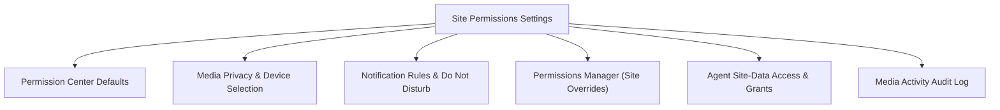
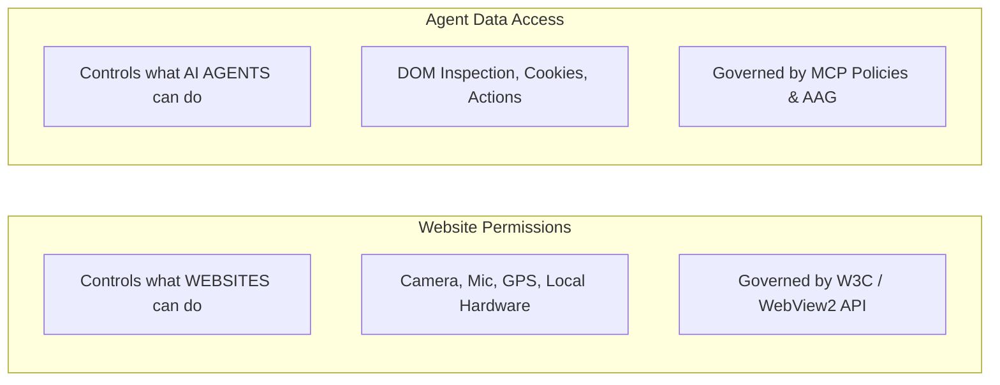

# Site Permissions Settings

> [!NOTE]
> Open **Menu → Settings → Site permissions** to configure global defaults for hardware access, manage remembered website decisions, configure notification policies, and inspect active agent data grants.

---

## 1. Overview

Websites frequently request access to your device's hardware and sensitive capabilities—such as your webcam, microphone, location, or clipboard. In Nova AI Workspace, the **Site permissions** panel gives you full authority over what websites can do, while also clearly separating website hardware access from AI agent automation permissions.

To inspect permissions for the page you are currently viewing, click the **Site info** (lock/tune) button located immediately to the left of the address bar.

---

## 2. Global Permission Center Defaults

When a new website requests a capability for the first time, Nova applies the fallback policy configured in the **Permission Center Defaults** card. You can configure each permission independently:

| Permission | Scope & Purpose | Available Choices |
|---|---|---|
| **Camera** | Video input access for web meetings, video recording, and barcode scanning. | `Ask`, `Allow`, `Block` |
| **Microphone** | Audio input capture for voice calls, speech recognition, and audio notes. | `Ask`, `Allow`, `Block` |
| **Speaker Selection** | Routes audio playback to a specific output device (separate from capture). | `Ask`, `Allow`, `Block` |
| **Screen Capture** | Sharing your desktop screen, a specific application window, or a tab. | `Ask`, `Block` |
| **Geolocation** | Physical location detection for maps, local weather, and navigation. | `Ask`, `Allow`, `Block` |
| **Clipboard Read** | Reading text, images, or code from your Windows system clipboard. | `Ask`, `Allow`, `Block` |
| **Advanced Hardware** | Direct access to WebUSB, WebHID, WebSerial, or MIDI controller devices. | `Ask`, `Allow`, `Block` |

* **`Ask` (Recommended Default):** Displays an in-tab approval banner whenever a website requests access, letting you choose **Allow once**, **Always allow**, or **Block**.
* **`Allow`:** Automatically grants access to requesting websites without prompting. Use with caution.
* **`Block`:** Silently refuses access without showing prompts or interrupting your browsing.

---

## 3. Media Privacy & Hardware Selection

To guard against unexpected device activation and manage multiple physical peripherals:

* **Block Non-User-Initiated Media Requests:** When enabled, Nova automatically suppresses microphone and camera requests that were not triggered by an explicit user click or keypress (e.g., preventing intrusive popups from requesting camera access immediately upon page load).
* **Hardware Device Selection:**
  * **Preferred Camera:** Select your default webcam from connected hardware devices.
  * **Preferred Microphone:** Choose your preferred audio input device.
  * **Preferred Speaker:** Choose your default audio output destination.
  * **Refresh & Test Media Devices:** Click to refresh the hardware list after plugging in a new USB headset or webcam, or run an audio loopback check to verify functionality.

---

## 4. Notification Permissions & Do Not Disturb

Website notifications are managed through their own dedicated security section:

* **Default Notification Policy:** Configure the baseline rule for newly visited domains (`Ask`, `Allow`, or `Block`).
* **Do Not Disturb (DND):** Suppresses all desktop notification popups and sound alerts. You can enable DND manually or establish a recurring quiet hours schedule.
* **Windows Notification Setup:** Displays the integration status of Nova's native Windows App SDK shell registration.
* **Notification Sites Manager:** Displays a comprehensive list of all websites with remembered notification permissions. You can modify individual origins or click **Clear all permissions** to reset all sites to the default policy. For everyday usage, see [Desktop Notifications](../browser/notifications.md).

---

## 5. Remembered Decisions & Site Overrides

Whenever you select **Always allow** or **Block** on an in-tab permission prompt, Nova records the decision in your profile settings:

* **Permissions Manager Card:** Lists all origins with custom rules, organized by capability (e.g., Camera, Location, Notifications).
* **Resetting an Origin:** Click the remove icon next to any remembered website to clear its custom decision. On the next visit, the site will revert to the global default policy.
* **Site Info Quick Access:** While on any web page, open the **Site info** button beside the URL bar to toggle remembered permissions for that specific domain without navigating to Settings.

---

## 6. Website Permissions vs. Agent Data Access

A common misconception is confusing website device permissions with AI agent capabilities. Nova maintains a strict conceptual and architectural boundary between the two:

* **Website Permissions:** Dictate whether a remote web server can access your local hardware (e.g., Google Meet accessing your webcam).
* **Agent Site-Data Access:** Governs whether an AI coding agent connected via MCP is allowed to inspect the rendered page text, read cookie tokens, or take automated actions on that origin.
* **Active Site-Data Grants:** The **Active site-data grants** card displays temporary, session-scoped access tokens granted to agents. You can revoke any active grant immediately with a single click.
* **Media Permission Activity Log:** An immutable chronological log recording every instance of camera, microphone, or speaker access by any tab, ensuring complete transparency over your hardware.

See [Website & Agent Permissions](../identity-and-security/permissions.md) for further details on agent autonomy and confirmation policies.

---

[Back to settings](README.md) · [Website and agent permissions](../identity-and-security/permissions.md) · [Desktop notifications](../browser/notifications.md) · [All user guides](../README.md)
